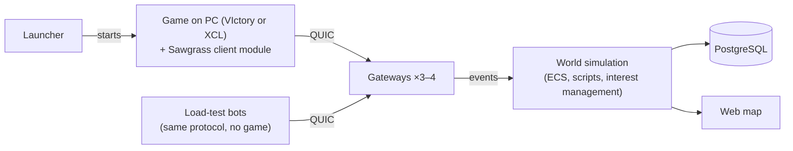

  

<h3 align="center">An open-source multiplayer roleplay server, built for 4096 players in one world</h3>

  
  
  
  
  

  <a href="#where-the-project-is">Status</a> ·
  <a href="#progress">Progress</a> ·
  <a href="#how-it-fits-together">Architecture</a> ·
  <a href="#how-it-is-built">How it is built</a> ·
  <a href="#contributing">Contributing</a>

---

Sawgrass is a multiplayer roleplay platform for Grand Theft Auto VI, written in Rust: a dedicated server that holds
**4096 players in one world**, with roleplay game modes written as sandboxed scripts.

## Where the project is

> [!IMPORTANT]
> **There is no playable build, and there cannot be one yet.** The game does not run on PC. Players will run it
> through [VIctory](https://github.com/Marvisak/VIctory) or [XCL](https://github.com/ivall/xcl), which run the Xbox
> Series build natively on Windows. VIctory, the furthest along, loads the world but does not render it yet.

So the work is split in two:

| | Side | State |
|---|---|---|
| 🟢 | **Server, protocol, storage, scripting** | Being built now. Everything is tested and load-tested with headless bots that speak the real protocol, no game needed. |
| ⏸️ | **Client module and launcher** | Waiting. Work starts when the game runs on PC through VIctory or XCL with a controllable character. |

## Progress

<!-- progress:start (generated by scripts/progress.py; do not edit by hand) -->

**Current stage: 1, server without the game.** 50% of the planned tasks are done, weighted by size (S = 1, M = 3, L = 8). New tasks are added as stages open, so the percentage measures the work planned so far, not the distance to a release.

| Stage | Progress | State |
|---|---|---|
| **Stage 0: Repository foundation** Rules, CI, claim bot, review agent | `████████████████████` 100% | done |
| **Stage 1: Server without the game** Gates: 1000 bots on one machine, then 4096 | `████████░░░░░░░░░░░░` 41% | 3 of 7 tasks done |
| **Stage 2: Roleplay base** PostgreSQL, scripting, characters, money, jobs | `██████████░░░░░░░░░░` 50% | 2 of 4 tasks done |
| **Stage 3: Client in the game** Waits until the game runs on PC through VIctory or XCL | `░░░░░░░░░░░░░░░░░░░░` 0% | waiting for the game |
| **Stage 4: Launcher and releases** Signing, auto-update, server list | `░░░░░░░░░░░░░░░░░░░░` 0% | not started |
| **Stage 5: Scale** Real players; zones only if measurements call for them | `░░░░░░░░░░░░░░░░░░░░` 0% | not started |
| **Tooling and docs** CI gates, review agent, documentation | `███████████░░░░░░░░░` 56% | 6 of 15 tasks done |

<b>Tasks</b>: 11 done, 1 in review, 1 in progress, 6 ready, 7 planned

| | Task | Size | Status |
|---|---|---|---|
| ✅ | [NET-1](https://github.com/sawgrass-mp/sawgrass/issues/2): Packet format and quantization | S | done |
| 🟢 | [NET-2](https://github.com/sawgrass-mp/sawgrass/issues/3): Client\-to\-gateway connection over QUIC | M | ready |
| ✅ | [SRV-1](https://github.com/sawgrass-mp/sawgrass/issues/5): Tick loop with metrics | M | done |
| 🟢 | [SRV-2](https://github.com/sawgrass-mp/sawgrass/issues/20): follow\-ups\: bounded metrics window, robust rate tests, measured between\-hook time | M | ready |
| ✅ | [IM-1](https://github.com/sawgrass-mp/sawgrass/issues/4): Spatial grid and visible sets | M | done |
| 🟢 | [BOT-1](https://github.com/sawgrass-mp/sawgrass/issues/6): Headless bot client | M | ready |
| 🟢 | [BOT-2](https://github.com/sawgrass-mp/sawgrass/issues/7): Load report for N bots | S | ready |
| ✅ | [DB-1](https://github.com/sawgrass-mp/sawgrass/issues/8): Character and wallet schema | S | done |
| ✅ | [DB-2](https://github.com/sawgrass-mp/sawgrass/issues/38): Compare SpacetimeDB with PostgreSQL for roleplay state | M | done |
| ⚪ | [DB-3](https://github.com/sawgrass-mp/sawgrass/issues/45): ADR for roleplay state in server memory with its own write\-ahead log | S | planned |
| 🔍 | [DB-4](https://github.com/sawgrass-mp/sawgrass/issues/47): Add SQLite, redb, RocksDB, LMDB and TigerBeetle to the storage comparison | M | in review |
| ⚪ | [OPS-1](https://github.com/sawgrass-mp/sawgrass/issues/9): Benchmark regression gate | M | planned |
| ⚪ | [OPS-2](https://github.com/sawgrass-mp/sawgrass/issues/10): Markdown link check | S | planned |
| ⚪ | [OPS-3](https://github.com/sawgrass-mp/sawgrass/issues/11): Protocol version gate | S | planned |
| ✅ | [OPS-4](https://github.com/sawgrass-mp/sawgrass/issues/12): Review agent, comment\-only mode | L | done |
| ✅ | [OPS-5](https://github.com/sawgrass-mp/sawgrass/issues/29): Guard pull requests against smuggled workflows, vandalism and shell injection | M | done |
| 🛠️ | [OPS-6](https://github.com/sawgrass-mp/sawgrass/issues/33): Run the policy checks as a required CI job | S | in progress |
| ✅ | [OPS-7](https://github.com/sawgrass-mp/sawgrass/issues/36): Dispatcher labels approved tasks ready | S | done |
| ⚪ | [OPS-8](https://github.com/sawgrass-mp/sawgrass/issues/43): Relicense the project for any storage and both client runtimes | S | planned |
| ✅ | [OPS-9](https://github.com/sawgrass-mp/sawgrass/issues/49): Automatic ready, claims and model declaration for the maintainer's account | S | done |
| ⚪ | [OPS-10](https://github.com/sawgrass-mp/sawgrass/issues/51): Let the claims link job label pull requests and survive one failure | S | planned |
| 🟢 | [DOC-1](https://github.com/sawgrass-mp/sawgrass/issues/13): Wire format in architecture\.md | S | ready |
| ✅ | [DOC-2](https://github.com/sawgrass-mp/sawgrass/issues/23): README with project status and generated progress | M | done |
| ✅ | [DOC-3](https://github.com/sawgrass-mp/sawgrass/issues/34): Support Leonida and XCL as client runtimes | S | done |
| 🟢 | [DOC-4](https://github.com/sawgrass-mp/sawgrass/issues/40): Accept ADR 0002 and name both runtimes in the README | S | ready |
| ⚪ | [DOC-5](https://github.com/sawgrass-mp/sawgrass/issues/53): Target VIctory as the client runtime | M | planned |

Generated by `scripts/progress.py` from the task issues and [docs/roadmap.md](docs/roadmap.md). The reviewer session refreshes it; see [docs/maintainers.md](docs/maintainers.md#readme-progress).

<!-- progress:end -->

## How it fits together

- **World simulation** (`crates/sawgrass-server`): one multithreaded process with every entity in an ECS. It owns
  authority decisions, runs the game-mode scripts and decides who sees what.
- **Gateways** hold player connections over QUIC and build each player's snapshot. They scale out, because outgoing
  traffic, not simulation, is the bottleneck.
- **Protocol** (`crates/sawgrass-protocol`): the wire format every peer shares, with quantized positions and
  rotations.
- **PostgreSQL** is the source of truth for characters, money, inventory and property. Storage options (an
  in-process log, SpacetimeDB, PostgreSQL) are measured in [docs/research](docs/research/spacetimedb-vs-postgresql/).
- **Client module**: loaded into the game under VIctory or XCL on the player's PC; syncs the local game with the server.
- **Launcher**: checks the player's VIctory or XCL build, installs the signed client module and starts the game.

| Budget | Target |
|---|---|
| Players in one world | 4096 |
| Server tick | 20–30 Hz, p99 tick time under 70% of the interval |
| Entities sent to one player | about 100–150 nearby, by priority |
| Downstream per player | about 40 KB/s at 100 visible entities |

The design is in [docs/architecture.md](docs/architecture.md), the stages in [docs/roadmap.md](docs/roadmap.md).

## How it is built

Most of the code is written by AI coding agents working as a swarm, under rules that keep the work small,
reviewable and safe to host.

1. **Tasks are issues** with an ID by area (`NET-`, `SRV-`, `IM-`, `DB-`, `BOT-`, `OPS-`, ...). A maintainer labels
   a task `ready`.
2. **An agent claims it** with a `/claim` comment and opens a draft pull request within 72 hours.
3. **CI checks every change**: formatting, clippy, tests, dependency licences and advisories, and a scan that keeps
   game data out.
4. **A review agent** comments on each pull request with a risk tier, policy checks and findings. It never runs
   pull request code and does not merge.
5. **A maintainer merges**, squash only.

## This repository contains no game data

Nothing from the game is or will be in this repository: no archives, executables, assets or keys. You need your own
copy of the game. Nothing here decrypts or works around any protection.

## Contributing

Contributors working with **Claude Opus 5.5 or Claude Fable** are welcome; work from other AI agents is not
accepted. Read [CONTRIBUTING.md](CONTRIBUTING.md); agents start with
[AGENTS.md](AGENTS.md). Pick an issue labelled
[`ready`](https://github.com/sawgrass-mp/sawgrass/issues?q=is%3Aissue+is%3Aopen+label%3Aready+-label%3Aclaimed),
comment `/claim`, and open a draft pull request. Security issues go through [SECURITY.md](SECURITY.md).

## Licence

[GNU Affero General Public License v3.0](LICENSE). If you run a modified server for others, you must publish your
changes.

Grand Theft Auto and Grand Theft Auto VI are trademarks of Take-Two Interactive Software. This project is not
affiliated with or endorsed by Take-Two Interactive or Rockstar Games.
