

  

<h3 align="center">An open-source multiplayer roleplay server, built for 4096 players in one world</h3>

  
  
  
  
  

  
  

  <a href="#where-the-project-is">Status</a> ·
  <a href="#progress">Progress</a> ·
  <a href="#how-it-fits-together">Architecture</a> ·
  <a href="#storage-measured">Storage</a> ·
  <a href="#network-transport-measured">Transport</a> ·
  <a href="#packet-serialization-measured">Serialization</a> ·
  <a href="#packet-compression-measured">Compression</a> ·
  <a href="#scripting-engines-measured">Scripting</a> ·
  <a href="#voice-chat-measured">Voice</a> ·
  <a href="#allocators-and-runtimes-measured">Runtime</a> ·
  <a href="#how-it-is-built">How it is built</a> ·
  <a href="#contributing">Contributing</a> ·
  <a href="#community">Community</a>

---

Sawgrass is a multiplayer roleplay platform for Grand Theft Auto VI, written in Rust: a dedicated server that holds
**4096 players in one world**, with roleplay game modes written as sandboxed scripts.

## Where the project is

> [!IMPORTANT]
> **There is no playable build, and there cannot be one yet.** The game does not run on PC. Players will run it
> through [VIctory](https://github.com/Marvisak/VIctory) or [XCL](https://github.com/ivall/xcl), which run the Xbox
> Series build natively on Windows. VIctory, the furthest along, loads the world but does not render it yet.

So the work is split in two:

| | Side | State |
|---|---|---|
| 🟢 | **Server, protocol, storage, scripting** | Being built now. Everything is tested and load-tested with headless bots that speak the real protocol, no game needed. |
| ⏸️ | **Client module and launcher** | Waiting. Work starts when the game runs on PC through VIctory or XCL with a controllable character. |

## Progress

<!-- progress:start (generated by scripts/progress.py; do not edit by hand) -->

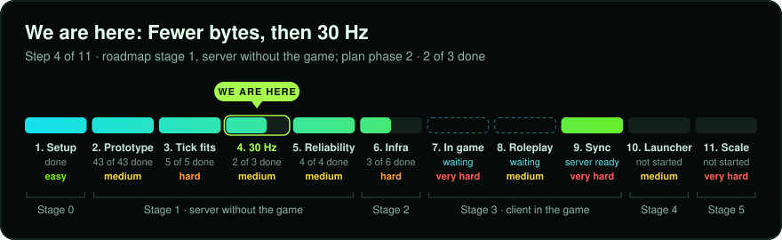

**📍 We are here: step 4 of 11, fewer bytes, then 30 hz** (roadmap stage 1, server without the game; plan phase 2): 2 of 4 done. A step is done when its last task is merged, so the marker follows `main`, not the plans. Difficulty is the maintainers' estimate of risk and unknowns, not of size: the hardest part starts with the client in the game. Each step's work, dependencies and risks are in [docs/roadmap.md](docs/roadmap.md#steps-in-detail).

| | Step | What it covers | Gate | Difficulty | Tasks |
|---|---|---|---|---|---|
| ✅ | [**1. Foundation**](docs/roadmap.md#1-foundation) Stage 0 | Workspace, rules, CI, claim bot, review agent | — | 🟢 **Easy** Known tools, no game and no server code | done |
| ✅ | [**2. Prototype and measurements**](docs/roadmap.md#2-prototype-and-measurements) Stage 1 | First server, protocol and load-test bots; the storage, transport, serialization, compression, visibility, scripting, voice, tick and allocator comparisons, checked on the real server | — | 🟡 **Medium** A first server and many benchmarks, but each one small and without the game | 29 of 29 done |
| ✅ | [**3. Make the tick fit**](docs/roadmap.md#3-make-the-tick-fit) Stage 1, plan phase 1 | jemalloc, one hand-off of datagrams per tick, dense entity slots, dense grid with bitset visible sets, per-player work in parallel | 3,000 bots in the 1.5 km square on one machine, no dropped bots, tick p99 under 35 ms (70% of the 20 Hz interval) | 🟠 **Hard** Rebuilds the core of the tick: entity slots, the visibility index and parallel work that must stay deterministic | 5 of 5 done: ✅ [SRV-6](https://github.com/sawgrass-mp/sawgrass/issues/94) · ✅ [NET-9](https://github.com/sawgrass-mp/sawgrass/issues/95) · ✅ [IM-4](https://github.com/sawgrass-mp/sawgrass/issues/96) · ✅ [IM-5](https://github.com/sawgrass-mp/sawgrass/issues/97) · ✅ [SRV-7](https://github.com/sawgrass-mp/sawgrass/issues/98) |
| 📍 | [**4. Fewer bytes, then 30 Hz**](docs/roadmap.md#4-fewer-bytes-then-30-hz) Stage 1, plan phase 2 | postcard payloads, delta snapshots, visible sets cut to a byte budget, 30 Hz by default | 4,096 bots from a second machine: the roadmap's stage 1 gate | 🟡 **Medium** The formats are chosen and measured; delta snapshots against acknowledgements need care, the rest is plumbing | 2 of 4 done: ⚪ NET-10 · ✅ [NET-11](https://github.com/sawgrass-mp/sawgrass/issues/107) · ✅ [IM-6](https://github.com/sawgrass-mp/sawgrass/issues/112) · ⚪ SRV-8 |
| ✅ | [**5. Reliability of the realtime core**](docs/roadmap.md#5-reliability-of-the-realtime-core) Stage 1, plan phase 3 | Movement validation, per-connection limits, overload policy, misbehaving bots as a load test | — | 🟡 **Medium** Well-known techniques; the work is covering every abuse case and testing it with hostile bots | 4 of 4 done: ✅ [SRV-9](https://github.com/sawgrass-mp/sawgrass/issues/117) · ✅ [NET-12](https://github.com/sawgrass-mp/sawgrass/issues/119) · ✅ [SRV-10](https://github.com/sawgrass-mp/sawgrass/issues/121) · ✅ [BOT-4](https://github.com/sawgrass-mp/sawgrass/issues/124) |
| ⚪ | [**6. Roleplay base**](docs/roadmap.md#6-roleplay-base) Stage 2, plan phase 4 | One writer with RocksDB, WAL copy to a second machine, PostgreSQL archive, Luau runtime with deadlines and memory caps, voice relay, then characters, money, inventory, jobs and admin tools | — | 🟠 **Hard** Money must never be lost: a durable single writer with a replicated log, plus a sandboxed script runtime | 3 of 7 done: ✅ [DB-5](https://github.com/sawgrass-mp/sawgrass/issues/126) · ⚪ DB-6 · ⚪ DB-7 · ✅ [SCRIPT-3](https://github.com/sawgrass-mp/sawgrass/issues/130) · ✅ [SCRIPT-4](https://github.com/sawgrass-mp/sawgrass/issues/145) · 🛠️ [SCRIPT-5](https://github.com/sawgrass-mp/sawgrass/issues/157) · ⚪ NET-13 |
| ⚪ | **7. Plan phase 5** Stage 2, plan phase 5 | See docs/implementation-plan.md | — | — | 5 of 10 done |
| ⏸️ | [**8. Client module in the game**](docs/roadmap.md#8-client-module-in-the-game) Stage 3 | VIctory adapter with module loading through an API proposed upstream; game functions found per build; hooks for the frame, peds, vehicles, input, camera and streaming; single-player systems turned off; the real GameApi; XCL's adapter later | Starts when the game runs on PC through VIctory or XCL with a controllable character | 🔴 **Very hard** The hardest part: an undocumented game on a young runtime, functions found by pattern per runtime and game version, everything can change with a game or runtime update | waiting for the game |
| ⏸️ | [**9. Sync in the game**](docs/roadmap.md#9-sync-in-the-game) Stage 3 | Interpolation and prediction of players, animations and ped tasks, vehicles with owners, weapons and damage decided by the server, world state, NPCs, in-game UI, client scripts, voice; the server side and the code over the fake GameApi can start before the game | Players see each other move, drive and fight in one world | 🔴 **Very hard** Game physics and animation the server does not own; animations and ped tasks are the largest piece of work | waiting for the game |
| ⚪ | [**10. Launcher and releases**](docs/roadmap.md#10-launcher-and-releases) Stage 4 | Detects the runtime and checks its build, installs the signed client module, auto-update, server list, downloads server resources, release process | — | 🟡 **Medium** Known technology (Tauri, signing, updates), but a security boundary on every player's machine | not started |
| ⚪ | [**11. Scale**](docs/roadmap.md#11-scale) Stage 5 | Real players on public servers, gateways in their own processes if the gateway limits, zones with entity hand-off only if measurements call for them, operations and moderation | — | 🔴 **Very hard** Real players behave unlike bots; zones with hand-off are the most error-prone step of the architecture | not started |

Tooling and docs run alongside every step: 18 of 24 tasks done.

Outside the plan, not counted in any step until a phase of [docs/implementation-plan.md](docs/implementation-plan.md) lists them: ⚪ [SRV-12](https://github.com/sawgrass-mp/sawgrass/issues/122) · 🛠️ [SRV-19](https://github.com/sawgrass-mp/sawgrass/issues/169) · ⚪ [IM-7](https://github.com/sawgrass-mp/sawgrass/issues/183) · 🛠️ [BOT-7](https://github.com/sawgrass-mp/sawgrass/issues/178) · 🛠️ [DB-8](https://github.com/sawgrass-mp/sawgrass/issues/161).

<b>All tasks</b>: 75 done, 1 in review, 6 in progress, 2 ready, 14 planned

| | Task | Step | Size | Status |
|---|---|---|---|---|
| ✅ | [NET-1](https://github.com/sawgrass-mp/sawgrass/issues/2): Packet format and quantization | 2. Prototype | S | done |
| ✅ | [NET-2](https://github.com/sawgrass-mp/sawgrass/issues/3): Client\-to\-gateway connection over QUIC | 2. Prototype | M | done |
| ✅ | [NET-3](https://github.com/sawgrass-mp/sawgrass/issues/59): Compare network transports for the client connection | 2. Prototype | M | done |
| ✅ | [NET-4](https://github.com/sawgrass-mp/sawgrass/issues/60): Compare packet serialization formats on game messages | 2. Prototype | M | done |
| ✅ | [NET-5](https://github.com/sawgrass-mp/sawgrass/issues/63): Compare packet compression on game messages | 2. Prototype | M | done |
| ✅ | [NET-6](https://github.com/sawgrass-mp/sawgrass/issues/71): Game payloads for client state, snapshots and events | 2. Prototype | M | done |
| ✅ | [NET-7](https://github.com/sawgrass-mp/sawgrass/issues/68): Compare proximity voice chat options for 4096 players | 2. Prototype | M | done |
| ✅ | [NET-8](https://github.com/sawgrass-mp/sawgrass/issues/89): Record snapshots from the bots and check serialization and compression on them | 2. Prototype | M | done |
| ✅ | [NET-14](https://github.com/sawgrass-mp/sawgrass/issues/108): Server and bots speak delta snapshots | 2. Prototype | M | done |
| ✅ | [NET-18](https://github.com/sawgrass-mp/sawgrass/issues/176): Tell a client where the server holds an entity after a refused state | 2. Prototype | M | done |
| ✅ | [SRV-1](https://github.com/sawgrass-mp/sawgrass/issues/5): Tick loop with metrics | 2. Prototype | M | done |
| ✅ | [SRV-2](https://github.com/sawgrass-mp/sawgrass/issues/20): follow\-ups\: bounded metrics window, robust rate tests, measured between\-hook time | 2. Prototype | M | done |
| ✅ | [SRV-3](https://github.com/sawgrass-mp/sawgrass/issues/72): Players join the world through an in\-process gateway | 2. Prototype | M | done |
| ✅ | [SRV-4](https://github.com/sawgrass-mp/sawgrass/issues/69): Compare tick models for 4096 players | 2. Prototype | M | done |
| ✅ | [SRV-5](https://github.com/sawgrass-mp/sawgrass/issues/70): Compare memory allocators and async runtimes on the gateway, tick and storage paths | 2. Prototype | M | done |
| ✅ | [SRV-11](https://github.com/sawgrass-mp/sawgrass/issues/115): Gateway and tick threads share the cores without overlap | 2. Prototype | M | done |
| ✅ | [IM-1](https://github.com/sawgrass-mp/sawgrass/issues/4): Spatial grid and visible sets | 2. Prototype | M | done |
| ✅ | [IM-2](https://github.com/sawgrass-mp/sawgrass/issues/77): Compare spatial indexes for visible sets in crowds | 2. Prototype | M | done |
| ✅ | [IM-3](https://github.com/sawgrass-mp/sawgrass/issues/88): Check the visibility index choice with the load\-test bots' movement | 2. Prototype | M | done |
| ✅ | [BOT-1](https://github.com/sawgrass-mp/sawgrass/issues/6): Headless bot client | 2. Prototype | M | done |
| ✅ | [BOT-2](https://github.com/sawgrass-mp/sawgrass/issues/7): Load report for N bots | 2. Prototype | S | done |
| ✅ | [BOT-3](https://github.com/sawgrass-mp/sawgrass/issues/87): Measure the real server under the load\-test bots and check the transport and allocator choices | 2. Prototype | M | done |
| ✅ | [BOT-6](https://github.com/sawgrass-mp/sawgrass/issues/140): Honest mass entry and a lighter bot generator | 2. Prototype | M | done |
| ✅ | [DB-1](https://github.com/sawgrass-mp/sawgrass/issues/8): Character and wallet schema | 2. Prototype | S | done |
| ✅ | [DB-2](https://github.com/sawgrass-mp/sawgrass/issues/38): Compare SpacetimeDB with PostgreSQL for roleplay state | 2. Prototype | M | done |
| ✅ | [DB-3](https://github.com/sawgrass-mp/sawgrass/issues/45): ADR for roleplay state in server memory with its own write\-ahead log | 2. Prototype | S | done |
| ✅ | [DB-4](https://github.com/sawgrass-mp/sawgrass/issues/47): Add SQLite, redb, RocksDB, LMDB and TigerBeetle to the storage comparison | 2. Prototype | M | done |
| ✅ | [SCRIPT-1](https://github.com/sawgrass-mp/sawgrass/issues/67): Compare scripting engines for roleplay logic | 2. Prototype | M | done |
| ✅ | [SCRIPT-2](https://github.com/sawgrass-mp/sawgrass/issues/82): Adopt Luau with native code for game\-mode scripts | 2. Prototype | M | done |
| ✅ | [SRV-6](https://github.com/sawgrass-mp/sawgrass/issues/94): jemalloc as the global allocator of the server and the bots | 3. Tick fits | M | done |
| ✅ | [NET-9](https://github.com/sawgrass-mp/sawgrass/issues/95): Hand snapshot datagrams to the gateway once per tick from reused buffers | 3. Tick fits | M | done |
| ✅ | [IM-4](https://github.com/sawgrass-mp/sawgrass/issues/96): Dense entity slots with generations and slot\-indexed network state | 3. Tick fits | M | done |
| ✅ | [IM-5](https://github.com/sawgrass-mp/sawgrass/issues/97): Dense grid and bitset visible sets in the server | 3. Tick fits | M | done |
| ✅ | [SRV-7](https://github.com/sawgrass-mp/sawgrass/issues/98): Visible sets and snapshots per player in parallel on rayon | 3. Tick fits | M | done |
| ⚪ | NET-10: postcard for every payload; `PROTOCOL_VERSION` bump; bots follow | 4. 30 Hz | M | planned |
| ✅ | [NET-11](https://github.com/sawgrass-mp/sawgrass/issues/107): Delta\-encoded snapshots and fragments in the protocol | 4. 30 Hz | M | done |
| ✅ | [IM-6](https://github.com/sawgrass-mp/sawgrass/issues/112): Cut each snapshot to the nearest visible entities | 4. 30 Hz | M | done |
| ⚪ | SRV-8: 30 Hz by default | 4. 30 Hz | M | planned |
| ✅ | [SRV-9](https://github.com/sawgrass-mp/sawgrass/issues/117): Validate movement\: map bounds, speed and teleports | 5. Reliability | M | done |
| ✅ | [NET-12](https://github.com/sawgrass-mp/sawgrass/issues/119): Rate limits and caps per connection | 5. Reliability | M | done |
| ✅ | [SRV-10](https://github.com/sawgrass-mp/sawgrass/issues/121): Report overruns by phase and stop cleanly on a panicking system | 5. Reliability | M | done |
| ✅ | [BOT-4](https://github.com/sawgrass-mp/sawgrass/issues/124): Bots that misbehave, as a load\-test scenario | 5. Reliability | M | done |
| ✅ | [DB-5](https://github.com/sawgrass-mp/sawgrass/issues/126): The single writer and its RocksDB store with group commit | 6. Roleplay | M | done |
| ⚪ | DB-6: WAL copy to a second machine before acknowledgement, and the restore procedure (ADR 0003) | 6. Roleplay | M | planned |
| ⚪ | DB-7: PostgreSQL archive fed from the operation records; `sawgrass-db`'s ledger becomes the archive's schema | 6. Roleplay | M | planned |
| ✅ | [SCRIPT-3](https://github.com/sawgrass-mp/sawgrass/issues/130): Luau runtime in the server\: resources, events, deadlines and memory caps | 6. Roleplay | M | done |
| ✅ | [SCRIPT-4](https://github.com/sawgrass-mp/sawgrass/issues/145): Run resources in the server's tick with a script budget | 6. Roleplay | M | done |
| 🛠️ | [SCRIPT-5](https://github.com/sawgrass-mp/sawgrass/issues/157): Turn off a resource that keeps overrunning | 6. Roleplay | M | in progress |
| ⚪ | NET-13: Voice relay over the same QUIC connection, Opus frames routed by the visible sets (NET-7) | 6. Roleplay | M | planned |
| ✅ | [NET-15](https://github.com/sawgrass-mp/sawgrass/issues/136): Entity kinds, model ids and the blocks list in delta snapshots | 7. Phase 5 | M | done |
| ✅ | [NET-16](https://github.com/sawgrass-mp/sawgrass/issues/148): The ped block in the protocol | 7. Phase 5 | M | done |
| ✅ | [SRV-18](https://github.com/sawgrass-mp/sawgrass/issues/152): Send entity infos and relay the players' ped blocks | 7. Phase 5 | M | done |
| ✅ | [NET-17](https://github.com/sawgrass-mp/sawgrass/issues/155): The vehicle block and owned\-entity states in the protocol | 7. Phase 5 | M | done |
| ✅ | [SRV-13](https://github.com/sawgrass-mp/sawgrass/issues/158): Vehicles, NPCs and objects as server entities | 7. Phase 5 | M | done |
| 🛠️ | [SRV-14](https://github.com/sawgrass-mp/sawgrass/issues/168): Owners for vehicles and NPCs, with epochs and the ownership event | 7. Phase 5 | M | in progress |
| ⚪ | SRV-15: Seats: enter and leave requests, decided by the server | 7. Phase 5 | M | planned |
| ⚪ | SRV-16: Hit reports checked against the snapshot history; health, armour and death on the server | 7. Phase 5 | M | planned |
| ⚪ | SRV-17: World state: time, weather, doors and routing buckets, sent on join and on change | 7. Phase 5 | M | planned |
| ⚪ | BOT-5: Bots that drive, change seats and owners and shoot, as a load-test scenario with bytes per player | 7. Phase 5 | M | planned |
| ✅ | [CLIENT-1](https://github.com/sawgrass-mp/sawgrass/issues/134): Client module crate, runtime boundary and per\-build function tables | 8. In game | M | done |
| ✅ | [CLIENT-2](https://github.com/sawgrass-mp/sawgrass/issues/137): GameApi, hooks, asset table and the network core attachment point | 8. In game | M | done |
| ✅ | [CLIENT-3](https://github.com/sawgrass-mp/sawgrass/issues/131): Client network core\: snapshot interpolation and local player correction | 8. In game | M | done |
| ✅ | [CLIENT-4](https://github.com/sawgrass-mp/sawgrass/issues/146): Hook event queue outside the module, the protocol's AssetId, and review follow\-ups from CLIENT\-2 | 8. In game | M | done |
| ✅ | [CLIENT-5](https://github.com/sawgrass-mp/sawgrass/issues/163): Generations on game handles, so late hook events cannot reach a reused handle | 8. In game | M | done |
| ✅ | [CLIENT-6](https://github.com/sawgrass-mp/sawgrass/issues/165): Entity kinds, models and blocks in the network core | 8. In game | M | done |
| 🔍 | [CLIENT-7](https://github.com/sawgrass-mp/sawgrass/issues/166): The network core inside the client module | 8. In game | M | in review |
| ✅ | [CLIENT-8](https://github.com/sawgrass-mp/sawgrass/issues/172): Measure corners and teleports in the network core's simulation | 8. In game | M | done |
| ✅ | [CLIENT-9](https://github.com/sawgrass-mp/sawgrass/issues/174): Generations for entities older than the module | 8. In game | M | done |
| ✅ | [CLIENT-10](https://github.com/sawgrass-mp/sawgrass/issues/181): Measure corners that fall between snapshots | 8. In game | M | done |
| ⚪ | [SRV-12](https://github.com/sawgrass-mp/sawgrass/issues/122): Show movement refusals per player for admins | Outside the plan | M | planned |
| 🛠️ | [SRV-19](https://github.com/sawgrass-mp/sawgrass/issues/169): Take owned states only from their owner, checked, with the damage rule | Outside the plan | M | in progress |
| ⚪ | [IM-7](https://github.com/sawgrass-mp/sawgrass/issues/183): Players and moving entities first in the 128\-nearest cut | Outside the plan | M | planned |
| 🛠️ | [BOT-7](https://github.com/sawgrass-mp/sawgrass/issues/178): Bots that pay each other through the ledger | Outside the plan | M | in progress |
| 🛠️ | [DB-8](https://github.com/sawgrass-mp/sawgrass/issues/161): Players' wallets in the server through the single writer | Outside the plan | M | in progress |
| ⚪ | [OPS-1](https://github.com/sawgrass-mp/sawgrass/issues/9): Benchmark regression gate | Tooling and docs | M | planned |
| ⚪ | [OPS-2](https://github.com/sawgrass-mp/sawgrass/issues/10): Markdown link check | Tooling and docs | S | planned |
| ⚪ | [OPS-3](https://github.com/sawgrass-mp/sawgrass/issues/11): Protocol version gate | Tooling and docs | S | planned |
| ✅ | [OPS-4](https://github.com/sawgrass-mp/sawgrass/issues/12): Review agent, comment\-only mode | Tooling and docs | L | done |
| ✅ | [OPS-5](https://github.com/sawgrass-mp/sawgrass/issues/29): Guard pull requests against smuggled workflows, vandalism and shell injection | Tooling and docs | M | done |
| ✅ | [OPS-6](https://github.com/sawgrass-mp/sawgrass/issues/33): Run the policy checks as a required CI job | Tooling and docs | S | done |
| ✅ | [OPS-7](https://github.com/sawgrass-mp/sawgrass/issues/36): Dispatcher labels approved tasks ready | Tooling and docs | S | done |
| 🛠️ | [OPS-8](https://github.com/sawgrass-mp/sawgrass/issues/43): Relicense the project for any storage and both client runtimes | Tooling and docs | S | in progress |
| ✅ | [OPS-9](https://github.com/sawgrass-mp/sawgrass/issues/49): Automatic ready, claims and model declaration for the maintainer's account | Tooling and docs | S | done |
| ✅ | [OPS-10](https://github.com/sawgrass-mp/sawgrass/issues/51): Let the claims link job label pull requests and survive one failure | Tooling and docs | S | done |
| ✅ | [OPS-11](https://github.com/sawgrass-mp/sawgrass/issues/55): Review agent merges the maintainer's pull requests that pass | Tooling and docs | S | done |
| ✅ | [OPS-12](https://github.com/sawgrass-mp/sawgrass/issues/128): Install libclang for the RocksDB build in CI | Tooling and docs | M | done |
| 🟢 | [DOC-1](https://github.com/sawgrass-mp/sawgrass/issues/13): Wire format in architecture\.md | Tooling and docs | S | ready |
| ✅ | [DOC-2](https://github.com/sawgrass-mp/sawgrass/issues/23): README with project status and generated progress | Tooling and docs | M | done |
| ✅ | [DOC-3](https://github.com/sawgrass-mp/sawgrass/issues/34): Support Leonida and XCL as client runtimes | Tooling and docs | S | done |
| 🟢 | [DOC-4](https://github.com/sawgrass-mp/sawgrass/issues/40): Accept ADR 0002 and name both runtimes in the README | Tooling and docs | S | ready |
| ✅ | [DOC-5](https://github.com/sawgrass-mp/sawgrass/issues/53): Target VIctory as the client runtime | Tooling and docs | M | done |
| ✅ | [DOC-6](https://github.com/sawgrass-mp/sawgrass/issues/57): Transparent background for the README logo | Tooling and docs | M | done |
| ✅ | [DOC-7](https://github.com/sawgrass-mp/sawgrass/issues/85): Official Telegram and X links in the README | Tooling and docs | M | done |
| ✅ | [DOC-8](https://github.com/sawgrass-mp/sawgrass/issues/93): Implementation plan from the measured choices to the server | Tooling and docs | M | done |
| ✅ | [DOC-9](https://github.com/sawgrass-mp/sawgrass/issues/104): One project progress bar with the development steps and where the project is | Tooling and docs | M | done |
| ✅ | [DOC-10](https://github.com/sawgrass-mp/sawgrass/issues/110): Describe every progress step in the roadmap and mark its difficulty | Tooling and docs | M | done |
| ✅ | [DOC-11](https://github.com/sawgrass-mp/sawgrass/issues/132): ADR for syncing peds, vehicles, damage and world state before the game | Tooling and docs | M | done |
| ✅ | [DOC-12](https://github.com/sawgrass-mp/sawgrass/issues/151): Report the load runs on the project's two machines | Tooling and docs | M | done |

Generated by `scripts/progress.py` from the task issues, [docs/implementation-plan.md](docs/implementation-plan.md) and [docs/roadmap.md](docs/roadmap.md). The reviewer session refreshes it; see [docs/maintainers.md](docs/maintainers.md#readme-progress).

<!-- progress:end -->

## How it fits together

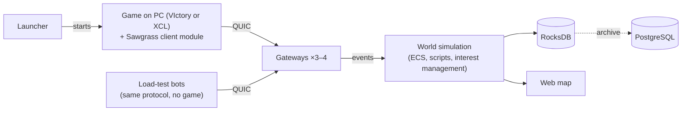

- **World simulation** (`crates/sawgrass-server`): one multithreaded process with every entity in an ECS. It owns
  authority decisions, runs the game-mode scripts and decides who sees what.
- **Gateways** hold player connections over QUIC and build each player's snapshot. They scale out, because outgoing
  traffic, not simulation, is the bottleneck.
- **Protocol** (`crates/sawgrass-protocol`): the wire format every peer shares, with quantized positions and
  rotations.
- **Roleplay state** (characters, money, inventory, property) is held by the world server and stored in RocksDB;
  **PostgreSQL** is its archive. Why: [Storage, measured](#storage-measured).
- **Client module**: loaded into the game under VIctory or XCL on the player's PC; syncs the local game with the server.
- **Launcher**: checks the player's VIctory or XCL build, installs the signed client module and starts the game.

| Budget | Target |
|---|---|
| Players in one world | 4096 |
| Server tick | 20–30 Hz, p99 tick time under 70% of the interval |
| Entities sent to one player | about 100–150 nearby, by priority |
| Downstream per player | about 40 KB/s at 100 visible entities |

The design is in [docs/architecture.md](docs/architecture.md), the stages in [docs/roadmap.md](docs/roadmap.md).

## Storage, measured

Roleplay state with money in it needs storage that is both reliable and fast: money is never created or lost,
and a change the server has confirmed survives a crash. We measured eleven designs on the same money ledger, with
the same rules and load, counting a transfer only once it was written to disk.

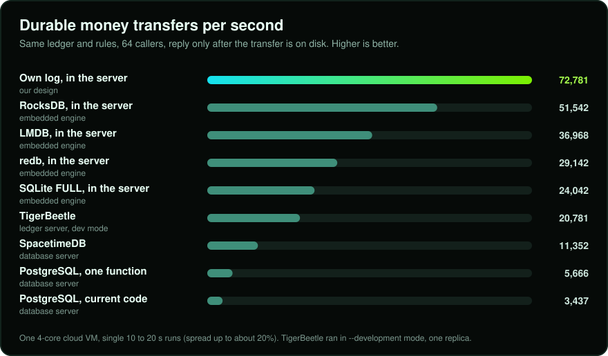

**We chose RocksDB behind one writer in the world server** ([ADR 0003](docs/adr/0003-in-memory-roleplay-state.md)).
The server keeps roleplay state in memory, one writer applies every change, and each batch of changes is one
RocksDB write flushed to disk before anyone gets a reply. PostgreSQL stays as an archive for history and admin
queries.

| Design | Durable transfers/s | Over 5 minutes (p99) | Why or why not |
|---|---:|---:|---|
| Own log in the server | 72,781 | 73,828 (1.4 ms) | Fastest, but we would have to build and maintain a storage engine. Kept as a later optimisation. |
| **RocksDB in the server** | **51,542** | **55,480 (1.9 ms)** | **Chosen**: fastest proven engine, about 45 times the expected peak load. |
| Fjall in the server | 43,836 | 40,107 (3.2 ms) | Pure Rust, but slower and far younger. First fallback. |
| LMDB in the server | 36,968 | 32,941 (3.7 ms) | Mature, but slower and needs a fixed maximum size. |
| redb, SQLite in the server | 24,042 to 29,142 | not run | About half of RocksDB or less. |
| SpacetimeDB | 11,352 | not run | About 4.5 times slower, extra network hop, licence allows one production instance. |
| PostgreSQL | 3,437 to 5,666 | not run | Under 1,000 on one hot wallet. Kept as the archive. |

- Speed comes from the design, not the database: one writer with state in memory and one disk flush per batch was
  2 to 20 times faster than any database server.
- In 21 kill -9 tests under load (our own log, RocksDB, Fjall, LMDB, redb, SQLite), no confirmed transfer was lost.
  RocksDB dropped only an unconfirmed, cut-off last batch, and refused to start on any damaged record, even the
  last one; then an operator restores from the second machine's copy.
- Not ranked: SQLite's fast mode (`synchronous=NORMAL`) can lose confirmed transfers on a power cut, and TigerBeetle
  could only run in development mode here, without the Direct I/O it relies on.
- Caveats: one 4-core VM; single runs with up to 20% spread; process kills, not power cuts; the copy to a second
  machine and the PostgreSQL archive are not built yet.

Full results, crash tests, licences, the reasoning for each option and how to reproduce:
[docs/research](docs/research/spacetimedb-vs-postgresql/).

## Network transport, measured

Players connect to gateways over the network, so the transport decides how fast an event arrives when packets are
lost, and how much CPU 4096 connections cost. We ran the same server and clients over five transports, through the
same lossy link, and with 1,000, 2,048 and 4,096 players at 20 Hz.

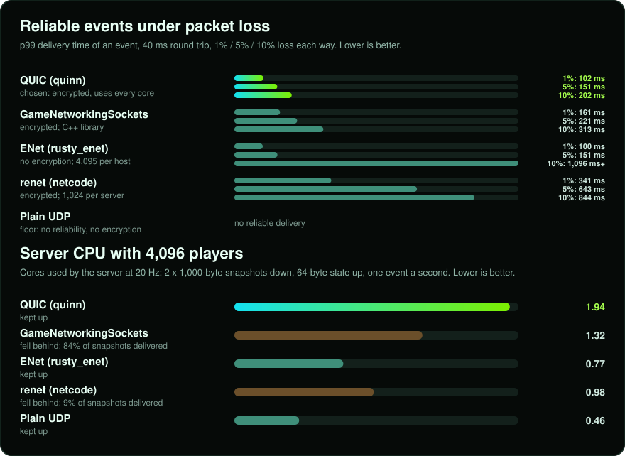

**We keep QUIC through quinn**, as [docs/architecture.md](docs/architecture.md) planned: unreliable datagrams for
movement and snapshots, streams for reliable events.

| Transport | Encrypted | Reliable event p99, 1% / 5% / 10% loss | Server CPU, 1,000 / 4,096 players | Why or why not |
|---|---|---:|---:|---|
| **QUIC (quinn)** | **yes** | **102 / 151 / 202 ms** | **0.77 / 1.94 cores** | **Chosen**: fastest encrypted transport under loss, multi-threaded, held 4,096 with everything delivered, no connection limit. |
| GameNetworkingSockets | yes | 161 / 221 / 313 ms | 0.56 / not established | Slower under loss; received only 68% of client messages at 2,048; C++ build. |
| ENet | no | 100 / 151 / 1,096 ms | 0.18 / 0.80 | Tied with quinn at 1% and 5% loss and cheaper, but no encryption, 4,095 peers per host, slow at 10% loss. |
| renet | insecure mode here | 341 / 643 / 844 ms | 0.99 / not established | 300 ms resend by default; about one core per 1,000 players; 1,024 clients per server. |
| Plain UDP | no | none | 0.11 / 0.43 | The floor: reliability and encryption would be ours to build. |

- Every transport answered in under half a millisecond without loss, so latency does not separate them; behaviour
  under loss and CPU do.
- quinn's price is CPU, 4.5 to 7 times plain UDP per player: about 1.9 cores of this VM for 4096 players, spread
  over the 3 to 4 gateways the architecture plans.
- Caveats: one 4-core VM with server and clients together; loss from our own relay (random, no bursts); single
  runs; default settings for every library. For renet and GNS at 4,096 the server or load generator cores were
  saturated, so their limits there are not established.
- Checked on the real server under the load-test bots: quinn spent 0.49 cores for 1,000 players and 0.86 for 2,000
  in a dense crowd, 4.7 to 9.4 µs per datagram against this harness's 7.9 to 12.8, so the choice holds
  ([load-test-bots](docs/research/load-test-bots/README.md)).

Full results, method, licences, the reasoning for each option and how to reproduce:
[docs/research/network-transport](docs/research/network-transport/).

## Packet serialization, measured

Every snapshot and event is encoded on one side and decoded on the other, so the format decides how many bytes a
gateway sends and what hostile bytes can do to the server. We encoded the game's own messages (a 100-entity
snapshot, client state, a chat line, a script event) in five formats, timed them, and fed each 400,000 random and
corrupted inputs.

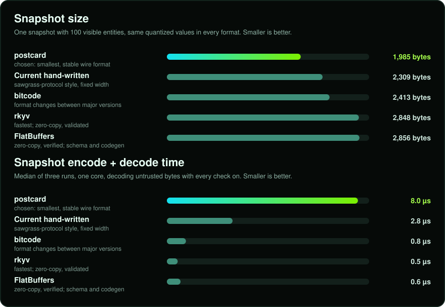

**We chose postcard**, with the quantized values `sawgrass-protocol` already defines.

| Format | Snapshot, 100 entities | Encode + decode | Why or why not |
|---|---:|---:|---|
| **postcard** | **1,985 B** | **8.0 µs** | **Chosen**: smallest on every message, stable documented wire format, plain serde derive. |
| Current hand-written | 2,309 B | 2.8 µs | 16% larger, and every new message needs its own encoder and decoder. |
| bitcode | 2,413 B | 0.8 µs | Fast, but larger here and its format may change between major versions. |
| rkyv (validated) | 2,848 B | 0.5 µs | Fastest, zero-copy, but 43% larger snapshots and up to 3.7 times larger events. |
| FlatBuffers (verified) | 2,856 B | 0.6 µs | Zero-copy across languages, which we do not need; largest messages and a code generator. |

- Bandwidth is what limits a gateway: at 4096 players postcard saves about 27 MB/s of outgoing traffic over the
  current code, and its extra encode and decode time costs about 0.3 cores across all gateways.
- No format panicked or ran out of memory on any of the 400,000 hostile inputs. Every format accepts some
  corrupted packets as valid, so integrity comes from QUIC's authenticated encryption.
- Caveats: one 4-core VM; single-threaded microbenchmarks on one pinned core with warm caches; delta compression
  and bit packing, which shrink snapshots more than any format, were not measured.
- Checked on snapshots recorded from the real server under the load-test bots: postcard was 17% smaller than the
  current format (1,466 against 1,772 bytes), so the choice holds.

Full results, method, licences, the reasoning for each option and how to reproduce:
[docs/research/packet-serialization](docs/research/packet-serialization/).

## Packet compression, measured

Snapshots are most of what a gateway sends, so we measured how to make them smaller: general compressors (LZ4,
zstd with and without a trained dictionary) and delta encoding against the last snapshot each client acknowledged,
on 38,400 snapshots from a simulated city block, with quinn sending them to 2,048 and 4,096 players.

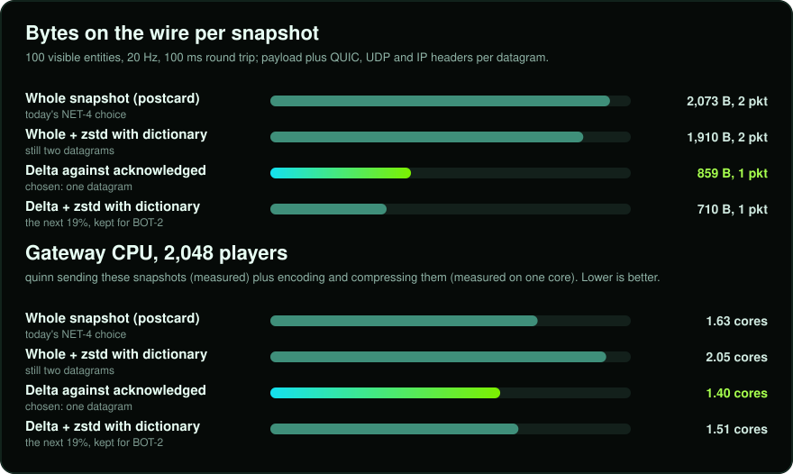

**We chose delta encoding**, with no general compressor for now.

| Snapshot of 100 entities | Payload | Datagrams | Encode | Why or why not |
|---|---:|---:|---:|---|
| Whole, postcard (NET-4) | 1,935 B | 2 | 5.7 µs | Twice the packets of a delta. |
| Whole + LZ4 or zstd | 1,757 to 1,927 B | 2 | 7.5 to 32 µs | Quantized values barely compress; still two datagrams. |
| **Delta** | **793 B** | **1** | **4.0 µs** | **Chosen**: 59% fewer bytes, half the packets, cheapest to encode. |
| Delta + zstd with dictionary | 644 B | 1 | 7.2 µs | Another 19%; waits for real traffic to train the dictionary on. |

- One datagram instead of two cut quinn's CPU by 11% at 2,048 players; 9% fewer bytes in two datagrams saved
  nothing measurable. With encoding included, delta was the cheapest pipeline in total.
- Loss barely matters: each client state acknowledges the newest snapshot, so at 10% loss deltas grew by 1%.
- Small messages (client state, chat, events) grew by 4 to 5 bytes with every compressor, so they stay
  uncompressed. No decoder crashed on 1.6 million random and corrupted packets.
- Caveats: simulated traffic, not the game's; one 4-core VM; at 4,096 players server and load generator were both
  near their cores, so CPU is compared at 2,048.
- Checked on snapshots recorded from the real server under the load-test bots: delta encoding saved 76% (355 against
  1,466 bytes), and zstd with a dictionary another 22%, about as in the simulation, so it stays out for now.

Full results, method, licences, the reasoning for each option and how to reproduce:
[docs/research/packet-compression](docs/research/packet-compression/).

## Interest management, measured

Every tick the server finds what each of 4096 players can see. We measured the current grid against a dense grid,
a quadtree, a BVH and ready-made trees (rstar, kiddo), with players spread out and in roleplay's worst case: 2,048
players inside 60 m, and 512 standing on one spawn point.

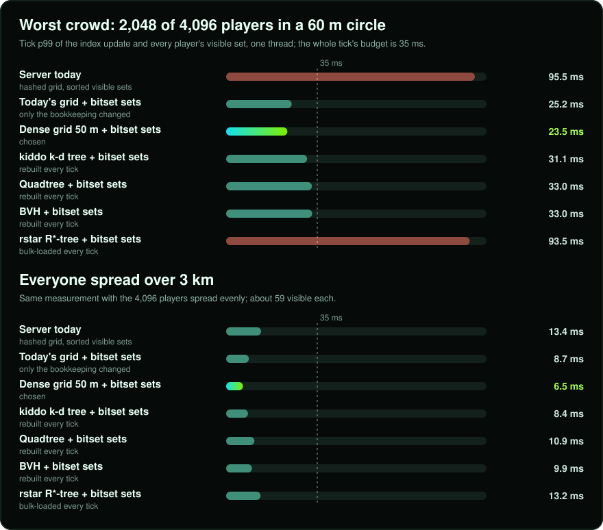

**We chose a dense 50 m grid rebuilt every tick, with visible sets stored as bitsets.**

| All 4096 visible sets, one thread | 2,048 in 60 m | Spread over 3 km | Why or why not |
|---|---:|---:|---|
| Server today: hashed grid, sorted sets | 72.3 ms | 9.4 ms | Sorting and searching the sets is most of the crowd's cost. |
| Today's grid + bitset sets | 15.8 ms | 6.7 ms | The bitsets alone fix the crowd; the grid is slower spread out. |
| **Dense grid 50 m + bitset sets** | **16.0 ms** | **4.6 ms** | **Chosen**: fastest or tied everywhere, no failure path, no dependency. |
| kiddo, quadtree, BVH + bitset sets | 20.0 to 23.8 ms | 6.4 to 8.3 ms | Slower in crowds; kiddo's mutable tree refused the spawn point. |
| rstar + bitset sets | 52.3 ms | 11.2 ms | Built for rectangles and inserts, not points that all move. |

- On four threads the dense grid took 7.5 ms (p99 16) in the 2,048 crowd, against 38 ms (p99 54) for today's code.
- Every index matched brute force exactly on 70,320 viewer positions; only kiddo's `MutableKdTree` failed, on 33
  or more players at one coordinate.
- The bitsets need dense entity slots that are cleared from every set before reuse; the server's ids today come
  from a counter that never reuses them, so the follow-up task adds slots first.
- Caveats: simulated movement, players only, one shared 4-core VM, interest management alone, not the whole tick.
- Checked with the load-test bots' movement: the dense grid was 1.8 to 2.8 times faster than today's code. In the real
  server visible sets were a quarter of the tick in a crowd, so the grid alone is not enough there
  ([load-test-bots](docs/research/load-test-bots/README.md)).

Full results, method, licences, the reasoning for each option and how to reproduce:
[docs/research/visibility-index](docs/research/visibility-index/).

## Scripting engines, measured

Game modes are scripts that server owners and modders write, so the engine decides how much roleplay logic fits in a
tick and whether one broken script can hang or crash the server. We ran the same roleplay resource (a zone check per
player, chat commands that move money, a payday, an inventory) in nine engine setups and tried to break each with an
endless loop, a long call into the string library, endless allocation, endless recursion and a thrown error.

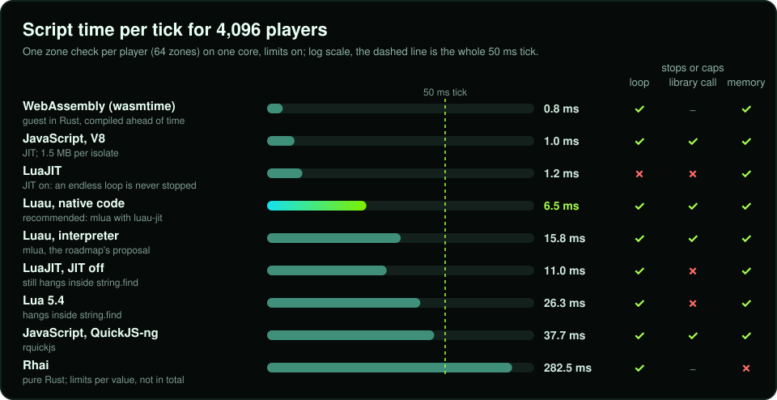

**We chose Luau with native code** ([ADR 0005](docs/adr/0005-luau-scripting.md)). The data ruled out four engines;
between Luau, JavaScript or TypeScript on V8, and WebAssembly the choice was partly taste and partly what the
client runtime allows, and the maintainer took the recommendation.

| Engine | Zone check | Host call | Stops a script | Memory cap | Why or why not |
|---|---:|---:|---|---|---|
| WebAssembly (wasmtime) | 0.18 µs | 5 ns | yes | exact | Fastest and best isolated, but authors must compile their code (a judgement, not a measurement). |
| JavaScript, V8 | 0.25 µs | 23 ns | yes | soft | Fast; 46 MB binary, 1.5 MB per instance, and its memory cap needs an `unsafe` callback. |
| LuaJIT | 0.30 µs | 36 ns | **no** | exact | Its hook never runs in compiled code or inside a library call: an endless loop or a backtracking `string.find` hangs it. |
| **Luau, native code** | **1.59 µs** | **74 ns** | **yes** | **exact** | **Chosen**: passed every isolation test, the long library call included; sandbox made for game scripts; 3 MB. |
| Lua 5.4 | 6.4 µs | 69 ns | **no** | exact | A backtracking `string.find` hangs it past any deadline; four times slower than Luau on the zone check. |
| QuickJS-ng | 9.2 µs | 144 ns | yes | exact | 3 to 6 times slower than Luau with native code, nothing it lacks. |
| Rhai | 69 µs | 279 ns | yes | none | 4 to 43 times slower than Luau, no cap on total memory. |

- Event-driven roleplay logic is cheap on all of them but Rhai: a chat command took 2.3 µs in Luau, 0.6 µs in V8.
  Work for every player on every tick is where V8 and WebAssembly pull ahead, 1.7 to 12 times.
- Every engine survived deep recursion and a thrown error, and stayed usable after each stopped script. Luau
  checks its deadline inside the pattern matcher; other long library calls (`table.sort` of a huge table) were not
  tested.
- Caveats: one 4-core VM; one core; our own workloads; the client (scripts inside the game on Windows, where a JIT
  may not be allowed) was not measured.

Full results, method, licences, the reasoning for each option and how to reproduce:
[docs/research/scripting-engines](docs/research/scripting-engines/).

## Voice chat, measured

Roleplay needs proximity voice: a player hears the people near them, their radio channel and their phone call. We
measured our own Opus relay on the QUIC connection against server-side mixing and against LiveKit under the same
load, with 4,096 players in a simulated city at 5, 10 and 20% speaking.

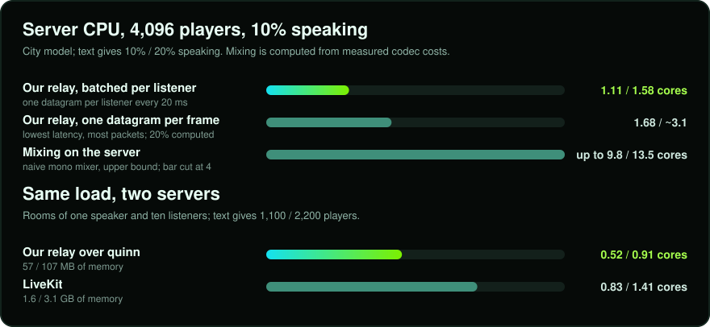

**We chose our own relay on the QUIC connection**: Opus at 24 kbit/s in 20 ms frames as datagrams, the server
deciding who hears each frame and sending each listener one datagram every 20 ms with everything they hear.

| Option | Server CPU, 4,096 players, 10% / 20% speaking | Same rooms load, 2,200 players | Why or why not |
|---|---:|---:|---|
| **Our relay, batched per listener** | **1.11 / 1.58 cores** | **1.00 cores, 107 MB** | **Chosen**: held 20% speaking with every frame delivered; the server decides who hears; one connection. |
| Our relay, one datagram per frame | 1.68 / about 3.1 (computed) | 0.91 cores, 107 MB | Lowest latency, but 2.6 times the packets; at 20% it would need more than the server's 2 cores. |
| Mixing on the server | up to 9.8 / 13.5 cores (computed) | not run | Encoding a stream per listener costs up to nine times the CPU; a mono mix loses each voice's direction. |
| LiveKit | not established | 1.41 cores, 3.1 GB | 1.4 to 1.6 times the CPU and 30 times the memory; a second connection and a WebRTC stack in the client. |
| mediasoup, Mumble | not run | not run | mediasoup could not be built here; Mumble-style routing by cell sends 8 to 24 times the packets. |

- Packets set the cost: at 4,096 players and 10% speaking, 200,000 voice frames a second leave the server, 2.4
  times the snapshot packets; batching per listener sends 80,000 datagrams for them. Batching adds 0 to 20 ms.
- Voice is light in bytes: 18 MB/s out at 10% speaking, 33 MB/s at 20%, against 165 MB/s for snapshots.
- libopus's in-band FEC added recovery data only when told to expect at least 10% loss; a redundant copy of each
  frame recovered best, for twice the bytes.
- Caveats: one 4-core VM; a simulated city whose hotspots, hearing ranges and radio use are assumptions; at 4,096
  players sending per frame, and LiveKit from 2,200, server or load generator neared their cores; single runs.

Full results, method, licences, the reasoning for each option and how to reproduce:
[docs/research/voice-chat](docs/research/voice-chat/).

## Tick model, measured

The world server runs every player's movement checks, visible set, roleplay logic and snapshot once per tick. We
measured how to schedule that work: the current loop on one thread, plain arrays without an ECS, zones in
parallel, every player in parallel (on arrays and on hecs) and bevy_ecs, at 30 and 60 Hz, with players spread out,
in a city, and with a quarter of them at one event.

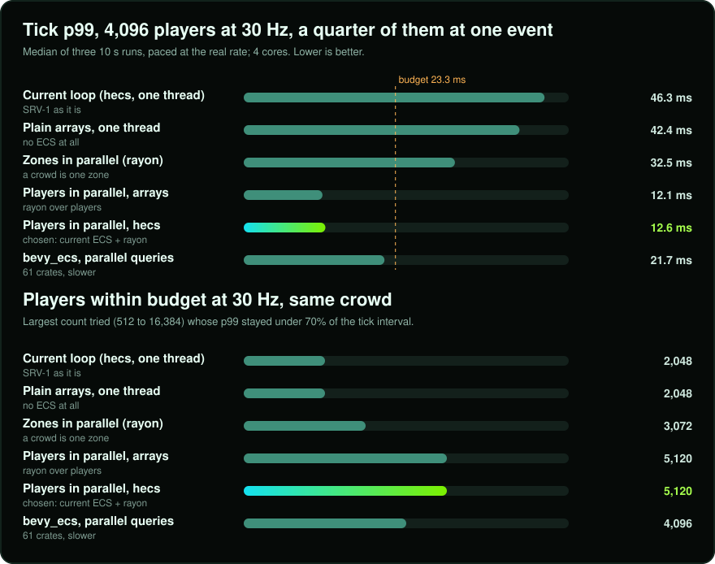

**We chose to keep hecs and run each system's per-player work in parallel with rayon**, applying effects on other
players in one serial, ordered phase, at 30 Hz.

| 4096 players, 30 Hz, 4 cores | City p99 | Crowd p99 | Players within budget, crowd (one run per count) | Why or why not |
|---|---:|---:|---:|---|
| Current loop (hecs, one thread) | 18.7 ms | 46.3 ms | 2,048 | Every crowd tick over the 23.3 ms budget. |
| Plain arrays, one thread | 15.7 ms | 42.4 ms | 2,048 | Up to 7% faster than hecs: not worth a rewrite. |
| Zones in parallel | 5.6 ms | 32.5 ms | 3,072 | A crowd in one zone runs on one thread. |
| **Players in parallel, hecs** | **5.4 ms** | **12.6 ms** | **5,120** | **Chosen**: half the budget in the crowd, same world as one thread, adds only rayon. |
| Players in parallel, plain arrays | 6.0 ms | 12.1 ms | 5,120 | Equal to hecs within noise. |
| bevy_ecs | 15.5 ms | 21.7 ms | 4,096 | 30 to 40% slower, wider tail, 61 crates with proc macros. |

- With 4 threads the median tick was 2.7 times shorter in the city and 3.2 times in the crowd, for 10 to 20% more CPU.
  Every model ended in the same world, bit for bit, on 1, 2 and 4 threads.
- At 60 Hz players in parallel held the city (p99 6.1 of 11.7 ms) but missed 4% of crowd ticks: plan for 30 Hz.
- Visible sets were 70 to 77% of the one-thread tick. IM-2's bitset sets, chosen while this ran, cut that work and
  were not measured here; they make every model faster and leave zones' crowd problem as it is.
- Caveats: one shared 4-core VM with a noisy tail (p99 varied up to 50% between rounds); a synthetic tick without
  scripts, gateways or storage; scaling past 4 cores not measured.

Full results, method, licences, the reasoning for each option and how to reproduce:
[docs/research/tick-model](docs/research/tick-model/).

## Allocators and runtimes, measured

The allocator and the async runtime sit under every path of the server, so we measured them on three of ours: the
QUIC gateway with 2,048 to 4,096 players, the world tick with 4,096 players, and RocksDB ledger writes. Allocators:
glibc malloc, mimalloc and jemalloc. Runtimes: Tokio (multi-thread, two endpoints, thread per core), smol, and
compio on io_uring with compio-quic.

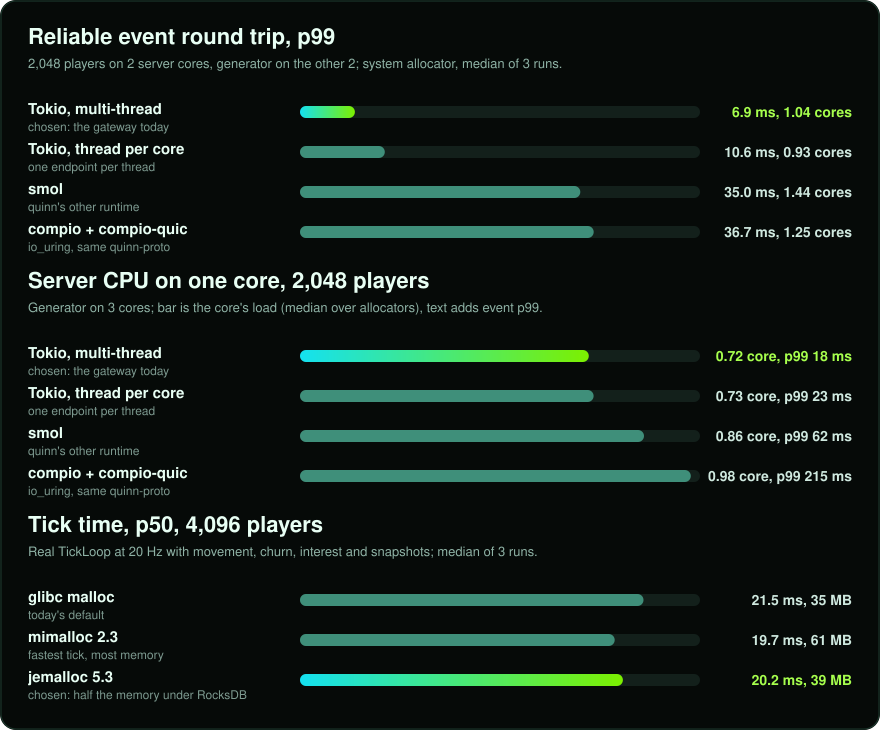

**We keep Tokio's multi-thread runtime and switch the server binaries to jemalloc.**

| Option | Event p99, 2,048 players | Players per core | Tick p50 | Memory under RocksDB | Why or why not |
|---|---:|---:|---:|---:|---|
| **Tokio, multi-thread** | **6.9 ms** | **3,072** | | | **Chosen**: lowest p99 and most players per core; what the gateway runs today. |
| Tokio, thread per core | 10.6 ms | 2,560 | | | 9% less CPU, but a higher p99 and fewer players per core. |
| smol | 33.8 ms | 2,048 | | | Same quinn code, 40% more CPU; lost clients at 4,096. |
| compio on io_uring | 36.7 ms | 1,536 | | | Slowest gateway at every load; io_uring did not help QUIC here. |
| glibc malloc | | | 21.5 ms | 157 to 172 MB | The fallback: same gateway, slowest tick, twice jemalloc's memory. |
| mimalloc | | | 19.7 ms | 107 to 409 MB | Fastest tick by 3%, but the most memory and the least steady. |
| **jemalloc** | | | **20.2 ms** | **80 to 92 MB** | **Chosen**: never slower, least memory where memory grew. |

- The allocator made no difference to the gateway, and no clear difference to RocksDB throughput in two runs each.
- Players per core: every client connected and every message delivered with p99 under 200 ms, server on one core
  and the load generator on three.
- Caveats: one 4-core VM; runs of 30 to 60 s, so long-run fragmentation is not covered; at 4,096 players on 2
  cores the load generator was at its limit, so those runs rank the runtimes but do not set Tokio's ceiling.

Full results, method, licences, the reasoning for each option and how to reproduce:
[docs/research/allocator-runtime](docs/research/allocator-runtime/).

## The real server under load, measured

The server and the load-test bots ran on the project's own machines: a 4-core server machine (two cores for the
server, two for local bots) and a second machine sending bots over the network. Bots walk, run and drive in a
1.5 km square, the dense crowd of the plan's gates, at 20 Hz.

| Players | Gateway threads | Tick p99 (budget 35 ms) | Overruns | Snapshots delivered | Server cores |
|---:|---:|---:|---:|---:|---:|
| 3,800 | 1 | 23.8 to 24.4 ms | 0 | 96 to 99% | 1.41 to 1.42 |
| 4,096 | 1 | 28.4 to 30.5 ms | 0 | 88 to 93% | 1.48 to 1.51 |
| 4,096 | 2 | 38.0 to 39.1 ms | 0 | 100% | 1.85 to 1.86 |

- **3,800 players fit with room to spare**, which meets phase 1's gate (3,000 bots, p99 under 35 ms, on a dedicated
  4-core machine).
- **At 4,096 players the tick is not the limit, the gateway is.** The tick used half a core; the gateway the rest.
  On two cores the server either drops some snapshots or runs over its p99 budget, never over a whole tick.
  A server with more cores gives the gateway threads of its own; the stand could not drive one, so that is not
  measured yet.
- Phase 2's gate (4,096 bots from a second machine) is not met yet: most bots ran on the server's machine, and no
  configuration kept the budget without dropping snapshots.
- Runs with a saturated load generator were thrown out; the page says which and why. The 4,096 runs used the
  server and bots of BOT-6 (#141), not merged at the time.

Full results, method and limits: [docs/research/two-machine-load](docs/research/two-machine-load/).

## How it is built

Most of the code is written by AI coding agents working as a swarm, under rules that keep the work small,
reviewable and safe to host.

1. **Tasks are issues** with an ID by area (`NET-`, `SRV-`, `IM-`, `DB-`, `BOT-`, `OPS-`, ...). A maintainer labels
   a task `ready`.
2. **An agent claims it** with a `/claim` comment and opens a draft pull request within 72 hours.
3. **CI checks every change**: formatting, clippy, tests, dependency licences and advisories, and a scan that keeps
   game data out.
4. **A review agent** comments on each pull request with a risk tier, policy checks and findings. It never runs
   pull request code and does not merge.
5. **A maintainer merges**, squash only.

## This repository contains no game data

Nothing from the game is or will be in this repository: no archives, executables, assets or keys. You need your own
copy of the game. Nothing here decrypts or works around any protection.

## Contributing

Contributors working with **Claude Opus 5.5 or Claude Fable** are welcome; work from other AI agents is not
accepted. Read [CONTRIBUTING.md](CONTRIBUTING.md); agents start with
[AGENTS.md](AGENTS.md). Pick an issue labelled
[`ready`](https://github.com/sawgrass-mp/sawgrass/issues?q=is%3Aissue+is%3Aopen+label%3Aready+-label%3Aclaimed),
comment `/claim`, and open a draft pull request. Security issues go through [SECURITY.md](SECURITY.md).

## Community

News, progress updates and announcements are posted on the project's official channels:

| Channel | Link |
|---|---|
| **Telegram** | [t.me/sawgrass_mp](https://t.me/sawgrass_mp) |
| **X** | [x.com/sawgrass_mp](https://x.com/sawgrass_mp) |

These are the only official accounts. Questions about the code, bug reports and proposals go to
[GitHub issues](https://github.com/sawgrass-mp/sawgrass/issues).

## Licence

[GNU Affero General Public License v3.0](LICENSE). If you run a modified server for others, you must publish your
changes.

Grand Theft Auto and Grand Theft Auto VI are trademarks of Take-Two Interactive Software. This project is not
affiliated with or endorsed by Take-Two Interactive or Rockstar Games.
