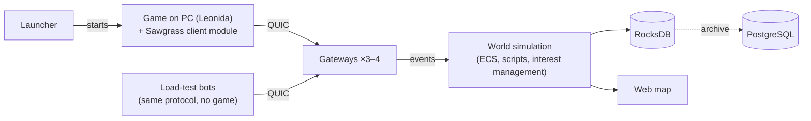

  

<h3 align="center">An open-source multiplayer roleplay server, built for 4096 players in one world</h3>

  
  
  
  
  

  <a href="#where-the-project-is">Status</a> ·
  <a href="#progress">Progress</a> ·
  <a href="#how-it-fits-together">Architecture</a> ·
  <a href="#storage-measured">Storage</a> ·
  <a href="#network-transport-measured">Transport</a> ·
  <a href="#how-it-is-built">How it is built</a> ·
  <a href="#contributing">Contributing</a>

---

Sawgrass is a multiplayer roleplay platform for Grand Theft Auto VI, written in Rust: a dedicated server that holds
**4096 players in one world**, with roleplay game modes written as sandboxed scripts.

## Where the project is

> [!IMPORTANT]
> **There is no playable build, and there cannot be one yet.** The game does not run on PC. Players will run it
> through [Leonida](https://github.com/ItsNotRexed/Leonida), a static recompilation of the Xbox Series build that
> does not boot to a world yet.

So the work is split in two:

| | Side | State |
|---|---|---|
| 🟢 | **Server, protocol, storage, scripting** | Being built now. Everything is tested and load-tested with headless bots that speak the real protocol, no game needed. |
| ⏸️ | **Client module and launcher** | Waiting. Work starts when the game boots on PC through Leonida with a controllable character. |

## Progress

<!-- progress:start (generated by scripts/progress.py; do not edit by hand) -->

**Current stage: 1, server without the game.** 56% of the planned tasks are done, weighted by size (S = 1, M = 3, L = 8). New tasks are added as stages open, so the percentage measures the work planned so far, not the distance to a release.

| Stage | Progress | State |
|---|---|---|
| **Stage 0: Repository foundation** Rules, CI, claim bot, review agent | `████████████████████` 100% | done |
| **Stage 1: Server without the game** Gates: 1000 bots on one machine, then 4096 | `██████████░░░░░░░░░░` 50% | 3 of 6 tasks done |
| **Stage 2: Roleplay base** PostgreSQL, scripting, characters, money, jobs | `░░░░░░░░░░░░░░░░░░░░` 0% | 0 of 1 task done |
| **Stage 3: Client in the game** Waits until the game boots on PC through Leonida | `░░░░░░░░░░░░░░░░░░░░` 0% | waiting for the game |
| **Stage 4: Launcher and releases** Signing, auto-update, server list | `░░░░░░░░░░░░░░░░░░░░` 0% | not started |
| **Stage 5: Scale** Real players; zones only if measurements call for them | `░░░░░░░░░░░░░░░░░░░░` 0% | not started |
| **Tooling and docs** CI gates, review agent, documentation | `█████████████░░░░░░░` 64% | 2 of 6 tasks done |

<b>Tasks</b>: 5 done, 1 in review, 0 in progress, 0 ready, 7 planned

| | Task | Size | Status |
|---|---|---|---|
| ✅ | [NET-1](https://github.com/sawgrass-mp/sawgrass/issues/2): Packet format and quantization | S | done |
| ⚪ | [NET-2](https://github.com/sawgrass-mp/sawgrass/issues/3): Client\-to\-gateway connection over QUIC | M | planned |
| ✅ | [SRV-1](https://github.com/sawgrass-mp/sawgrass/issues/5): Tick loop with metrics | M | done |
| ✅ | [IM-1](https://github.com/sawgrass-mp/sawgrass/issues/4): Spatial grid and visible sets | M | done |
| ⚪ | [BOT-1](https://github.com/sawgrass-mp/sawgrass/issues/6): Headless bot client | M | planned |
| ⚪ | [BOT-2](https://github.com/sawgrass-mp/sawgrass/issues/7): Load report for N bots | S | planned |
| 🔍 | [DB-1](https://github.com/sawgrass-mp/sawgrass/issues/8): Character and wallet schema | S | in review |
| ⚪ | [OPS-1](https://github.com/sawgrass-mp/sawgrass/issues/9): Benchmark regression gate | M | planned |
| ⚪ | [OPS-2](https://github.com/sawgrass-mp/sawgrass/issues/10): Markdown link check | S | planned |
| ⚪ | [OPS-3](https://github.com/sawgrass-mp/sawgrass/issues/11): Protocol version gate | S | planned |
| ✅ | [OPS-4](https://github.com/sawgrass-mp/sawgrass/issues/12): Review agent, comment\-only mode | L | done |
| ⚪ | [DOC-1](https://github.com/sawgrass-mp/sawgrass/issues/13): Wire format in architecture\.md | S | planned |
| ✅ | [DOC-2](https://github.com/sawgrass-mp/sawgrass/issues/23): README with project status and generated progress | M | done |

Generated by `scripts/progress.py` from the task issues and [docs/roadmap.md](docs/roadmap.md). The reviewer session refreshes it; see [docs/maintainers.md](docs/maintainers.md#readme-progress).

<!-- progress:end -->

## How it fits together

- **World simulation** (`crates/sawgrass-server`): one multithreaded process with every entity in an ECS. It owns
  authority decisions, runs the game-mode scripts and decides who sees what.
- **Gateways** hold player connections over QUIC and build each player's snapshot. They scale out, because outgoing
  traffic, not simulation, is the bottleneck.
- **Protocol** (`crates/sawgrass-protocol`): the wire format every peer shares, with quantized positions and
  rotations.
- **Roleplay state** (characters, money, inventory, property) is held by the world server and stored in RocksDB;
  **PostgreSQL** is its archive. Why: [Storage, measured](#storage-measured).
- **Client module**: loaded by Leonida's runtime on the player's PC; syncs the local game with the server.
- **Launcher**: checks the player's Leonida build, installs the signed client module and starts the game.

| Budget | Target |
|---|---|
| Players in one world | 4096 |
| Server tick | 20–30 Hz, p99 tick time under 70% of the interval |
| Entities sent to one player | about 100–150 nearby, by priority |
| Downstream per player | about 40 KB/s at 100 visible entities |

The design is in [docs/architecture.md](docs/architecture.md), the stages in [docs/roadmap.md](docs/roadmap.md).

## Storage, measured

Roleplay state with money in it needs storage that is both reliable and fast: money is never created or lost,
and a change the server has confirmed survives a crash. We measured eleven designs on the same money ledger, with
the same rules and load, counting a transfer only once it was written to disk.

**We chose RocksDB behind one writer in the world server** ([ADR 0003](docs/adr/0003-in-memory-roleplay-state.md)).
The server keeps roleplay state in memory, one writer applies every change, and each batch of changes is one
RocksDB write flushed to disk before anyone gets a reply. PostgreSQL stays as an archive for history and admin
queries.

| Design | Durable transfers/s | Over 5 minutes (p99) | Why or why not |
|---|---:|---:|---|
| Own log in the server | 72,781 | 73,828 (1.4 ms) | Fastest, but we would have to build and maintain a storage engine. Kept as a later optimisation. |
| **RocksDB in the server** | **51,542** | **55,480 (1.9 ms)** | **Chosen**: fastest proven engine, about 45 times the expected peak load. |
| Fjall in the server | 43,836 | 40,107 (3.2 ms) | Pure Rust, but slower and far younger. First fallback. |
| LMDB in the server | 36,968 | 32,941 (3.7 ms) | Mature, but slower and needs a fixed maximum size. |
| redb, SQLite in the server | 24,042 to 29,142 | not run | About half of RocksDB or less. |
| SpacetimeDB | 11,352 | not run | About 4.5 times slower, extra network hop, licence allows one production instance. |
| PostgreSQL | 3,437 to 5,666 | not run | Under 1,000 on one hot wallet. Kept as the archive. |

- Speed comes from the design, not the database: one writer with state in memory and one disk flush per batch was
  2 to 20 times faster than any database server.
- In 21 kill -9 tests under load (our own log, RocksDB, Fjall, LMDB, redb, SQLite), no confirmed transfer was lost.
  RocksDB dropped only an unconfirmed, cut-off last batch, and refused to start on any damaged record, even the
  last one; then an operator restores from the second machine's copy.
- Not ranked: SQLite's fast mode (`synchronous=NORMAL`) can lose confirmed transfers on a power cut, and TigerBeetle
  could only run in development mode here, without the Direct I/O it relies on.
- Caveats: one 4-core VM; single runs with up to 20% spread; process kills, not power cuts; the copy to a second
  machine and the PostgreSQL archive are not built yet.

Full results, crash tests, licences, the reasoning for each option and how to reproduce:
[docs/research](docs/research/spacetimedb-vs-postgresql/).

## Network transport, measured

Players connect to gateways over the network, so the transport decides how fast an event arrives when packets are
lost, and how much CPU 4096 connections cost. We ran the same server and clients over five transports, through the
same lossy link, and with 1,000 and 4,096 players at 20 Hz.

**We keep QUIC through quinn**, as [docs/architecture.md](docs/architecture.md) planned: unreliable datagrams for
movement and snapshots, streams for reliable events.

| Transport | Encrypted | Reliable event p99, 1% / 5% / 10% loss | Server CPU, 4,096 players | Why or why not |
|---|---|---:|---:|---|
| **QUIC (quinn)** | **yes** | **102 / 151 / 202 ms** | **1.94 cores** | **Chosen**: best under loss, encrypted, uses several cores, no connection limit. |
| GameNetworkingSockets | yes | 161 / 221 / 313 ms | 1.32, fell behind | Slower under loss; 1.2 GB and dropped connections near 4,096; C++ build. |
| ENet | no | 100 / 151 / 1,096 ms | 0.77 | Cheap, but no encryption, 4,095 peers per host, slow at high loss. |
| renet | yes | 341 / 643 / 844 ms | 0.98, fell behind | 300 ms resend by default; one thread was full at 1,000 players. |
| Plain UDP | no | none | 0.46 | The floor: reliability and encryption would be ours to build. |

- Every transport answered in under half a millisecond without loss, so latency does not separate them; behaviour
  under loss and CPU do.
- quinn's price is CPU, about four times plain UDP per player: about 2 cores of this VM for 4096 players, spread
  over the 3 to 4 gateways the architecture plans.
- Caveats: one 4-core VM with server and clients together; loss from our own relay (random, no bursts); single
  runs; default settings for every library; renet and GNS fell behind at 4,096 while the load generator was also
  near its limit.

Full results, method, licences, the reasoning for each option and how to reproduce:
[docs/research/network-transport](docs/research/network-transport/).

## How it is built

Most of the code is written by AI coding agents working as a swarm, under rules that keep the work small,
reviewable and safe to host.

1. **Tasks are issues** with an ID by area (`NET-`, `SRV-`, `IM-`, `DB-`, `BOT-`, `OPS-`, ...). A maintainer labels
   a task `ready`.
2. **An agent claims it** with a `/claim` comment and opens a draft pull request within 72 hours.
3. **CI checks every change**: formatting, clippy, tests, dependency licences and advisories, and a scan that keeps
   game data out.
4. **A review agent** comments on each pull request with a risk tier, policy checks and findings. It never runs
   pull request code and does not merge.
5. **A maintainer merges**, squash only.

## This repository contains no game data

Nothing from the game is or will be in this repository: no archives, executables, assets or keys. You need your own
copy of the game. Nothing here decrypts or works around any protection.

## Contributing

Contributors working with **Claude Opus 5.5 or Claude Fable** are welcome; work from other AI agents is not
accepted. Read [CONTRIBUTING.md](CONTRIBUTING.md); agents start with
[AGENTS.md](AGENTS.md). Pick an issue labelled
[`ready`](https://github.com/sawgrass-mp/sawgrass/issues?q=is%3Aissue+is%3Aopen+label%3Aready+-label%3Aclaimed),
comment `/claim`, and open a draft pull request. Security issues go through [SECURITY.md](SECURITY.md).

## Licence

[GNU Affero General Public License v3.0](LICENSE). If you run a modified server for others, you must publish your
changes.

Grand Theft Auto and Grand Theft Auto VI are trademarks of Take-Two Interactive Software. This project is not
affiliated with or endorsed by Take-Two Interactive or Rockstar Games.
