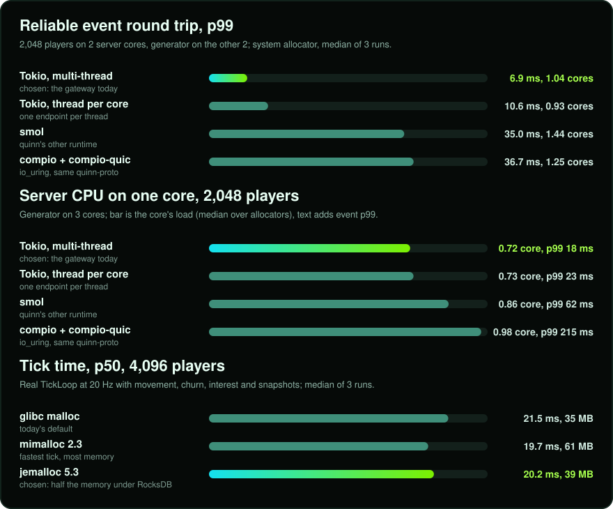

# Memory allocators and async runtimes: what we measured and what we chose

Measured 2026-11-24 with Rust 1.97.0 on the Sawgrass tree at NET-2 (c33723a). Allocators: glibc malloc (the
system allocator), mimalloc 2.3.2 through the `mimalloc` 0.1.52 crate, and jemalloc 5.3 through
`tikv-jemallocator` 0.7.0. Runtimes: Tokio 1.54.1, smol 2.0.2, and compio 0.19.2 on io_uring with compio-quic
0.8.2. quinn 0.11.12 (quinn-proto 0.11.19, rustls 0.23.46 with ring), RocksDB 10.4.2 through `rocksdb` 0.24.0.
Task: SRV-5 (#70).

The question: which allocator and which async runtime should the server use, for 4096 players, fast and reliable
together? The gateway (`sawgrass-gateway`) runs quinn on Tokio's multi-thread runtime today, and every binary uses
glibc malloc. Keeping either was not a goal; this page measures both against the alternatives on three of the
project's own paths: the QUIC gateway, the world tick, and RocksDB writes.

## Short answer

**We keep Tokio's multi-thread runtime for the gateway, and switch the server binaries to jemalloc.**

- **Runtime.** Tokio had the lowest reliable event p99 at 2,048 players (6.9 ms, against 34 to 37 ms for smol and
  compio) and carried the most players on one core: 3,072 with every message delivered and p99 under 200 ms, against
  2,560 for Tokio thread per core, 2,048 for smol and 1,536 for compio on io_uring. io_uring did not
  make the QUIC gateway faster here.
- **Allocator.** The allocator made no measurable difference to the gateway. In the tick it cut p50 by 6%
  (jemalloc) or 8% (mimalloc). Under RocksDB writes jemalloc used about half the memory of glibc (80 to 92 MB
  against 157 to 172 MB) and less than mimalloc in every run; mimalloc's also varied most between runs.
  jemalloc is the only option that was never slower and used least memory where memory grew.

See [What we chose and why](#what-we-chose-and-why).

<p align="center"></p>

| Runtime | Event p99, 2,048 players, 2 cores | Server CPU, same | Players one core carries (all delivered, p99 under 200 ms) |
|---|---:|---:|---:|
| **Tokio, multi-thread** | **6.9 ms** | **1.02 cores** | **3,072** |
| Tokio, 2 endpoints (SO_REUSEPORT) | 8.5 ms | 0.99 cores | not run on one core |
| Tokio, thread per core | 10.6 ms | 0.93 cores | 2,560 |
| smol | 33.8 ms | 1.42 cores | 2,048 |
| compio + compio-quic (io_uring) | 36.7 ms | 1.25 cores | 1,536 |

| Allocator | Tick p50 / p99, 4,096 players | Tick memory | RocksDB ledger memory, closed loop | Gateway, 2,048 players |
|---|---:|---:|---:|---|
| glibc malloc | 21.5 / 34.9 ms | 35 MB | 157 to 172 MB | baseline |
| mimalloc 2.3 | 19.7 / 32.2 ms | 61 MB | 107 to 409 MB | same p99 and CPU, +26% memory |
| **jemalloc 5.3** | **20.2 / 32.7 ms** | **39 MB** | **80 to 92 MB** | **same p99 and CPU, +5% memory** |

Medians over runs. The tick p99 differences (31 to 37 ms in every run) are inside the spread between runs.

## What was compared

### Allocators

Each allocator is a separate build of the same binary (`--features mimalloc` or `--features jemalloc`). Both
replace `malloc` for the whole process (`mimalloc` with `override`, `tikv-jemallocator` with
`unprefixed_malloc_on_supported_platforms`; `nm` showed `malloc` defined in both binaries), so RocksDB's C++ code
allocates through the same allocator as the Rust code. No allocator setting was tuned.

### Runtimes

| Runtime | How the gateway runs on it |
|---|---|
| Tokio, multi-thread | One quinn endpoint, a 2-thread runtime, as `sawgrass-gateway` does today. |
| Tokio, 2 endpoints | The same runtime, two endpoints on one port with `SO_REUSEPORT`, so the kernel spreads clients. |
| Tokio, thread per core | One `current_thread` runtime per thread, each with its own `SO_REUSEPORT` endpoint. |
| smol | quinn's `runtime-smol` on smol's global executor with `SMOL_THREADS` threads. |
| compio | One compio runtime per thread on io_uring (the driver reported `IoUring`), each with a compio-quic endpoint on its own `SO_REUSEPORT` socket. compio-quic wraps the same quinn-proto 0.11.19 as quinn. |

Left out:

- **monoio and glommio.** quinn has no runtime for them, and its `Runtime` and `AsyncUdpSocket` traits are
  readiness based, while both are completion based (io_uring) and lend buffers to the kernel. A gateway on either
  would mean writing our own QUIC driver around quinn-proto, which is what compio-quic already is. compio stands
  for this family; monoio's last release is 0.2.4 (August 2024) and glommio's 0.9.0 (March 2024).
- **async-std.** Discontinued in favour of smol, which is measured.

### Tests

All on one VM: 4 vCPUs (Intel Xeon, 2.1 GHz), 16 GB, Linux 6.18, socket buffers raised to 16 MB. Every process is
pinned with `sched_setaffinity`. Repetitions are interleaved (every variant once, then every variant again).

- **Gateway** ([`gw.rs`](bench/src/gw.rs), [`cgw.rs`](bench/src/cgw.rs)). The gateway's QUIC settings (30 s idle
  timeout, 5 s keep-alive, 256 KiB windows, 64 KiB datagram buffer), its hello and version handshake, and the
  NET-5 traffic: each client sends 64-byte state datagrams 20 times a second and one 100-byte reliable event a
  second on a stream, which the server echoes; the server sends each client one 800-byte snapshot datagram (the
  NET-5 delta) per 20 Hz tick. Measured: the round trip of reliable events (p50, p99, p99.9, max), the share of
  snapshots and events delivered, server CPU, the busiest server thread and peak memory, over 30 s after 5 s of
  warm-up. The load generator ([`load.rs`](bench/src/load.rs)) is the same build for every variant (Tokio, glibc).
  - 2,048 and 4,096 players: server on CPUs 0 and 1, generator on 2 and 3; 3 runs at 2,048, 2 at 4,096.
  - One core: server on CPU 0, generator on 1 to 3; 1,536 to 3,072 players, one run per allocator.
- **Tick** ([`tick.rs`](bench/src/tick.rs)). `sawgrass_server::TickLoop` at 20 Hz with 4,096 players and 4,096
  other entities in the IM-1 city (3 km square): movement, 40 entities despawned and spawned per tick with a
  name and an inventory, the spatial grid and each player's visible set, and a snapshot per player (header plus up
  to 150 encoded `EntityState`s) handed to 2 gateway threads, which free them. Also 200 formatted event strings a
  tick. 200 ticks of warm-up, then 1,200 ticks (60 s) measured with `TickMetrics`; 3 runs per allocator, on CPUs 0
  to 2.
- **Ledger** ([`ledger.rs`](bench/src/ledger.rs)). The DB-4 RocksDB ledger: one writer thread groups waiting
  transfers into one `WriteBatch` with `sync=true` and replies after it returns; 64 caller tasks on Tokio (2
  workers) or compio (2 threads). Closed loop (each caller waits for its reply, then sends the next) and an open
  loop of 2,000 transfers a second, latency counted from when each transfer was due. 30 s, 2 runs each.

## Results

### Gateway

| Runtime, 2,048 players on 2 cores | Event p50 | p99 | p99.9 | Server CPU | Busiest thread | Peak memory |
|---|---:|---:|---:|---:|---:|---:|
| Tokio, multi-thread | 0.3 ms | 6.9 ms | 14.7 ms | 1.02 | 0.51 | 101 MB |
| Tokio, 2 endpoints | 0.3 ms | 8.5 ms | 19.5 ms | 0.99 | 0.50 | 101 MB |
| Tokio, thread per core | 0.3 ms | 10.6 ms | 33.1 ms | 0.93 | 0.50 | 99 MB |
| smol | 0.9 ms | 33.8 ms | 54.5 ms | 1.42 | 0.69 | 101 MB |
| compio | 0.4 ms | 36.7 ms | 85.7 ms | 1.25 | 0.67 | 113 MB |

Medians of 9 runs (3 per allocator). Every run connected all 2,048 clients, delivered every event and at least
99.9% of snapshots. The generator used 1.0 to 1.3 of its 2 cores (busiest thread 0.66).

| One server core | 1,536 | 2,048 | 2,560 | 3,072 |
|---|---|---|---|---|
| Tokio, multi-thread | 0.55 to 0.62 core, p99 11 to 20 ms | 0.72 to 0.81, 16 to 29 ms | 0.88 to 0.95, 55 to 70 ms | 0.99, 101 to 123 ms, all delivered |
| Tokio, thread per core | 0.53 to 0.58, 12 to 20 ms | 0.72 to 0.77, 21 to 49 ms | 0.89 to 0.93, 98 to 134 ms | 0.98 to 1.00, 0.55 to 2.8 s |
| smol | 0.64 to 0.67, 30 to 49 ms | 0.82 to 0.86, 51 to 187 ms | 0.95 to 0.99, 0.28 to 2.1 s | saturated, up to 1.5% of events lost |
| compio | 0.80 to 0.85, 111 to 151 ms | 0.97 to 0.99, 151 to 754 ms | saturated, 1 to 9% lost | saturated, 7 to 8% lost, 65 to 82 clients not connected |

Ranges over the three allocators. The generator's busiest thread stayed under 0.7 of a core in every one-core run,
so these limits are the server's.

At **4,096 players on 2 cores** the generator was at its limit (busiest thread 0.95 to 0.96 of a core), so these
runs only rank the runtimes, they do not measure Tokio's ceiling: Tokio (all three setups) connected every client
and delivered everything with p99 62 to 205 ms (medians 88 to 112 ms) at 1.6 to 1.9 cores; compio delivered everything but with p99 0.5 to
1.4 s and its busiest thread at 0.99; smol did not connect 3 to 84 clients and lost up to 7% of events.

Why compio and smol cost more here was not profiled. compio-quic is its own endpoint driver around quinn-proto,
not quinn on a different runtime, so the gap is compio-quic plus io_uring, not io_uring alone. quinn on smol runs
the same quinn code as on Tokio, through async-io's reactor.

### Tick

| Allocator | p50 (3 runs) | p99 (3 runs) | Max | Overruns of 3,600 ticks | Memory | CPU |
|---|---|---|---:|---:|---:|---:|
| glibc malloc | 21.2, 21.5, 21.8 ms | 31.6, 36.5, 34.9 ms | 42 to 76 ms | 3 | 35 MB | 0.46 |
| mimalloc | 19.5, 19.7, 19.8 ms | 32.2, 31.1, 33.5 ms | 37 to 58 ms | 3 | 61 MB | 0.41 |
| jemalloc | 20.5, 20.2, 19.9 ms | 33.6, 32.7, 30.5 ms | 40 to 55 ms | 1 | 39 MB | 0.42 |

Every mimalloc and jemalloc run had a lower p50 than every glibc run: 8% and 6% lower at the median. p99 and the
longest tick overlap between allocators. One glibc run went over the architecture's 35 ms p99 budget and every
run is within 5 ms of it; the tick in this harness is not the optimised one (IM-2 has since replaced the visible sets), and that is the subject
of other tasks. A run on the IM-2 tree with glibc gave p50 22.4 ms and p99 31.7 ms, in the same range.

### Ledger (RocksDB)

| Callers on | Allocator | Closed loop: transfers/s | p99 | Memory | Open, 2,000/s: p50 | p99 | Memory |
|---|---|---|---|---|---|---|---|
| Tokio | glibc | 56,914; 53,469 | 2.2; 2.7 ms | 162; 157 MB | 1.7 ms | 3.4; 3.5 ms | 22 MB |
| Tokio | mimalloc | 60,699; 58,934 | 2.4; 2.6 ms | 409; 121 MB | 1.7; 1.8 ms | 3.8; 4.0 ms | 49 MB |
| Tokio | jemalloc | 64,996; 60,186 | 2.2; 2.6 ms | 91; 92 MB | 1.5; 1.6 ms | 3.5; 6.4 ms | 17 MB |
| compio | glibc | 60,677; 64,967 | 2.7; 2.4 ms | 167; 172 MB | 0.4 ms | 2.2; 2.0 ms | 21 MB |
| compio | mimalloc | 60,757; 69,830 | 2.6; 2.0 ms | 373; 107 MB | 0.5; 0.4 ms | 2.7; 2.2 ms | 48 MB |
| compio | jemalloc | 60,402; 64,443 | 2.4; 2.2 ms | 80; 90 MB | 0.5; 0.4 ms | 2.5; 2.2 ms | 16 MB |

Two runs each, separated by `;`. With Tokio callers, jemalloc and mimalloc committed more than glibc in both runs;
with compio callers they did not, and two runs of one variant differ by up to 15%. We do not claim a throughput
difference from two runs.
Memory does change: jemalloc held 80 to 92 MB in all four closed-loop runs, glibc 157 to 172 MB, and mimalloc
between 107 and 409 MB. At 2,000 transfers a second, callers on compio saw p50 0.4 ms against 1.7 ms on Tokio:
waking a caller on its own thread is cheaper than Tokio's cross-thread wake-up. Both are far below a tick.

### Was the comparison fair?

- **The load generator is the same for every variant**, a separate build with glibc on Tokio, on its own CPUs.
  Its load is reported with every run; results where it was near its cores (4,096 players on 2 cores) are used to
  rank, not as limits.
- **Not the same QUIC code for compio.** compio-quic drives quinn-proto itself; the other four use quinn. That is
  the only maintained way to run QUIC on io_uring in Rust today, so it is what choosing io_uring would mean.
- **Defaults.** No runtime or allocator setting was tuned: no `MALLOC_ARENA_MAX`, no jemalloc `background_thread`
  or decay settings, no Tokio `event_interval` or `global_queue_interval`, no io_uring `SQPOLL`.
- **Short runs.** 30 to 60 s each. Fragmentation that builds up over days, which is where allocators differ most,
  is not covered; the memory figures here are a lower bound on those differences, not a measure of them.
- **A harness bug was fixed before the ledger runs.** The first ledger runs with compio held a mutex across an
  await, which blocked one of its two threads; those results were discarded and all ledger runs repeated.

### What was not measured

- Runs of hours or days, and memory growth over them.
- Larger machines, clients on other machines, or the load generator off the server's VM. Tokio's ceiling at 4,096
  players on 2 cores is therefore not established.
- Tuned settings for any allocator or runtime, and Tokio with more than 2 worker threads.
- io_uring for RocksDB's own I/O (RocksDB has an io_uring option for reads) and for the write-ahead log.
- A profile of why compio-quic and smol cost more per player.
- The real gateway crate's code: the harness copies its settings and handshake but not its session handling. The
  real world simulation, with scripting and real game modes, does not exist yet.

## What we chose and why

**Tokio, multi-thread, for the gateway, as now.**

- **Fastest reliable events**: p99 6.9 ms at 2,048 players, 1.5 times better than thread per core and 5 times
  better than smol or compio, with the same CPU as thread per core within 10%.
- **Most players per core**: 3,072 on one core with every message delivered. The architecture runs 3 to 4
  gateways, about 1,000 to 1,400 players each; on this VM that is about half a core each.
- **No change and no new code**: quinn's own runtime, the one quinn is tested on most, with the largest set of
  libraries around it (RocksDB callers, timers, channels).

**jemalloc for the server binaries** (gateway, world server, bots), set with `#[global_allocator]` and the
unprefixed `malloc` override so RocksDB uses it too.

- **Never slower**: the same gateway figures as glibc, 6% lower tick p50, and RocksDB throughput at least as
  high in every run.
- **Least memory where memory grew**: about half of glibc's under RocksDB writes, and steady between runs, where
  mimalloc's ranged from 107 to 409 MB. A server that runs for days is where glibc's per-thread arenas are known to
  fragment; jemalloc is built to limit fragmentation, and these short runs already show its smaller footprint.
- **A one-line change both ways**: going back is removing the `#[global_allocator]` line.

This page does not change any crate. Adding the allocator to the server binaries is a follow-up task.

### Why not the others

| Option | Measured | Why not |
|---|---|---|
| Tokio, thread per core | 10.6 ms p99, 0.93 cores at 2,048; 2,560 per core | 9% less CPU than multi-thread, but a higher p99 and 512 fewer players per core, and a slow thread cannot hand work to the others. Worth measuring again if the gateway becomes CPU bound. |
| Tokio, 2 endpoints | 8.5 ms p99 at 2,048 | No gain over one endpoint at this size; one endpoint is simpler. |
| smol | 33.8 ms p99, 1.42 cores at 2,048; 2,048 per core | Five times the p99 and 40% more CPU than Tokio on the same quinn code, and it lost clients and events at 4,096. |
| compio on io_uring | 36.7 ms p99, 1.25 cores at 2,048; 1,536 per core | The slowest gateway at every load. io_uring made the ledger callers' wake-ups faster (0.4 against 1.7 ms p50), but that is far below a tick and does not justify a second runtime. compio-quic is also younger and less used than quinn. |
| monoio, glommio | not measured | No quinn runtime: QUIC on them is our own driver around quinn-proto. Their last releases are from 2024. |
| glibc malloc | baseline | Twice jemalloc's memory under RocksDB and the slowest tick p50; kept only as the fallback. |
| mimalloc | fastest tick p50 (19.7 ms) | 3% faster tick than jemalloc, but the most memory everywhere (61 MB against 39 MB in the tick, up to 409 MB under RocksDB) and the least predictable. |

jemalloc's maintenance: Meta archived the upstream repository in 2025 and unarchived it in March 2026, saying it
will keep developing jemalloc with the community, without a release plan yet. The Rust crate `tikv-jemallocator`
is maintained by the TiKV project and builds jemalloc 5.3 from source. If jemalloc stopped being maintained,
mimalloc is the replacement with the numbers above.

### What would change the answer

- Long runs (BOT-2) show glibc or mimalloc holding memory steady as well as jemalloc, or jemalloc growing.
- The gateway becomes CPU bound on real hardware: then thread per core, and a profile of the gap to compio-quic,
  are next.
- A maintained quinn runtime on io_uring appears that matches Tokio here.

## Licences

Checked against the manifests and licence files of the versions used. Sawgrass is AGPL-3.0.

| Component | Licence | Fits AGPL-3.0 |
|---|---|---|
| tikv-jemallocator, tikv-jemalloc-sys | MIT OR Apache-2.0; jemalloc itself BSD-2-Clause | Yes |
| mimalloc (crate), libmimalloc-sys | MIT; mimalloc itself MIT | Yes |
| Tokio | MIT | Yes |
| smol | Apache-2.0 OR MIT | Yes |
| compio, compio-quic | MIT; io-uring MIT OR Apache-2.0 | Yes |
| quinn, quinn-proto | MIT OR Apache-2.0 | Yes |
| rocksdb, librocksdb-sys | Apache-2.0 (RocksDB is Apache-2.0 OR GPL-2.0) | Yes |

All of these licences are in the allow list of `deny.toml`. The harness is a standalone crate outside the
workspace, so none of its dependencies reach the project's dependency graph.

## Reproduce

Build one binary per allocator. RocksDB needs a C++ compiler and libclang (`LIBCLANG_PATH` pointing at the
directory with `libclang.so` if it is not found):

```sh
cd bench
cargo build --release && mkdir -p bin && cp target/release/runtime-bench bin/runtime-bench-system
cargo build --release --features mimalloc && cp target/release/runtime-bench bin/runtime-bench-mimalloc
cargo build --release --features jemalloc && cp target/release/runtime-bench bin/runtime-bench-jemalloc
cd ..
```

Raise the socket buffer and open-file limits, then run the suites. Each appends one JSON line per run to
`results/`. The gateway suites need at least 4 cores and io_uring enabled (`/proc/sys/kernel/io_uring_disabled`
at 0) for compio.

```sh
sysctl -w net.core.rmem_max=16777216 net.core.wmem_max=16777216
ulimit -n 20000
python3 -I run.py tick --reps 3                     # about 11 minutes
python3 -I run.py ledger --reps 2                   # about 13 minutes
python3 -I run.py gateway --players 2048 --reps 3   # about 45 minutes
python3 -I run.py gateway --players 4096 --reps 2   # about 40 minutes
python3 -I run.py capacity                          # about 60 minutes
python3 -I chart.py                                 # redraws docs/assets/runtime.svg
```

Or by hand:

```sh
bench/bin/runtime-bench-system server tokio-mt 127.0.0.1:7400 2         # tokio-mt, tokio-tpc, smol, compio
bench/bin/runtime-bench-system load 127.0.0.1:7400 2048 2 30            # clients, threads, seconds
bench/bin/runtime-bench-jemalloc tick 4096 200 1200                     # players, warm-up ticks, ticks
bench/bin/runtime-bench-jemalloc ledger tokio /tmp/ledger 64 closed 30  # or a rate: 2000
```

## Sources

- quinn's runtime traits (`Runtime`, `AsyncUdpSocket`): the quinn 0.11.12 source, `quinn/src/runtime.rs`.
- compio-quic: <https://github.com/compio-rs/compio>, `compio-quic` 0.8.2.
- monoio and glommio release dates: crates.io pages of `monoio` 0.2.4 and `glommio` 0.9.0.
- jemalloc's status: Meta Engineering, "Investing in infrastructure: Meta's renewed commitment to jemalloc",
  <https://engineering.fb.com/2026/03/02/data-infrastructure/investing-in-infrastructure-metas-renewed-commitment-to-jemalloc/>.
- The ledger: [DB-4](../spacetimedb-vs-postgresql/); the traffic model: [NET-3](../network-transport/) and
  [NET-5](../packet-compression/).
