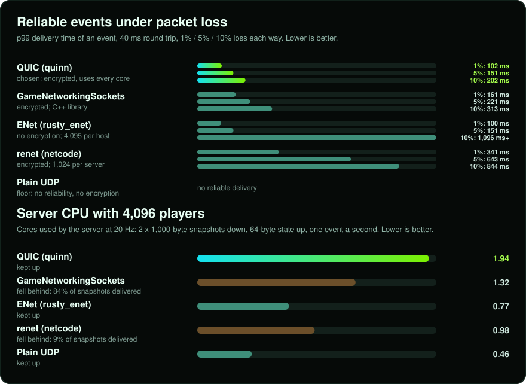

# Network transport for player connections: what we measured and what we chose

Measured 2026-11-24 with quinn 0.11.12 (quinn-proto 0.11.19, rustls 0.23.46 with ring), rusty_enet 0.4.1 (a Rust
port of ENet), renet 2.0.1 with renet_netcode 2.0.1, GameNetworkingSockets 1.6.0 (through the
`game-networking-sockets` 0.3.0 bindings) and plain UDP from the standard library. Task: NET-3 (#59).

The question: which transport should carry player connections, for 4096 players, fast and reliable together?
[architecture.md](../../architecture.md) already names QUIC through `quinn` (unreliable datagrams for movement,
streams for events). Keeping that choice was not a goal; this page checks it against the alternatives with numbers.

## Short answer

**We keep QUIC through quinn.** Among the encrypted candidates it delivered reliable events fastest under packet
loss, and it was the only encrypted one shown to carry 4096 players on this VM with every message
delivered. ENet matched it under 1% and 5% loss and costs less CPU, but has no encryption. quinn's price is CPU:
about 1.9 cores of this VM for 4096 players, 2.4 to 4 times ENet and 4.5 to 7 times plain UDP. See
[What we chose and why](#what-we-chose-and-why).

<p align="center"></p>

| Transport | Encrypted | Reliable event p99 at 1% / 5% / 10% loss | Server CPU, 1000 players | Server CPU, 4096 players |
|---|---|---:|---:|---:|
| **QUIC (quinn)** | **yes** | **102 / 151 / 202 ms** | **0.77 cores** | **1.94 cores, all delivered** |
| GameNetworkingSockets | yes | 161 / 221 / 313 ms | 0.56 cores | not established (see below) |
| ENet (rusty_enet) | no | 100 / 151 / 1,096 ms | 0.18 cores | 0.80 cores, all delivered, two hosts |
| renet (netcode) | yes, but insecure mode here | 341 / 643 / 844 ms | 0.99 cores | not established (see below) |
| Plain UDP | no | no reliable delivery | 0.11 cores | 0.43 cores, all delivered |

Round trip 40 ms (20 ms each way through a relay), loss applied independently in each direction. Players send
their state 20 times a second and get two 1,000-byte snapshot datagrams 20 times a second (the 40 KB/s budget in
architecture.md), plus one reliable event a second each way.

- **Under loss, quinn and ENet were tied at 1% and 5%, and quinn was ahead at 10%** (202 ms against ENet's 1.1 s).
  quinn was the fastest of the three encrypted transports at every loss level. renet, with its default 300 ms
  resend timer, was 3 to 6 times slower. Unreliable state behaved the same in every transport: the share that
  arrived matched the loss, and what arrived was on time.
- **Without loss, every transport answered in under half a millisecond on this machine** (median round trip 0.08
  to 0.41 ms). Latency does not separate them; behaviour under loss and CPU do.
- **CPU per player: plain UDP is the floor, ENet about 1.7 to 1.9 times it, quinn 4.5 to 7 times.** Encryption is
  part of quinn's price; ENet and plain UDP have none.
- **At 4096 players only quinn, ENet and plain UDP were shown to keep up.** For renet and GameNetworkingSockets the
  test could not tell: at 4096 the server cores, the load generator cores or both were saturated on this 4-core
  VM, so their limits are not established. At 1000 and 2048 renet delivered everything, at about one core per
  1000 players. GameNetworkingSockets already received only 68% of client messages at 2048, for a reason we did
  not find.
- **Two libraries cap connections per server:** ENet at 4,095 peers per host (a 12-bit id on the wire), renet at
  1,024 clients per netcode server. quinn and GNS have no limit that we met.

All figures come from one 4-core VM with server and clients on the same machine, and single runs. Read
[What was not measured](#what-was-not-measured) before relying on them.

## What was compared

One harness, [`bench/`](bench/src/main.rs), runs the same server and the same clients over each transport:

- **Plain UDP** ([`udp.rs`](bench/src/udp.rs)): `std::net::UdpSocket`, no connection, no reliability, no
  encryption. The floor every other transport adds to; it shows what "our own protocol on UDP" starts from before
  reliability, encryption and congestion control are added.
- **QUIC through quinn** ([`quic.rs`](bench/src/quic.rs)): TLS 1.3 with a self-signed certificate, unreliable
  datagrams for state and snapshots, one bidirectional stream per connection for reliable, ordered events
  (length-prefixed), as architecture.md describes. Tokio runtime with 2 worker threads on the server. Three
  settings differ from quinn's defaults, on both sides: idle timeout 30 s (so 4096 clients have time to connect),
  keep-alive every 5 s, and a 1 MiB datagram receive buffer (so a burst of snapshots is not dropped by quinn).
- **ENet through rusty_enet** ([`enet.rs`](bench/src/enet.rs)): a pure Rust port of the C library, transpiled from
  it. Channel 0 reliable, channel 1 unreliable (sequenced). No encryption or authentication.
- **renet over netcode** ([`renet.rs`](bench/src/renet.rs)): renet's default channels (unreliable; reliable ordered
  with a 300 ms resend time) over `renet_netcode`, which encrypts every packet with ChaCha20-Poly1305. Connections
  used its `Unsecure` mode, which skips the connect token from a web backend. Packets are still encrypted, but the
  keys come from a token the client makes itself, so in this mode there is no real confidentiality or
  authentication. A real deployment would use secure mode with a token server, which this test did not measure.
- **GameNetworkingSockets** ([`gns.rs`](bench/src/gns.rs)): Valve's C++ library, built from source with its
  OpenSSL and protobuf dependencies, through the `game-networking-sockets` bindings. AES-GCM encryption. Reliable
  and unreliable messages share the default lane; every send sets `NO_NAGLE`, so nothing waits for its 5 ms Nagle
  timer.

Every transport ran with its default settings apart from what is named above. The ENet and renet resend timers in
particular can be tuned; that was not tried.

### How the server runs

The servers for UDP, ENet and renet are one thread per process. Under load the thread updates the network 60 times
a second and sends snapshots on every third update (20 Hz), like a game loop. GNS uses the same loop, and the
library adds its own service thread. quinn is event-driven: its tasks wake for each packet and the snapshot task
runs at 20 Hz. For the latency tests every server instead wakes on each packet (GNS, which owns its sockets, is
polled in a spin loop) and echoes it at once.

### Tests

- **Latency:** one client sends a 64-byte ping 100 times a second for 20 s, unreliable and then reliable; the
  server echoes it on the same channel. Direct on loopback.
- **Loss:** the same at 50 pings a second for 30 s through a relay ([`relay.rs`](bench/src/relay.rs)) that holds
  every datagram for 20 ms and drops 0, 1, 5 or 10% at random, each direction independently. Every transport goes
  through the same relay with the same seeds. TCP was left out: a relay in user space terminates TCP, so its loss
  would not reach TCP's retransmission, and emulating loss in the kernel (netem) was not available.
- **Load:** 1,000, 2,048 and then 4,096 clients connect; after all are connected and 5 s of warm-up, 30 s are measured.
  Each client sends 64 bytes of state 20 times a second and one 100-byte reliable event a second, which the server
  echoes; the server sends each client two 1,000-byte snapshot datagrams 20 times a second. Server CPU is user plus
  system time of the server process from `/proc`, sampled every 5 s; the table shows the mean over the window. The
  server ran on 2 of the 4 cores and the clients on the other 2, so they never shared a core. Because of their
  connection limits, ENet ran 2 hosts in its one thread at 4,096, and renet ran one server process per 1,024 clients
  (2 at 2,048, 4 at 4,096), each with its own thread. CPU is also read per thread, to show whether one thread was
  the limit.

[`run.py`](run.py) starts everything with fixed arguments and writes every run to [`results/`](results/).

## Results

Machine: one cloud VM, 4 vCPU (Intel Xeon 2.1 GHz), 16 GB RAM, Linux, loopback network, socket buffers 8 MB.

### Latency without loss

Round trip of a 64-byte ping, 2,000 pings each, milliseconds:

| Transport | Channel | p50 | p99 | p99.9 | Worst |
|---|---|---:|---:|---:|---:|
| Plain UDP | unreliable | 0.17 | 0.74 | 2.3 | 3.0 |
| quinn | datagram | 0.38 | 1.5 | 3.9 | 4.1 |
| quinn | stream | 0.41 | 1.5 | 3.2 | 9.0 |
| ENet | unreliable | 0.23 | 0.74 | 2.0 | 3.2 |
| ENet | reliable | 0.24 | 0.92 | 2.5 | 3.0 |
| renet | unreliable | 0.08 | 0.21 | 1.0 | 4.1 |
| renet | reliable | 0.08 | 0.20 | 0.80 | 3.1 |
| GNS | unreliable | 0.37 | 2.8 | 12 | 22 |
| GNS | reliable | 0.35 | 2.6 | 9.7 | 39 |

All are far below the 50 ms of a 20 Hz tick, and a real network adds tens of milliseconds, so these differences
do not matter in play. renet was lowest; we did not investigate why. GNS had the longest tail, probably because it
receives on its own service thread and hands messages over through a queue that our loop polls.

### Behaviour under loss

Round trip through the relay (40 ms without loss), 1,500 pings per run, milliseconds. "Arrived" counts pings whose
echo came back; unreliable pings are lost in either direction, so at 5% each way about 90% come back.

| Transport | Channel | Loss each way | Arrived | p50 | p99 | Worst |
|---|---|---:|---:|---:|---:|---:|
| Plain UDP | unreliable | 0% / 1% / 5% / 10% | 100 / 98.0 / 90.9 / 82.1% | 40.7 | 44 to 50 | 60 to 83 |
| quinn | datagram | 0% / 1% / 5% / 10% | 100 / 97.9 / 90.9 / 82.8% | 41.0 | 44 to 50 | 53 to 86 |
| ENet | unreliable | 0% / 1% / 5% / 10% | 100 / 98.1 / 90.9 / 82.0% | 40.7 | 43 to 45 | 44 to 73 |
| renet | unreliable | 0% / 1% / 5% / 10% | 100 / 98.3 / 90.0 / 81.3% | 40.5 | 42 to 43 | 45 to 70 |
| GNS | unreliable | 0% / 1% / 5% / 10% | 100 / 98.0 / 90.9 / 82.0% | 40.9 | 44 to 45 | 50 to 76 |

Reliable events, every one delivered in every run:

| Transport | Loss each way | p50 | p99 | Worst |
|---|---:|---:|---:|---:|
| quinn (one stream) | 0% | 41.0 | 46.6 | 61.7 |
| | 1% | 41.0 | 102 | 162 |
| | 5% | 41.1 | 151 | 243 |
| | 10% | 43.3 | 202 | 261 |
| GNS | 0% | 40.9 | 44.9 | 49.1 |
| | 1% | 40.9 | 161 | 221 |
| | 5% | 41.8 | 221 | 291 |
| | 10% | 80.9 | 313 | 401 |
| ENet | 0% | 40.7 | 53.1 | 155 |
| | 1% | 40.8 | 100 | 231 |
| | 5% | 40.8 | 151 | 251 |
| | 10% | 62.1 | 1,096 | 1,396 |
| renet | 0% | 40.5 | 42.7 | 48.6 |
| | 1% | 40.6 | 341 | 342 |
| | 5% | 201 | 643 | 942 |
| | 10% | 280 | 844 | 943 |

What this shows:

- **A lost packet costs at least one more round trip for a reliable event, and everything behind it on the same
  ordered channel waits too.** That is why the p99 of every transport rises with loss. How much depends on how
  fast each one notices the loss and resends.
- **quinn noticed and resent fastest**: QUIC's loss detection resends after about one round trip plus a margin,
  and its p99 grew by about 50 ms per step. Worst case 261 ms at 10% loss.
- **ENet kept up with quinn until 10% loss, then backed off hard** (p99 1.1 s): its retransmission timeout doubles
  each time the same packet is lost again, and at 10% each way that happens often enough to show at p99.
- **renet waits a fixed 300 ms before resending** by default, so its p99 sits at 341 ms even at 1% loss, and
  head-of-line blocking on the ordered channel pushes its median to 200 ms at 5%. The timer can be lowered; with
  a shorter one it would resend more often and use more bandwidth.
- **Unreliable state is unaffected by the transport.** Each delivered the expected share at the base delay.
- The relay and the VM add their own jitter: plain UDP, with nothing on top, had a p99 up to 10 ms above the
  40 ms floor and a worst case up to 43 ms above it. Differences smaller than that are noise.

### CPU and memory with many players

"Received" is the share of client messages (20 states and one event per client per second) that the server got;
"snapshots" is the share of snapshots the clients got. Both at 100% means the server kept up. "Busiest thread" is
the CPU of the server's busiest thread; a single-threaded server cannot go past 1.0.

| Transport | Players | Server CPU (cores) | Busiest thread | Memory | Received | Snapshots | Generator CPU (of 2) |
|---|---:|---:|---:|---:|---:|---:|---:|
| Plain UDP | 1,000 | 0.11 | 0.11 | 4 MB | 100% | 100% | 0.12 |
| Plain UDP | 2,048 | 0.21 | 0.21 | 4 MB | 100% | 100% | 0.24 |
| Plain UDP | 4,096 | 0.43 | 0.43 | 4 MB | 100% | 100% | 0.49 |
| quinn | 1,000 | 0.77 | 0.39 | 53 MB | 100% | 100% | 0.78 |
| quinn | 2,048 | 1.39 | 0.70 | 111 MB | 100% | 100% | 1.39 |
| quinn | 4,096 | 1.94 | 0.97 | 232 MB | 100% | 100% | 1.92 |
| ENet | 1,000 | 0.18 | 0.18 | 6 MB | 100% | 100% | 0.19 |
| ENet | 2,048 | 0.39 | 0.39 | 11 MB | 99.5% | 98.6% | 0.39 |
| ENet | 4,096 | 0.80 | 0.80 | 18 MB | 99.8% | 99.9% | 0.79 |
| renet | 1,000 | 0.99 | 0.99 | 15 MB | 100% | 100% | 0.92 |
| renet | 2,048 (2 processes) | 1.97 | 0.99 | 30 MB | 100% | 100% | 1.81 |
| renet | 4,096 (4 processes) | 1.98 | 0.50 | 60 MB | 64% | 57% | 1.97 |
| GNS | 1,000 | 0.56 | 0.46 | 27 MB | 100% | 100% | 0.69 |
| GNS | 2,048 | 1.10 | 0.84 | 51 MB | 68% | 100% | 1.32 |
| GNS | 4,096 | 1.35 | 0.83 | 1.9 GB | 6% | 88% | 1.77 (2 processes) |

What this shows:

- **Plain UDP costs about 0.1 ms of CPU per player per second** on this VM: receiving 21 messages and sending 40
  snapshots. Everything else is what each library adds.
- **ENet adds little** (1.7 to 1.9 times plain UDP) because it adds little: sequence numbers, acknowledgements and
  resends, no encryption.
- **quinn costs 4.5 to 7 times plain UDP.** Each datagram is encrypted with AES-GCM and travels through quinn's
  connection state and Tokio's task wake-ups. At 4,096 players it used nearly both of its 2 cores and still received
  and delivered everything. The load generator, which also runs quinn, was at 1.92 of its 2 cores in that run, so
  4,096 is close to what this VM can show for quinn, not a measured ceiling.
- **renet costs about one core per 1,000 players**, one process per netcode server. With 2 processes on 2 cores it
  carried 2,048 fully. At 4,096 its 4 processes shared the same 2 cores (1.98 in total) and the generator was at
  1.97, so the run shows only that this VM cannot hold 4,096 renet players, not that renet cannot. We did not
  profile where the time goes.
- **GNS used more than one thread** (its service thread beside our loop) and was moderate at 1,000. At 2,048 the
  server received only 68% of client messages while its busiest thread was at 0.84 and the generator at 1.32
  cores, so neither side was obviously saturated; we did not find the cause. At 4,096 only 3,838 clients
  connected, memory reached 1.9 GB and 6% of client messages arrived, with the generator near its limit, so this
  run does not establish GNS's limit either.

### Was the comparison fair?

- **Same messages, same relay, same machine, same loop.** Every transport ran behind the same server and client
  code ([`poll.rs`](bench/src/poll.rs) for the four that are polled, [`quic.rs`](bench/src/quic.rs) for quinn,
  which is async and has the same logic as tasks).
- **Not the same security.** quinn, GNS and renet encrypt and authenticate every packet; ENet and plain UDP do
  neither, so anyone on the path can read or forge their traffic. A fair price for ENet or plain UDP includes
  adding encryption, which this test did not measure.
- **Not the same threading.** quinn used 2 Tokio worker threads; GNS one loop thread plus its service thread; UDP
  and ENet one thread; renet one thread per process, one process per 1,024 clients. That last setup is our
  harness's choice, not a limit of renet. The CPU columns count all threads, so they are the total cost.
- **The load generator shares the VM.** It had 2 cores, the same as the server, and for quinn, renet and GNS at
  4,096 it was near them. Results where both sides were near full are marked as not established.
- **Defaults.** No transport was tuned. renet's 300 ms resend time and ENet's timeouts would change the loss
  results if tuned; quinn's congestion controller and GNS's send rates were left as they are.
- **The relay is ours.** It holds every datagram exactly 20 ms and drops at random, with no reordering, no
  bursts and no bandwidth limit. Real networks lose packets in bursts.

### What was not measured

- A real network: everything ran on loopback, with loss and delay from our relay. No reordering, burst loss,
  bandwidth limits, NAT rebinding or connection migration.
- Larger machines, clients on other machines, several gateway processes, and runs longer than 30 s under load.
  Every result is a single run.
- Tuned settings for any transport, and quinn with more than 2 threads.
- Connection set-up cost and time under load (quinn's TLS handshake, GNS's key exchange), except that GNS did not
  finish connecting 4,096 clients from one machine in 120 s.
- The load generator's busiest thread for the polled transports: in `results/load.jsonl` the field
  `client_busiest_thread_cores` reads 0 for UDP, ENet and renet because their client threads had exited before it
  was sampled. The harness now has each thread read its own CPU; the figure is not used on this page.
- renet in secure mode with a token server, and any transport with the load generator on a separate machine,
  which is what it takes to establish the 4,096 limits of renet and GNS.
- The cost of adding encryption to ENet or plain UDP, and of writing our own reliability, congestion control and
  connection security on plain UDP.
- Bytes on the wire per transport: headers, acknowledgements and keep-alives differ, and were not counted.
- Clients behind real game client code: the bots (BOT-1) and the game module do not exist yet.

## What we chose and why

**QUIC through quinn, as architecture.md already says**: unreliable datagrams for state and snapshots, streams
for reliable events.

- **Reliable events under loss**: tied with ENet at 1% and 5% loss, the lowest p99 at 10% (202 ms), and the
  fastest of the encrypted transports at every level, with no setting changed.
- **Security built in**: TLS 1.3 encrypts and authenticates every packet, so a player's session cannot be read
  or forged by someone on the path. For a server where money and property change hands, that is required, and with
  ENet or plain UDP we would build it ourselves.
- **Shown to scale in one process**: 4,096 players at 20 Hz with every message delivered on 2 cores of this VM,
  spread over 2 threads (busiest 0.97). The architecture already splits players over 3 to 4 gateway processes, so
  a gateway with 1,000 to 1,400 players would need about 0.8 to 1 core by these figures.
- **No connection limit, pure Rust, widely used.** quinn is one of the most used QUIC libraries in Rust, and its
  datagrams and streams map directly onto our unreliable and reliable messages, with several independent streams
  available when one ordered stream is not wanted.

The price is CPU: 4.5 to 7 times plain UDP and 2.4 to 4 times ENet per player. At the expected scale that is a known, bounded cost
paid in gateways that scale out, and it buys encryption and the best loss behaviour measured.

### Why not the others

| Option | Measured | Why not |
|---|---|---|
| Plain UDP with our own reliability | 0.43 cores at 4,096 | The cheapest floor, but it has no reliability, encryption, congestion control or connection security. Writing them is a protocol of our own to secure and maintain, the way our own log was for storage. Kept as the optimisation to measure if gateway CPU ever becomes the limit, for snapshots only. |
| ENet (rusty_enet) | 0.80 cores at 4,096; p99 1.1 s at 10% loss | Cheapest of the libraries and tied with quinn at 1% and 5% loss, but no encryption or authentication, a 4,095-peer limit per host, and a sharp slowdown of reliable delivery at 10% loss. rusty_enet is a machine translation of the C code. |
| GameNetworkingSockets | 0.56 cores at 1,000; 68% of client messages received at 2,048 | Encrypted and well tested in Valve's games, but 50 to 110 ms slower than quinn at p99 under loss here, it lost client messages at 2,048 for a reason we did not find, and it needs a C++ build with OpenSSL and protobuf behind young (0.3) unsafe bindings. Its 4,096 limit is not established. |
| renet (netcode) | 0.99 cores per 1,000 players | Lowest latency on a clean link, but 1,024 clients per netcode server, about 5 times ENet's CPU per player, and a 300 ms default resend time that made reliable events the slowest under loss. Tested only in its insecure mode. Its 4,096 limit is not established. |
| TCP or WebSocket | not measured | One lost packet holds back everything after it, unreliable state included. Already ruled out in architecture.md. |

### What would change the answer

- Gateway CPU turns out to be the bottleneck in BOT-2 on real hardware. Then snapshots over our own encrypted UDP
  channel, beside quinn for everything else, is the next thing to measure.
- A newer quinn, or tuning (fewer task wake-ups, larger batches), changes its CPU per player a lot in either
  direction.
- Measurements on a real network with burst loss reverse the order of quinn and GNS under loss.

## Licences

Checked against the licence files and manifests of the versions used. Sawgrass is AGPL-3.0, and #44 proposes MIT
OR Apache-2.0.

| Transport | Licence | Fits AGPL-3.0 and MIT OR Apache-2.0 |
|---|---|---|
| quinn, quinn-proto | MIT OR Apache-2.0; uses rustls (Apache-2.0 OR ISC OR MIT) and ring (Apache-2.0 AND ISC) | Yes |
| rusty_enet | MIT (ENet itself is MIT) | Yes |
| renet, renet_netcode, renetcode | MIT OR Apache-2.0 | Yes |
| GameNetworkingSockets | BSD-3-Clause; the Rust bindings MIT OR Apache-2.0; links protobuf (BSD-3-Clause) and OpenSSL 3 (Apache-2.0) | Yes |

All of these licences are in the allow list of `deny.toml`. None limits how many servers run or who runs them.

## Reproduce

Build (GNS needs cmake, a C++ compiler, protobuf and OpenSSL development files; on Ubuntu
`protobuf-compiler libprotobuf-dev libssl-dev`):

```sh
cd bench
cargo build --release
cargo build --release --features gns --target-dir target-gns
cd ..
```

Run the three suites; each appends one JSON line per run to `results/`. The load suite pins the server to CPUs 0
and 1 and the clients to 2 and 3, and needs at least 4 cores. Raise the socket buffer limit first
(`sysctl -w net.core.rmem_max=16777216 net.core.wmem_max=16777216`) and the open-file limit (`ulimit -n 20000`).

```sh
python3 -I run.py latency          # about 5 minutes
python3 -I run.py loss             # about 25 minutes
python3 -I run.py load             # about 15 minutes
python3 -I run.py load quinn enet  # a subset
python3 -I chart.py                # redraws docs/assets/transport.svg
```

Or by hand, for one transport (`udp`, `quinn`, `enet`, `renet`, `gns`):

```sh
bench/target/release/transport-bench server quinn 127.0.0.1:7100 echo
bench/target/release/transport-bench relay 127.0.0.1:7200 127.0.0.1:7100 20 5   # delay ms, loss %
bench/target/release/transport-bench ping quinn 127.0.0.1:7200 reliable 50 30   # rate, seconds
```

`SNAPSHOT_BYTES` and `SNAPSHOTS_PER_TICK` in the environment of the server and the load clients change the
snapshot datagrams (1,000 bytes, 2 per tick by default), and `run.py load ... --snapshot BYTESxCOUNT` sets both;
[NET-5](../packet-compression/README.md) uses them. `transport-bench datagram-size quinn ADDR` prints the largest
datagram quinn will send to a running server.

## Sources

- QUIC loss detection: [RFC 9002](https://www.rfc-editor.org/rfc/rfc9002); datagrams:
  [RFC 9221](https://www.rfc-editor.org/rfc/rfc9221).
- ENet's protocol limits and retransmission: the `rusty_enet` source (`PROTOCOL_MAXIMUM_PEER_ID = 4095`) and
  <http://enet.bespin.org/>.
- renet's channel defaults (`resend_time: 300 ms`) and netcode's 1,024-client limit (`NETCODE_MAX_CLIENTS`): the
  renet 2.0.1 and renetcode 2.0.0 source.
- GameNetworkingSockets: <https://github.com/ValveSoftware/GameNetworkingSockets>, version 1.6.0 as vendored by
  `game-networking-sockets-sys` 0.3.0.
