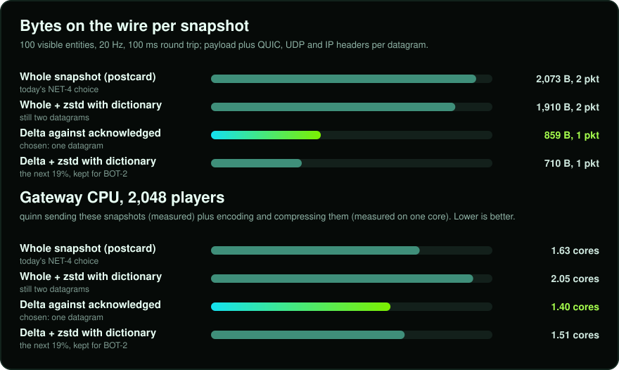

# Packet compression for snapshots: what we measured and what we chose

Measured 2026-11-24 on top of the choices of [NET-3](../network-transport/README.md) (QUIC through quinn 0.11.12)
and [NET-4](../packet-serialization/README.md) (postcard 1.2.0), with lz4_flex 0.11.7 and zstd 1.5.7 (through the
`zstd` 0.13.5 crate). Task: NET-5 (#63).

The question: can the packets be made smaller, so that a gateway sends fewer bytes and fewer datagrams, without
paying for it in CPU or latency? Snapshots are what matter: a gateway fleet sends 81,920 of them a second at 4096
players, and outgoing traffic is what limits a gateway (architecture.md).

## Short answer

**We chose delta encoding of snapshots against the last snapshot the client acknowledged, with no general-purpose
compressor for now.** It cut a snapshot of 100 entities from 1,935 to 793 bytes (59% less) and from two
datagrams to one, and it was also the cheapest to encode. zstd with a trained dictionary on top saves another 19%
of the bytes but costs CPU, depends on a dictionary trained on the traffic, and was trained here on simulated
traffic, so it waits for the load-test bots (BOT-2). See [What we chose and why](#what-we-chose-and-why).

<p align="center"></p>

| Snapshot pipeline | Payload, mean | Datagrams | On the wire at 4096 players | Encode / decode | Gateway CPU at 2,048 players |
|---|---:|---:|---:|---:|---:|
| Whole snapshot, postcard (NET-4) | 1,935 B | 2 | 170 MB/s | 5.7 / 3.4 µs | 1.63 cores |
| Whole + LZ4 | 1,927 B | 2 | 169 MB/s | 7.5 / 4.3 µs | not run |
| Whole + zstd level 1 | 1,783 B | 2 | 157 MB/s | 13.4 / 7.7 µs | not run |
| Whole + zstd level 1, dictionary | 1,772 B | 2 | 156 MB/s | 16.2 / 6.0 µs | 2.05 cores |
| **Delta** | **793 B** | **1** | **70 MB/s** | **4.0 / 5.6 µs** | **1.40 cores** |
| Delta + LZ4 | 799 B | 1 | 71 MB/s | 4.4 / 6.3 µs | not run |
| Delta + zstd level 1 | 698 B | 1 | 63 MB/s | 12.1 / 8.7 µs | not run |
| Delta + zstd level 1, dictionary | 644 B | 1 | 58 MB/s | 7.2 / 10.4 µs | 1.51 cores |

"On the wire" adds 38 bytes of QUIC and 28 of IPv4 and UDP per datagram, and a 3-byte fragment header when a
snapshot is split. Gateway CPU is quinn sending snapshots of that size to 2,048 players, measured, plus encoding
them, measured on one core and added.

- **Delta encoding is what pays.** About two thirds of the 100 visible entities change between snapshots, but each
  change is a few centimetres, which takes 1 or 2 bytes instead of the whole value. The snapshot fits in one
  datagram (largest 983 bytes, against 1,414 that quinn can send), so the gateway sends half as many packets.
- **Generic compressors do little on whole snapshots.** Quantized positions and velocities look random to them:
  LZ4 saved nothing, zstd 8 to 9%, and every whole snapshot still needed two datagrams.
- **Fewer datagrams saved more CPU than fewer bytes.** At 2,048 players quinn used 1.40 cores for two datagrams per
  snapshot, 1.39 when the bytes shrank by 9% in two datagrams, and 1.24 with one datagram (11% less).
- **Loss barely changes delta sizes.** Each client state acknowledges the newest snapshot received, so a lost
  acknowledgement is replaced 50 ms later: at 10% loss each way snapshots grew by 1%. A longer round trip
  matters more: 697 bytes at 40 ms, 863 at 200 ms, still one datagram.
- **Small messages should not be compressed.** Every compressor made client states, chat lines and script events
  4 or 5 bytes larger.
- **No decoder crashed** on 200,000 random and 200,000 corrupted packets per pipeline.

All figures come from one 4-core VM and a simulated world. Read [What was not measured](#what-was-not-measured)
before relying on them.

## What was compared

One harness, [`bench/`](bench/src/main.rs), produces the snapshots, encodes and compresses them every way, and
checks that every packet decodes back to the same snapshot.

**The traffic** ([`sim.rs`](bench/src/sim.rs)). Compression gains from what repeats between packets, so instead
of independent random snapshots (as NET-4 used) the harness simulates a dense area over time: 800 entities on 600
by 600 metres of rolling ground, 30% standing, 40% walking with wandering headings, 30% driving at up to 45 m/s,
turning and changing speed; now and then someone stops or starts walking. Moving entities get a centimetre of
jitter, as physics on the owning client produces; vehicles pitch with the slope. 32 of the entities are players;
each gets the 100 nearest entities, and keeps ones already in view until they fall below rank 120 (the
hysteresis of architecture.md). Values are quantized with `sawgrass-protocol` exactly as in NET-4. After 10 s of
warm-up, 60 s are recorded at 20 Hz: 38,400 snapshots. On average 66 of the 100 entities changed since the
baseline and 0.6 entered the view.

**The encodings:**

- **Whole**: the snapshot as NET-4 sends it, postcard's encoding of the `Packet::Snapshot` message. Decoding
  rejects bytes after the packet, which NET-4's review asked for (see below).
- **Delta** ([`delta.rs`](bench/src/delta.rs)): the snapshot against the newest one the client has acknowledged,
  as Quake 3 and most action-game servers since do. It lists the entities that left the view, the entities that
  changed with only the changed fields as differences (each a postcard-style variable-length integer), and the
  entities that entered in full. Unchanged entities are not sent. Rotation differences are taken per 10-bit
  component when the largest component stays the same, otherwise the rotation is sent whole. A snapshot whose
  baseline is older than 32 ticks (1.6 s), or that has none, is sent against nothing, which is a full snapshot.

**The compressors** ([`codec.rs`](bench/src/codec.rs)), each on one packet at a time, since datagrams are lost
independently and one must never need another to be decoded:

- **None**: the bytes as they are.
- **LZ4** through `lz4_flex` (safe Rust), block format with a 2-byte length.
- **zstd** at levels 1 and 3, with and without a dictionary trained by zstd's own trainer on 3,200 packets of the
  same encoding from a different simulated world (another seed). Dictionaries of 4, 16 and 64 KB were tried; 16 KB
  is shown, the others were within 3% on deltas. The 4-byte frame magic, the same in every packet, is dropped on
  the wire and restored before decoding, and the dictionary id is left out, since both ends know the dictionary.

Every decompressor is bounded to 16 KB of output, so a packet that claims a huge size is rejected instead of
allocated.

### The acknowledgement model

Delta encoding depends on which snapshot the server knows the client has. In the harness ([`main.rs`](bench/src/main.rs),
`Link`), each snapshot arrives half a round trip after it is sent; the client sends its state 20 times a second,
half a tick after each snapshot, carrying the tick of the newest snapshot it received; that state arrives half a
round trip later. Snapshots and client states are each lost independently. The server encodes every snapshot
against the newest acknowledged one it still keeps. At a 100 ms round trip the baseline was 3 ticks (150 ms) old.

### Tests

- **Sizes:** every snapshot of the 60 s in every pipeline at a 100 ms round trip without loss; mean, median,
  p99 and largest size, and datagrams per snapshot at quinn's largest datagram (1,414 bytes, see below) and at
  the QUIC minimum MTU (1,162 bytes). Also the client state, a chat line and a script event.
- **Loss:** delta sizes at round trips of 40, 100 and 200 ms and loss of 0, 1, 5 and 10% each way, 30 s each.
- **Speed:** encode (encoding plus compression) and decode (decompression plus decoding) of 2,048 consecutive
  snapshots in turn, nanoseconds per snapshot, median of five 200 ms rounds; the suite ran three times and the
  median run is shown. Pinned to one core, nothing else running.
- **Hostile input:** per pipeline, 100,000 random byte strings and 100,000 valid packets cut short, extended or
  with 1 to 4 bytes changed, decoded under `catch_unwind` in a process limited to 4 GB of address space.
- **Gateway CPU:** the NET-3 load test ([`../network-transport/run.py`](../network-transport/run.py)) with quinn,
  2,048 and then 4,096 clients, the server on 2 cores and the clients on the other 2, sending each pipeline's mean
  snapshot as one datagram, or as two equal halves when it does not fit, 20 times a second.

The largest datagram quinn sends was measured with `transport-bench datagram-size`: 1,414 bytes on this path,
where quinn's MTU discovery reaches its default ceiling of a 1,452-byte UDP payload. On a path limited to the
1,200 bytes every QUIC path must carry, the same 38 bytes of overhead leave 1,162.

[`run.py`](run.py) runs everything with fixed arguments and writes [`results/`](results/).

## Results

Machine: one cloud VM, 4 vCPU (Intel Xeon 2.1 GHz), 16 GB RAM, Linux.

### Size

Snapshot of 100 entities, 38,400 snapshots, bytes:

| Pipeline | Mean | Median | p99 | Largest | Datagrams (1,414 B) | Datagrams (1,162 B) |
|---|---:|---:|---:|---:|---:|---:|
| Whole | 1,935 | 1,940 | 1,979 | 1,994 | 2 | 2 |
| Whole + LZ4 | 1,927 | 1,931 | 1,984 | 2,001 | 2 | 2 |
| Whole + zstd 1 | 1,783 | 1,785 | 1,837 | 1,864 | 2 | 2 |
| Whole + zstd 3 | 1,757 | 1,759 | 1,830 | 1,854 | 2 | 2 |
| Whole + zstd 1, dictionary | 1,772 | 1,773 | 1,826 | 1,840 | 2 | 2 |
| Whole + zstd 3, dictionary | 1,760 | 1,759 | 1,820 | 1,839 | 2 | 2 |
| **Delta** | **793** | **793** | **908** | **983** | **1** | **1** |
| Delta + LZ4 | 799 | 799 | 915 | 990 | 1 | 1 |
| Delta + zstd 1 | 698 | 697 | 799 | 862 | 1 | 1 |
| Delta + zstd 3 | 702 | 701 | 802 | 871 | 1 | 1 |
| Delta + zstd 1, dictionary | 644 | 643 | 744 | 811 | 1 | 1 |
| Delta + zstd 3, dictionary | 647 | 646 | 746 | 812 | 1 | 1 |

The whole snapshot here (1,935 bytes) is a little smaller than NET-4's 1,985 because the simulated entities
are closer together; the encoding is the same.

- Whole snapshots were about 18 to 19 bytes per entity whatever the compressor. LZ4 finds no repeated byte strings
  in quantized coordinates, and zstd's entropy coding gains 8 to 9%. The 16 and 64 KB dictionaries helped whole
  snapshots by under 1% or not at all, and the 4 KB one by 4% (1,680 bytes): there is little shared text to
  learn.
- Deltas were about 12 bytes per changed entity: an id gap, a mask, and 1 to 2 bytes per changed field. zstd took
  12% off them, and with a dictionary 19%, because a delta repeats the same small set of masks and short values.
- With the 1,162-byte minimum the counts are the same: no delta reached it, and every whole snapshot needs two
  either way.

Small messages, bytes (postcard alone, then the smallest any compressor produced):

| Message | None | Best compressed |
|---|---:|---:|
| Client state | 30 | 34 (LZ4) |
| Chat line | 60 | 64 (LZ4) |
| Script event | 35 | 39 (LZ4) |

### Loss and round trip

Delta snapshot size, mean (p99), bytes; every one fitted in one datagram:

| Round trip | 0% loss | 1% | 5% | 10% |
|---|---:|---:|---:|---:|
| 40 ms | 697 (794) | 698 (800) | 703 (820) | 710 (844) |
| 100 ms | 800 (914) | 801 (916) | 804 (920) | 808 (931) |
| 200 ms | 863 (989) | 863 (990) | 865 (993) | 868 (998) |
| 100 ms, zstd 3 with dictionary | 652 (751) | 652 (754) | 655 (761) | 660 (773) |

The baseline was on average 1, 3 and 5 ticks old at 40, 100 and 200 ms, and at 10% loss 0.2 ticks older. No
snapshot lost its baseline (none was older than 1.6 s), because the client acknowledges again with every state it
sends. A lost snapshot does not break the next one: that one is encoded against what the client acknowledged,
which it has.

### Speed

Nanoseconds per snapshot, median of three runs (range of the three):

| Pipeline | Encode | Decode |
|---|---:|---:|
| Whole | 5,699 (5,170 to 5,860) | 3,441 (3,365 to 3,692) |
| Whole + LZ4 | 7,534 (7,494 to 8,034) | 4,306 (3,954 to 4,802) |
| Whole + zstd 1 | 13,356 (11,760 to 15,893) | 7,669 (6,869 to 9,030) |
| Whole + zstd 3 | 24,953 (16,844 to 27,164) | 7,590 (7,256 to 8,457) |
| Whole + zstd 1, dictionary | 16,161 (15,452 to 18,356) | 5,963 (5,259 to 6,203) |
| Whole + zstd 3, dictionary | 31,802 (31,366 to 33,343) | 6,381 (6,304 to 7,189) |
| **Delta** | **3,983 (3,926 to 4,029)** | **5,619 (5,454 to 6,299)** |
| Delta + LZ4 | 4,371 (4,263 to 4,848) | 6,277 (6,247 to 6,753) |
| Delta + zstd 1 | 12,135 (9,931 to 12,747) | 8,705 (8,624 to 8,728) |
| Delta + zstd 3 | 12,036 (11,829 to 16,560) | 10,252 (8,408 to 10,595) |
| Delta + zstd 1, dictionary | 7,175 (6,616 to 7,333) | 10,427 (9,663 to 10,488) |
| Delta + zstd 3, dictionary | 12,214 (11,513 to 13,680) | 9,166 (8,816 to 10,344) |

- **Delta encoding was faster than encoding the whole snapshot** (4.0 against 5.7 µs): it compares two sorted
  lists and writes a third of the bytes. Decoding a delta costs more (5.6 against 3.4 µs), but that runs on each
  client, once per snapshot.
- At 81,920 snapshots a second (4096 players), encoding costs the gateways 0.47 cores for whole snapshots, 0.33
  for deltas, and 0.59 for deltas with zstd 1 and a dictionary.
- **Latency added:** encode plus decode is 9 µs for whole snapshots and 10 µs for deltas, against 50 ms between
  snapshots. No pipeline waits for anything: each packet is compressed and sent on its own.
- zstd level 3 was slower than level 1 for little gain; on whole snapshots its time varied most between runs.

### Gateway CPU with quinn

The NET-3 load test, sending each pipeline's mean snapshot size (two datagrams of half the size each when it does
not fit in one):

| Pipeline | Datagrams sent | quinn CPU, 2,048 players | quinn CPU, 4,096 players | Server memory, 4,096 |
|---|---|---:|---:|---:|
| Whole | 2 x 971 B | 1.40 | 1.94 | 230 MB |
| Whole + zstd 3, dictionary | 2 x 884 B | 1.39 | 1.95 | 223 MB |
| Delta | 1 x 793 B | 1.24 | 1.91 | 194 MB |
| Delta + zstd 3, dictionary | 1 x 647 B | 1.22 | 1.86 | 193 MB |

Every run received every client message and delivered every snapshot (99.9 to 100.1%). At 4,096 players the
server was at nearly its 2 cores and the load generator at 1.88 to 1.91 of its 2, as in NET-3, so the 4,096 column
cannot separate the pipelines; the 2,048 column can.

- **Halving the datagrams cut quinn's CPU by 11%** at 2,048 players (1.40 to 1.24 cores). Shrinking the bytes by
  9% in the same number of datagrams changed nothing measurable (1.40 to 1.39). quinn's cost is per packet more
  than per byte: encryption of a 1 KB datagram is cheap next to the work of sending it.
- **Adding the encoding cost** (measured on one core, 40,960 snapshots a second at 2,048 players): whole snapshots
  1.63 cores, whole with zstd and a dictionary 2.05, delta 1.40, delta with zstd 1 and a dictionary 1.51. Delta
  encoding is the cheapest in total, by 14%.

### Hostile input

Per pipeline, 100,000 random and 100,000 corrupted packets:

| Pipeline | Panics | Corrupted packets accepted | Slowest single decode |
|---|---:|---:|---:|
| Whole | 0 | 11.5% | 0.17 ms |
| Whole + LZ4 | 0 | 10.5% | 0.07 ms |
| Whole + zstd 3 | 0 | 3.6% | 0.60 ms |
| Whole + zstd 3, dictionary | 0 | 3.6% | 0.14 ms |
| Delta | 0 | 7.8% | 2.8 ms |
| Delta + LZ4 | 0 | 7.7% | 0.26 ms |
| Delta + zstd 3 | 0 | 1.3% | 0.31 ms |
| Delta + zstd 3, dictionary | 0 | 1.6% | 0.86 ms |

No random input was accepted by any pipeline. "Accepted" means a corrupted packet still decoded to some snapshot,
with wrong values; QUIC's authenticated encryption drops any packet changed on the way, so on the wire these only
come from a client or server that sends them on purpose. The delta decoder checks every count against the bytes
left, every id against the baseline, every value against its range, and rejects bytes left over. The 2.8 ms is a
single outlier in 200,000 (the slowest decode of the other delta pipelines was 0.26 to 0.86 ms), most likely the
shared VM. This is random and mutation testing, not coverage-guided fuzzing; see below.

### Was the comparison fair?

- **Same snapshots, same machine, one core for the timings.** Every pipeline encoded the same 38,400 snapshots and
  every packet was checked to decode back to the same snapshot.
- **Simulated traffic.** The world is ours: its mix of standing, walking and driving, its jitter and its density
  decide how many entities change and by how much. Real traffic from the game, or from the bots, may compress
  differently, and the dictionaries in particular learn what this simulation repeats.
- **The quinn runs send fixed sizes.** The load test sends a payload of each pipeline's mean size, not the real
  packets, and encoding cost was measured separately and added. A gateway also builds each player's snapshot from
  the world, which none of the pipelines includes.
- **zstd keeps its own buffers between calls** and LZ4 decompresses into a reused buffer, as a gateway would; the
  harness copies uncompressed bytes once for "none", a few nanoseconds.

### What was not measured

- Real traffic: the game does not run yet, and the bots (BOT-1) do not exist. The dictionaries are trained on
  simulated packets and would have to be trained again on real ones.
- Prediction: encoding positions against where the last velocity says the entity should be, instead of against
  where it was, which should shrink deltas of moving entities further. And domain bit packing (positions relative
  to a grid cell, fewer bits for velocities), and priority-based update rates (far entities less often), which
  architecture.md plans and which change how much each snapshot carries.
- Burst loss and reordering; the loss model drops packets independently.
- Memory for delta encoding: the server keeps up to 33 recent snapshots per client to encode against (about
  90 KB per client at 100 entities, about 380 MB across gateways at 4096 players), and the client the snapshots it has
  acknowledged. Keeping only those newer than the last acknowledgement would cut that; it was not measured.
- Streaming compression of the reliable stream (one compression context per connection, across messages), which
  could shrink chat and events where per-message compression cannot. They are small and rare, so it was left out.
- Coverage-guided fuzzing of the decoders (`cargo fuzz`), for the delta decoder in particular once it moves into
  the protocol crate.
- Other compressors (Snappy, Brotli, deflate) and zstd levels above 3.

## What we chose and why

**Delta encoding of every snapshot against the newest one the client acknowledged, encoded with postcard-style
variable-length integers, and no general-purpose compressor for now.** Client states, chat and events stay as
NET-4 chose: postcard, uncompressed.

- **Half the packets and 59% fewer bytes**: one datagram of about 800 bytes instead of two carrying 1,935. At 4096
  players that is 70 MB/s on the wire instead of 170 MB/s, well inside the 165 MB/s budget of architecture.md, which
  whole snapshots with their headers would exceed.
- **Cheapest in CPU**: faster to encode than a whole snapshot, and quinn spends 11% less sending one datagram
  instead of two.
- **Robust to loss**: a lost snapshot or acknowledgement costs at most a slightly larger next delta; at 10% loss
  the mean grew by 1%.
- **Our own code, no new dependency**: about 300 lines that the protocol crate can own and test, including a
  decoder that rejects inconsistent packets.

**zstd with a dictionary is the measured next step, not part of the choice yet.** It took another 19% off deltas
(644 bytes, about 12 MB/s at 4096 players) for 3.2 µs more encoding per snapshot (about 0.26 cores across the
gateways) and a C library in client and server. Its gain comes from a dictionary that learns the traffic, and the
only traffic so far is simulated; once BOT-2 produces real packets, it should be trained on them and measured again.

### Why not the others

| Option | Measured | Why not |
|---|---|---|
| Whole snapshots, uncompressed (today) | 1,935 B in 2 datagrams | Twice the packets and 2.4 times the bytes of a delta, and more CPU. |
| Whole + LZ4 | 1,927 B in 2 datagrams | Saves nothing on quantized values, costs 1.8 µs. |
| Whole + zstd (with or without dictionary) | 1,757 to 1,783 B in 2 datagrams | 8 to 9% fewer bytes in as many datagrams, so quinn's CPU did not drop, and 7.7 to 26 µs more to encode: 2.05 cores in total at 2,048 players against 1.40 for delta. |
| Delta + LZ4 | 799 B | Larger than delta alone. |
| Delta + zstd, no dictionary | 698 B, 12 µs | 12% smaller than delta for three times its encoding time; with a dictionary it is smaller and faster. |
| Delta + zstd with dictionary | 644 B, 7.2 µs | The best size, and the next thing to adopt; see above. |

### What would change the answer

- Real traffic in BOT-2 compressing differently: if zstd with a dictionary saves much more than 19% on it,
  adopt it; if deltas grow past one datagram (more entities, more change), the snapshot needs splitting or a
  tighter budget.
- Gateway CPU rather than bandwidth turning out to be the limit, which would favour leaving zstd out for good.
- Prediction or bit packing shrinking deltas further, which would leave less for zstd to find.

## Licences

Checked against the licence files and manifests of the versions used. Sawgrass is AGPL-3.0, and #44 proposes MIT
OR Apache-2.0.

| Component | Licence | Fits AGPL-3.0 and MIT OR Apache-2.0 |
|---|---|---|
| Delta encoding | our code | Yes |
| lz4_flex 0.11.7 | MIT | Yes |
| zstd 0.13.5, zstd-safe 7.4.1 | BSD-3-Clause | Yes |
| zstd-sys 2.1.3 (libzstd 1.5.7) | BSD-3-Clause AND BSD-2-Clause as distributed in the crate (upstream zstd is BSD-3-Clause OR GPL-2.0) | Yes |

All of these licences are in the allow list of `deny.toml`. A trained dictionary is our data, made from our own
traffic.

## Reproduce

Build the harness, and the NET-3 harness for the quinn suite (the `zstd` crate compiles libzstd with the system
C compiler):

```sh
cd bench && cargo build --release && cd ..
cd ../network-transport/bench && cargo build --release && cd ../../packet-compression
```

Run the suites; each writes `results/<suite>.jsonl`. The quinn suite needs at least 4 cores, raised socket
buffer limits (`sysctl -w net.core.rmem_max=16777216 net.core.wmem_max=16777216`) and `ulimit -n 20000`, and
reads the sizes suite's results.

```sh
python3 -I run.py sizes loss speed fuzz   # about 5 minutes
python3 -I run.py quinn                   # about 10 minutes
python3 -I chart.py                       # redraws docs/assets/compression.svg
```

## Sources

- Delta encoding against acknowledged snapshots: the Quake 3 networking model, described by its author John Carmack
  and in Glenn Fiedler's "Snapshot Compression" (<https://gafferongames.com/post/snapshot_compression/>).
- zstd's frame format and dictionary training: <https://github.com/facebook/zstd>, `doc/zstd_compression_format.md`.
- quinn's MTU discovery defaults (initial 1,200, upper bound 1,452): the quinn-proto 0.11 `TransportConfig` and
  `MtuDiscoveryConfig` source.
