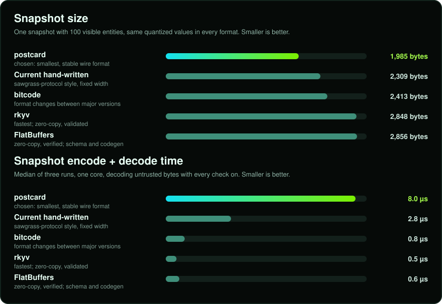

# Packet serialization: what we measured and what we chose

Measured 2026-11-24 with the current `sawgrass-protocol` encoding, postcard 1.2.0 (with serde 1.0.229), bitcode
0.6.9, rkyv 0.8.18 and FlatBuffers 25.12.19 (code generated by `flatc` 25.12.19). Task: NET-4 (#60). The transport
these packets travel over was chosen in [NET-3](../network-transport/README.md): QUIC through quinn.

The question: how should packets be encoded, so that they are small (outgoing bandwidth is what limits a gateway)
and cheap to encode and decode, and so that hostile bytes from the network can never crash or stall the server?
Keeping the current hand-written code was not a goal.

## Short answer

**We chose postcard for every packet, with the quantized values `sawgrass-protocol` already defines.** It gave the
smallest packet of every kind, has a documented wire format that is stable across its versions, decoded 400,000
hostile inputs without a panic, and is a plain serde derive with no code generation. It is also the slowest here,
by a few microseconds per snapshot; at 4096 players that costs about a third of a core in total and saves about
27 MB/s of outgoing traffic. See [What we chose and why](#what-we-chose-and-why).

<p align="center"></p>

| Format | Snapshot, 100 entities | Client state | Chat line | Script event | Snapshot encode + decode | Hostile inputs |
|---|---:|---:|---:|---:|---:|---|
| **postcard** | **1,985 B** | **34 B** | **60 B** | **35 B** | **8.0 µs** | **no panic in 400,000** |
| Current hand-written | 2,309 B | 38 B | 65 B | 51 B | 2.8 µs | no panic in 400,000 |
| bitcode | 2,413 B | 44 B | 64 B | 37 B | 0.8 µs | no panic in 400,000 |
| rkyv (validated) | 2,848 B | 48 B | 100 B | 128 B | 0.5 µs | no panic in 400,000 |
| FlatBuffers (verified) | 2,856 B | 88 B | 116 B | 240 B | 0.6 µs | no panic in 400,000 |

- **postcard is the smallest on every message**: 14% smaller than the current encoding on a snapshot, 30% smaller
  than rkyv and FlatBuffers. Its variable-length integers spend 1 byte on a zero velocity and up to 3 on ids and
  coordinates, where the current code always spends 2 to 4.
- **rkyv, FlatBuffers and bitcode are the fastest**, 10 to 18 times faster than postcard on a snapshot, but their
  snapshots are 22 to 44% larger than postcard's.
- **The current hand-written code is in the middle on both**: 16% larger than postcard and about 3 times faster.
- **None crashed on hostile input.** Each format decoded 200,000 random byte strings and 200,000 corrupted valid
  packets; every one returned either an error or some packet, none panicked, and none ran out of memory under a
  4 GB limit.
- **Every format accepts some corrupted inputs as valid** (9 to 23%): a changed byte inside a number is still a
  number. Integrity has to come from the transport, which QUIC provides with its authenticated encryption.

All figures come from one 4-core VM. Read [What was not measured](#what-was-not-measured) before relying on them.

## What was compared

The harness, [`bench/`](bench/src/main.rs), encodes the same game messages in each format
([`model.rs`](bench/src/model.rs)):

- **Snapshot** (server to client, 20 times a second): sequence, tick and 100 visible entities, each with id,
  position (three `i32` in centimetres), velocity (three `i16` in cm/s) and rotation (32 smallest-three bits). 100
  is about what the 40 KB/s budget in [architecture.md](../../architecture.md) allows at 20 Hz.
- **Client state** (client to server, 20 times a second): its own entity state, a button mask and two aim angles.
- **Chat line** (reliable): sender, channel and a 51-character text.
- **Script event** (reliable): the name `inventory:use` and four typed arguments.

Every format encodes the same enum of these four, so the receiver learns from the bytes which message it got.
Values are generated from a fixed seed: entities within 250 m of a point on the map, 30% standing, 40% on foot,
30% in vehicles, any heading. All values are already quantized exactly as `sawgrass-protocol` quantizes them, so
every format carries the same information and only the encoding differs.

- **Current hand-written** ([`handwritten.rs`](bench/src/handwritten.rs)): `sawgrass-protocol`'s own
  `PacketHeader` (7 bytes) and `EntityState` (23 bytes: a 24-bit position per axis), used as they are. The rest of
  each message does not exist in the protocol yet (NET-2 adds it), so it is written here in the same style:
  fixed-width little-endian integers, `u16` counts, `u8` string lengths, every read checked.
- **postcard**: serde derive, `to_slice` into a reused buffer, `from_bytes` to decode. Integers are
  variable-length (zigzag for signed), enums a variable-length tag.
- **bitcode**: its own derive, with a reused `bitcode::Buffer`. It lays values out by column and packs integers to
  the bits their range needs.
- **rkyv**: its derive, encoding into a reused aligned buffer. Bytes from the network are not aligned, so each
  decode first copies them into an aligned buffer (included in the time), then validates with bytecheck
  (`rkyv::from_bytes`, or `rkyv::access` for the zero-copy read). The unchecked access functions were not used:
  on untrusted input they are undefined behaviour.
- **FlatBuffers**: the schema [`packets.fbs`](bench/schema/packets.fbs) compiled by `flatc` into
  [`packets_generated.rs`](bench/src/packets_generated.rs); entities are a fixed-size struct, the message a union.
  Every decode runs the verifier (`root_as_packet`) first.

### Tests

- **Size:** bytes of each message; bytes per entity from the difference between snapshots of 100 and 150.
- **Speed:** nanoseconds per encode, per decode into owned Rust values, and per "read": visiting every field
  without building owned values, which only rkyv and FlatBuffers can do (zero-copy); for the others a read is a
  decode. Each figure is the median of five 200 ms rounds; the suite ran three times, and the tables show the
  median run and the range of the three. Pinned to one core.
- **Hostile input:** per format, 200,000 random byte strings of 0 to 4 KB, then 200,000 valid packets with 1 to 4
  bytes changed, cut short, or with bytes appended. Each decode runs under `catch_unwind` in a process limited to
  4 GB of address space, so a panic is counted and an allocation sized by a forged length would abort the run.

[`run.py`](run.py) runs the three suites and writes [`results/`](results/).

## Results

Machine: one cloud VM, 4 vCPU (Intel Xeon 2.1 GHz), 16 GB RAM, Linux.

### Size

Bytes per message:

| Format | Snapshot (100 entities) | Per entity | Client state | Chat line | Script event |
|---|---:|---:|---:|---:|---:|
| postcard | 1,985 | 20.1 | 34 | 60 | 35 |
| Current hand-written | 2,309 | 23 | 38 | 65 | 51 |
| bitcode | 2,413 | 24 | 44 | 64 | 37 |
| rkyv | 2,848 | 28 | 48 | 100 | 128 |
| FlatBuffers | 2,856 | 28 | 88 | 116 | 240 |

- postcard's advantage depends on the values. Standing entities (zero velocity), ids below about 2 million and
  coordinates within about 10 km of the origin take fewer bytes; a rotation takes 5 bytes instead of 4. On this
  mix it saves about 3 bytes per entity.
- bitcode packs each column to the bits its values need, which helps most when values are alike; with 100
  entities spread over 500 m it ended slightly larger than the current encoding.
- rkyv and FlatBuffers keep fixed, aligned layouts (and FlatBuffers adds tables and offsets), which is what lets
  them read in place, at the cost of padding: 28 bytes per entity, and several times more for small events.
- A snapshot of 100 entities is larger than one datagram in every format (about 1,200 bytes fit), so the gateway
  sends two either way.

### Speed

Nanoseconds per message, median of three runs (range in brackets):

| Message | Format | Encode | Decode | Read every field |
|---|---|---:|---:|---:|
| Snapshot | postcard | 4,725 [4,498 to 5,073] | 3,303 [3,218 to 3,463] | 3,187 |
| | Current | 1,116 [998 to 1,200] | 1,644 [1,642 to 2,240] | 1,839 |
| | bitcode | 392 [348 to 501] | 409 [402 to 504] | 579 |
| | rkyv | 208 [180 to 244] | 246 [202 to 252] | 173 (zero-copy) |
| | FlatBuffers | 276 [270 to 303] | 298 [288 to 340] | 278 (zero-copy) |
| Client state | postcard | 94 | 43 | 63 |
| | Current | 18 | 34 | 40 |
| | bitcode | 281 [184 to 306] | 179 [118 to 191] | 158 |
| | rkyv | 30 | 19 | 10 (zero-copy) |
| | FlatBuffers | 71 | 192 | 178 (zero-copy) |
| Chat line | postcard | 22 | 62 | 42 |
| | Current | 11 | 38 | 45 |
| | bitcode | 200 | 139 | 136 |
| | rkyv | 36 | 43 | 21 (zero-copy) |
| | FlatBuffers | 94 | 161 | 149 (zero-copy) |
| Script event | postcard | 38 | 103 | 120 |
| | Current | 18 | 93 | 93 |
| | bitcode | 191 | 168 | 186 |
| | rkyv | 73 | 86 | 40 (zero-copy) |
| | FlatBuffers | 539 | 504 | 508 (zero-copy) |

- **On snapshots, rkyv, FlatBuffers and bitcode are 3 to 20 times faster than postcard and the current code.**
  They move whole rows at once; postcard encodes every integer as a variable-length number through serde, and the
  current code goes through `EntityState` field by field.
- **On small messages the order changes.** The current code and rkyv take 10 to 90 ns, postcard 20 to 120 ns, and
  bitcode pays a fixed cost of about 150 to 300 ns per call, so it is the slowest on everything but snapshots.
  FlatBuffers is slow on events: each string and union is its own table.
- **What it costs the server.** At 4096 players and 20 Hz, gateways encode 81,920 snapshots a second. With
  postcard that is about 0.39 cores in total, with the current code 0.09, with rkyv 0.02. Decoding client states
  costs under 0.01 cores with any of them.

### Hostile input

| Format | Inputs | Rejected | Accepted as some packet | Panicked | Slowest single decode |
|---|---:|---:|---:|---:|---:|
| postcard | 400,000 | 310,314 | 89,686 | 0 | 191 µs |
| Current hand-written | 400,000 | 356,775 | 43,225 | 0 | 255 µs |
| bitcode | 400,000 | 363,138 | 36,862 | 0 | 114 µs |
| rkyv (validated) | 400,000 | 350,731 | 49,269 | 0 | 62 µs |
| FlatBuffers (verified) | 400,000 | 307,007 | 92,993 | 0 | 152 µs |

- **No format panicked, aborted or ran out of memory.** In particular none tried to allocate gigabytes on a
  forged length, and rkyv and FlatBuffers rejected every offset that pointed outside the input before reading it.
- **The slowest single decode was under 0.3 ms in every format**, and in an earlier run of the same inputs the
  worst cases were up to 8 ms; both are single outliers in 400,000 that move between runs, so they reflect the
  shared VM rather than the formats. No input made any decoder loop.
- **"Accepted" is not a failure.** A corrupted packet whose bytes still form valid values decodes to wrong values.
  postcard and FlatBuffers accept more, partly because they do not reject trailing bytes (postcard's `from_bytes`
  ignores them; FlatBuffers ignores anything its offsets do not reach). The current code rejects them. The game
  must validate values anyway, and QUIC's authenticated encryption drops any packet changed on the way.

### Was the comparison fair?

- **Same values, same messages, same machine, one core.** Every format encoded the same quantized integers, so
  none gained from quantization the others lacked.
- **Each format used its fast path:** reused buffers for all, bitcode's `Buffer`, rkyv's validated access, the
  FlatBuffers builder with `reset`. Decoding always validates, because the input comes from the network.
- **The current code is a fair baseline but not a tuned one.** It is the straightforward style of
  `sawgrass-protocol`; it was not optimised for this test, and the parts beyond the header and `EntityState` were
  written here.
- **No load generator, nothing else running.** Every test is a single-threaded loop in one process, pinned to one
  core, with no network and no second process competing for the CPU; the runs were made while nothing else heavy
  ran on the VM. So, unlike the transport test, no generator could be the bottleneck. The flip side is that these
  are figures for one hot loop, with warm caches, not for a gateway handling thousands of connections at once.
- **rkyv pays for a copy** into an aligned buffer on every decode. A gateway could receive into aligned buffers
  and skip it, which would make rkyv's decode faster still.

### What was not measured

- Delta compression against the last acknowledged snapshot, and domain-specific bit packing (positions relative
  to a grid cell, a flag for zero velocity). These shrink snapshots far more than any choice of format, and they
  work on the values before any format sees them.
- General compression (LZ4, zstd) of packets.
- Other formats: bincode, MessagePack, Protocol Buffers (prost), Cap'n Proto, speedy, borsh.
- Schema evolution in practice: adding a field and reading old packets with new code.
- Code size and compile time of each format, and memory use.
- Other machines, and the client side under the game.

## What we chose and why

**postcard for every packet**, with positions, velocities and rotations quantized by `sawgrass-protocol` as today.
The protocol version check at connection (`PROTOCOL_VERSION`) stays as it is.

- **Smallest packets**, of every kind. At 4096 players and 20 Hz a gateway fleet sends 81,920 snapshots a second;
  324 bytes saved per snapshot is about 27 MB/s (about 210 Mbit/s), some 16% of the 165 MB/s downstream budget in
  architecture.md. Outgoing traffic is what limits a gateway, so this is where performance is won.
- **Enough speed.** The extra CPU over the current code is about 0.3 cores across all gateways at 4096 players,
  next to about 2 cores that QUIC itself costs. Small messages take 20 to 120 ns.
- **A stable wire format.** postcard's format is documented and stable since 1.0, so a client and a server built
  with different postcard versions still agree. bitcode states that its format may change between major
  versions.
- **Reliable on hostile input**: no panic, no runaway allocation, no stall in 400,000 inputs.
- **Little to maintain.** A serde derive on the message types replaces hand-written encode and decode for every new
  message, and keeps us free to change messages without writing byte offsets.

### Why not the others

| Option | Snapshot | Why not |
|---|---|---|
| Current hand-written | 2,309 B, 2.8 µs | 16% larger and every new message needs its own encoder, decoder and tests. Its speed advantage is about 0.3 cores across the fleet at 4096 players, while its size costs bandwidth, which is scarcer. A tuned hand-written encoding with variable-length fields could beat postcard on both; that is the planned optimisation if snapshots ever dominate CPU, together with delta compression. |
| bitcode | 2,413 B, 0.8 µs | Fast on snapshots, but larger than the current code here, about 200 ns per small message, and its format may change between major versions, which a client and server on different builds cannot afford. |
| rkyv | 2,848 B, 0.5 µs | The fastest, with validated zero-copy reads, but 43% larger snapshots and 1.7 to 3.7 times larger events. Bandwidth matters more than the 0.4 cores it would save. |
| FlatBuffers | 2,856 B, 0.6 µs | Zero-copy with a cross-language schema, which we do not need (both ends are Rust); 44% larger snapshots, events up to 7 times larger and slow, and a code generator in the build. |

### What would change the answer

- Delta compression and bit packing land (part of interest management). Snapshots then shrink to a fraction, the
  format's share of the size falls, and its speed matters relatively more: measure again with delta snapshots.
- BOT-2 shows gateway CPU, not bandwidth, is the limit. Then rkyv for snapshots, or a tuned hand-written snapshot
  encoder, is the first thing to try.
- Clients in another language need to read packets. Then FlatBuffers or Protocol Buffers.

## Licences

Checked against the manifests and licence files of the versions used. Sawgrass is AGPL-3.0, and #44 proposes MIT
OR Apache-2.0.

| Format | Licence | Fits AGPL-3.0 and MIT OR Apache-2.0 |
|---|---|---|
| postcard (with serde) | MIT OR Apache-2.0 | Yes |
| bitcode | MIT OR Apache-2.0 | Yes |
| rkyv (with bytecheck) | MIT | Yes |
| FlatBuffers (runtime crate and `flatc`) | Apache-2.0 | Yes |

The current encoding is our own code. All of these licences are in the allow list of `deny.toml`.

## Reproduce

```sh
cd bench
cargo build --release
cd ..
python3 -I run.py           # sizes, speed (three runs) and hostile input; about 6 minutes
python3 -I run.py sizes     # one suite
python3 -I chart.py         # redraws docs/assets/serialization.svg
```

The generated FlatBuffers code is committed. To regenerate it, with `flatc` 25.12.19 from
<https://github.com/google/flatbuffers/releases>:

```sh
flatc --rust -o bench/src/ bench/schema/packets.fbs
```

## Sources

- postcard's wire format and its stability: <https://postcard.jamesmunns.com/wire-format>, and the postcard 1.2.0
  README.
- bitcode's goals and non-goals (a stable format across major versions is a non-goal): the bitcode 0.6.9 README.
- rkyv validation: <https://rkyv.org/validation.html>.
- FlatBuffers verifier and Rust code generation: <https://flatbuffers.dev/>.
