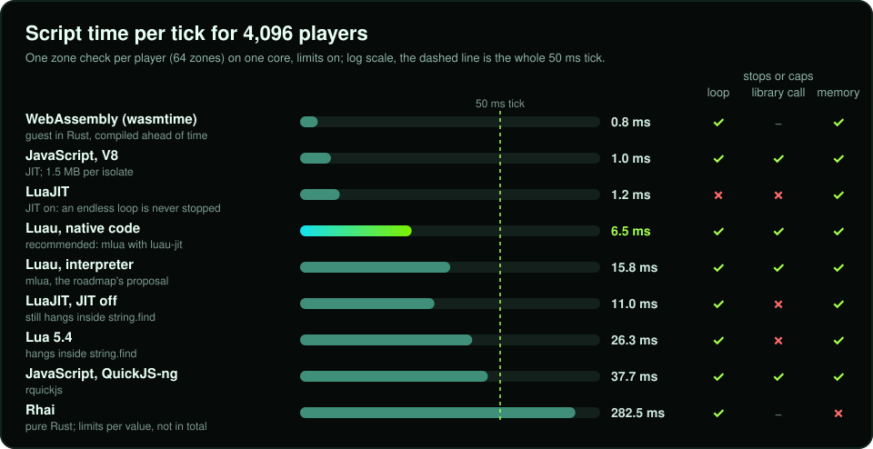

# Scripting engines for roleplay logic: what we measured and what we recommend

Measured 2026-11-24 with mlua 0.12.3 (Luau 0.748, Lua 5.4.9, LuaJIT 2.1 at 63c8f1a), wasmtime 51.0.0, rquickjs
0.14.0 (QuickJS-ng 0.16.2), the `v8` crate 152.2.0 and Rhai 1.27.0, on Rust 1.97.0. Task: SCRIPT-1 (#67).

The question: which engine runs the game modes in `resources/`, the code server owners and modders write
(architecture.md, "Scripting")? The roadmap lists it as an open decision: "Luau (proposed), WASM or
JavaScript". The engine has to be fast enough to run inside the 50 ms tick at 4096 players, and a broken or hostile
script must not hang the tick or take the server down.

## Short answer

**We recommend Luau with native code generation (mlua's `luau-jit`); the maintainer adopted it on 2026-11-24
([ADR 0005](../../adr/0005-luau-scripting.md)).** It passed every isolation test, including
a long call into the string library that Lua 5.4 and LuaJIT cannot interrupt, it caps memory exactly, it is built
for untrusted code, and it adds 3 MB to the server, built from source. It is not the fastest: V8 and WebAssembly
ran the roleplay workloads 1.7 to 12 times faster and called the host 3 to 15 times more cheaply. Both of them
passed the isolation tests too, V8 with an `unsafe` callback and a memory cap it overshoots, WebAssembly cleanly.
We do not recommend WebAssembly because authors would have to compile their scripts, which is a judgement about
authors, not a measurement. The choice between Luau, JavaScript or TypeScript on V8, and WebAssembly is partly
the language and partly what the client runtime allows, so it goes to the maintainer;
[What the data decides and what it does not](#what-the-data-decides-and-what-it-does-not) separates the two.

<p align="center"></p>

| Engine | Call into script | Host call | Zone check | Chat command | Inventory | Per tick, 4096 zone checks | Stops a script | Memory cap | Per instance | Binary |
|---|---:|---:|---:|---:|---:|---:|---|---|---:|---:|
| WebAssembly (wasmtime) | 24 ns | 5 ns | 0.18 µs | 0.54 µs | 7.8 µs | 0.8 ms | yes | exact | 139 KB | 11.3 MB |
| JavaScript, V8 | 148 ns | 23 ns | 0.25 µs | 0.62 µs | 7.6 µs | 1.0 ms | yes | soft (callback) | 1,524 KB | 46.0 MB |
| LuaJIT | 67 ns | 36 ns | 0.30 µs | 1.30 µs | 11.1 µs | 1.2 ms | **no**: loop, library call | exact | 180 KB | 1.2 MB |
| **Luau, native code** | **99 ns** | **74 ns** | **1.59 µs** | **2.27 µs** | **12.9 µs** | **6.5 ms** | **yes** | **exact** | **493 KB** | **3.0 MB** |
| Luau, interpreter | 94 ns | 93 ns | 3.87 µs | 1.98 µs | 17.9 µs | 15.8 ms | yes | exact | 409 KB | 2.2 MB |
| LuaJIT, JIT off | 64 ns | 43 ns | 2.69 µs | 1.29 µs | 20.0 µs | 11.0 ms | **no**: library call | exact | 164 KB | 1.2 MB |
| Lua 5.4 | 79 ns | 69 ns | 6.42 µs | 2.31 µs | 38.3 µs | 26.3 ms | **no**: library call | exact | 132 KB | 0.9 MB |
| JavaScript, QuickJS-ng | 118 ns | 144 ns | 9.19 µs | 6.99 µs | 66.6 µs | 37.7 ms | yes | exact | 281 KB | 1.6 MB |
| Rhai | 389 ns | 279 ns | 68.97 µs | 13.93 µs | 362.2 µs | 282.5 ms | yes | none (per value only) | 455 KB | 3.7 MB |

Times are medians on one core with the deadline check and the memory cap installed, as a server would run them.
"Host call" is a script calling a Rust function; "Stops a script" is whether a 10 ms deadline stopped both an
endless loop and a backtracking `string.find` (a regular expression in JavaScript); "Binary" is the stripped
benchmark binary, the engine plus a small harness.

- **LuaJIT and Lua 5.4 cannot be stopped reliably.** Their deadline hook runs only between script instructions: it
  is never called from LuaJIT's compiled code, so `while true do end` ran until it was killed after 30 s, and in
  neither is it called inside a library function, so one `string.find` with a backtracking pattern hung all three
  (LuaJIT with and without its compiler, Lua 5.4). Luau checks its interrupt inside the pattern matcher and
  stopped it in 10 ms.
- **Rhai is 4 to 43 times slower than Luau with native code** on every workload and has no cap on total memory.
  **QuickJS-ng** is 3 to 6 times slower than it on zone, chat and inventory, and offers nothing it lacks.
- **V8 and WebAssembly are the fast ones.** V8 costs 1.5 MB and 3.1 ms per instance, a 46 MB binary and a
  198 MB prebuilt library downloaded at build time, and its memory cap needs an `unsafe` callback that lets the
  heap grow to twice the cap while the script is terminated. WebAssembly asks mod authors to compile their code.
- **Event-driven roleplay logic is cheap on all of them but Rhai.** A chat command in Luau took 2.3 µs; a thousand
  a second is 0.2% of a core. The difference matters for work done for every player on every tick.

All figures come from one 4-core VM. Read [What was not measured](#what-was-not-measured) before relying on them.

## What was compared

One harness, [`bench/`](bench/src/main.rs), embeds each engine behind the same interface ([`host.rs`](bench/src/host.rs))
and runs the same roleplay resource in it. mlua's Lua flavours exclude each other, so each engine is a separate
build (a cargo feature), run in a fresh process.

**The candidates**, each through its usual Rust binding:

- **Luau** through mlua, at optimization level 2, sandboxed (`Lua::sandbox`, read-only libraries and globals, as
  Roblox runs untrusted code). Twice: the interpreter, and with native code generation (`luau-jit`), which
  compiles every function of the resource to machine code at load.
- **Lua 5.4** and **LuaJIT** through mlua, LuaJIT twice: as shipped, and with `jit.off()`.
- **WebAssembly** through wasmtime (Cranelift), with the resource written in Rust ([`guest/`](guest/src/lib.rs)) and
  compiled to `wasm32-unknown-unknown`. Compiled once per process; each instance gets its own store.
- **JavaScript** through rquickjs (QuickJS-ng) and through the `v8` crate (rusty_v8, Deno's binding), one isolate
  per instance since heap limits and termination apply per isolate.
- **Rhai**, a scripting language written in Rust.

**The resource** is written four times, as [`rp.lua`](scripts/rp.lua) (run unchanged by Luau, Lua 5.4 and
LuaJIT), [`rp.js`](scripts/rp.js) (QuickJS-ng and V8), [`rp.rhai`](scripts/rp.rhai) and the Rust guest, with the
same logic:

- `zone(x, y)`: which of 64 circular zones (shops, job sites) a player stands in. Called once per player per tick;
  most players are in no zone, so most calls check all 64.
- `chat(from, line)`: a chat command (`/pay 17 250`, `/me ...`, `/roll`, an unknown one) split into words,
  dispatched, checked against the payer's balance and paid through two host calls; returns the reply. Strings
  both ways.
- `payday()`: every one of 4096 players is paid by job, two host calls per player.
- `inventory(seed)`: 64 item records built and merged into stacks, then weighed; the allocation and garbage
  collection workload.
- `noop(x)`, `host_loop(n)` (the script calls the host n times) and `echo(s)` for the cost of the boundary.
- `spin`, `bomb`, `recurse`, `fail` and `slow_builtin`: an endless loop, endless allocation, endless recursion, a
  thrown error, and one long call into the library, `string.find(string.rep("a", 50000), ".-.-.-.-.-b")` in Lua
  and the same backtracking search as a regular expression in JavaScript, during which no script code runs.

The host functions (`get_money`, `add_money`, `player_count`, `player_job`, `host_add`) read and change a world of
4096 wallets. Every engine produced the same results and the same wallets after the same calls
([`results/verify.jsonl`](results/verify.jsonl)), so all of them ran the same work.

**Limits**, installed as a server would ([`host.rs`](bench/src/host.rs)): a watchdog thread checks a deadline every
250 µs and sets a flag when it passes. Luau polls it from its interrupt callback (called at function calls and
loop back-edges, also from native code), Lua 5.4 and LuaJIT from a hook every 1,000 instructions, QuickJS-ng from
its interrupt handler, Rhai from its progress callback; the watchdog terminates the V8 isolate and advances
wasmtime's epoch, which traps the next epoch check. The deadline is armed once per measurement, as a server would
arm one budget per tick. Memory is capped at 64 MB per instance: mlua's allocator limit, QuickJS-ng's
`set_memory_limit`, wasmtime's `StoreLimits`, V8's heap limit with a near-limit callback that terminates the
script. Rhai has no total cap; it limits each string (1 MB), array (65,536 items) and map.

### Tests

- **Speed:** each workload in a loop, nanoseconds per call, median of five rounds of about 200 ms after
  calibration; the whole suite ran three times over all engines, interleaved, with limits and without, and the
  median of the three is shown. Pinned to one core.
- **Latency:** each call timed on its own: 200,000 zone checks, 100,000 chat commands, 100,000 inventories,
  1,000 paydays; p50, p99, p99.9 and the maximum.
- **Memory:** a first instance, then 100 more, each called once with every workload; resident memory (RSS) per
  instance and the time to create one (load and compile the resource), median of three runs.
- **Isolation:** each misbehaving function in its own process with a 4 GB data limit and a 30 s timeout. The
  endless loop and the long library call get a 10 ms deadline, the others 10 s, so that memory and stack limits
  are what stop them. The WebAssembly guest has no host library to call and Rhai has no pattern matching, so the
  library call does not apply to them.
  Afterwards the same instance must still answer `noop`.
- **Size:** the benchmark binary for each engine with symbols stripped.

## Results

Raw results are in [`results/`](results/); the tables below are computed from them.

### Speed

Medians with limits installed (`speed.jsonl`):

| Engine | Call into script | Host call | Echo, 32 chars | Zone check | Chat command | Payday, 4096 players | Inventory |
|---|---:|---:|---:|---:|---:|---:|---:|
| WebAssembly | 24 ns | 5 ns | 225 ns | 0.18 µs | 0.54 µs | 0.05 ms | 7.8 µs |
| V8 | 148 ns | 23 ns | 249 ns | 0.25 µs | 0.62 µs | 0.27 ms | 7.6 µs |
| LuaJIT | 67 ns | 36 ns | 360 ns | 0.30 µs | 1.30 µs | 0.33 ms | 11.1 µs |
| Luau, native code | 99 ns | 74 ns | 450 ns | 1.59 µs | 2.27 µs | 0.61 ms | 12.9 µs |
| Luau, interpreter | 94 ns | 93 ns | 438 ns | 3.87 µs | 1.98 µs | 0.68 ms | 17.9 µs |
| LuaJIT, JIT off | 64 ns | 43 ns | 366 ns | 2.69 µs | 1.29 µs | 0.44 ms | 20.0 µs |
| Lua 5.4 | 79 ns | 69 ns | 396 ns | 6.42 µs | 2.31 µs | 0.64 ms | 38.3 µs |
| QuickJS-ng | 118 ns | 144 ns | 232 ns | 9.19 µs | 6.99 µs | 1.14 ms | 66.6 µs |
| Rhai | 389 ns | 279 ns | 545 ns | 68.97 µs | 13.93 µs | 4.74 ms | 362.2 µs |

"Host call" is `host_loop(1000)` divided by 1,000, so it includes the script's loop around each call.

- **The boundary costs the most where the binding converts values.** wasmtime passes integers straight through
  (5 ns a host call); V8 23 ns; mlua 36 to 93 ns; rquickjs 144 ns; Rhai 279 ns. A payday is almost all host calls,
  so it ranks the engines the same way.
- **Calling into V8 is the second most expensive** (148 ns): each call opens a handle scope, a context scope and a
  try-catch scope. It does not matter for a chat command, and the work inside is then the fastest of the dynamic
  engines.
- **Native code more than doubles Luau's speed on the zone check** (3.87 to 1.59 µs) and helps the inventory by
  28%, but not chat, which is spent in string functions and the host.
- **The chat command is close across the Lua engines** (1.3 to 2.3 µs): string splitting and formatting run in
  the engines' C libraries.

What the limits cost, medians without and with them (`speed.jsonl`, `limits`):

| Engine | Zone check | Host call | Inventory |
|---|---:|---:|---:|
| WebAssembly (epoch check) | 0.18 → 0.18 µs | 5 → 5 ns | 5.9 → 7.8 µs |
| V8 (terminate from the watchdog) | 0.25 → 0.25 µs | 24 → 23 ns | 7.3 → 7.6 µs |
| Luau, native code (interrupt) | 1.04 → 1.59 µs | 50 → 74 ns | 9.7 → 12.9 µs |
| Luau, interpreter (interrupt) | 3.79 → 3.87 µs | 56 → 93 ns | 16.4 → 17.9 µs |
| LuaJIT, JIT off (hook) | 1.95 → 2.69 µs | 39 → 43 ns | 17.4 → 20.0 µs |
| Lua 5.4 (hook) | 2.96 → 6.42 µs | 48 → 69 ns | 28.5 → 38.3 µs |

Polling a flag from inside the interpreter costs Luau with native code a third of its zone-check speed, and Lua
5.4 more than half. V8 and wasmtime stop a script from outside, which costs nothing measurable. LuaJIT with its
compiler on and QuickJS-ng moved by up to 20% either way, which is noise here (LuaJIT because the hook never runs
in compiled code).

### Latency

Per call, in microseconds (`latency.jsonl`):

| Engine | Zone p50 | Zone p99 | Inventory p50 | Inventory p99 | Inventory p99.9 |
|---|---:|---:|---:|---:|---:|
| WebAssembly | 0.30 | 0.4 | 6.4 | 42.9 | 68.0 |
| V8 | 0.24 | 0.6 | 6.2 | 43.0 | 77.9 |
| LuaJIT | 0.27 | 0.6 | 7.6 | 62.3 | 102.0 |
| Luau, native code | 1.35 | 3.5 | 8.6 | 48.8 | 87.0 |
| Luau, interpreter | 3.48 | 31.3 | 15.5 | 67.6 | 105.7 |
| LuaJIT, JIT off | 2.50 | 27.5 | 15.3 | 62.0 | 201.5 |
| Lua 5.4 | 5.70 | 31.8 | 36.9 | 126.9 | 182.8 |
| QuickJS-ng | 7.71 | 47.3 | 55.6 | 157.9 | 337.9 |
| Rhai | 83.46 | 171.8 | 331.3 | 623.7 | 1,125.6 |

No engine paused for long in its garbage collector: the slowest inventory in the 99.9th percentile took 1.1 ms in
Rhai and at most 0.34 ms in the others. The maximum of each run is left out: it reached 8 ms in WebAssembly, which
collects no garbage, so we take the maxima to be the shared VM's rather than the engines'; that was not checked
further.

### Memory and start-up

Medians of three runs (`memory.jsonl`, `size.jsonl`):

| Engine | Create an instance | Memory per instance | First instance | Stripped binary |
|---|---:|---:|---:|---:|
| WebAssembly | 0.07 ms (after a 75 ms compile) | 139 KB | 9.4 MB | 11.3 MB |
| V8 | 3.11 ms | 1,524 KB | 21.3 MB | 46.0 MB |
| LuaJIT | 0.36 ms | 180 KB | 0.7 MB | 1.2 MB |
| Luau, native code | 4.52 ms | 493 KB | 1.0 MB | 3.0 MB |
| Luau, interpreter | 0.96 ms | 409 KB | 0.8 MB | 2.2 MB |
| LuaJIT, JIT off | 0.28 ms | 164 KB | 0.5 MB | 1.2 MB |
| Lua 5.4 | 0.32 ms | 132 KB | 0.4 MB | 0.9 MB |
| QuickJS-ng | 0.73 ms | 281 KB | 1.2 MB | 1.6 MB |
| Rhai | 1.27 ms | 455 KB | 2.7 MB | 3.7 MB |

"First instance" includes what the engine sets up once per process (V8's platform, wasmtime's compiled module).
A server runs one instance per resource, tens of them, not one per player, so even V8's 1.5 MB is 75 MB for 50
resources. Creation time is what a resource restart or hot reload costs; Luau with native code spends 4.5 ms
compiling the resource to machine code, which a server would do when the resource starts, not in a tick.

### Isolation

Each case in its own process (`isolation.jsonl`); "stopped" means the call returned an error and the same instance
then answered the next call correctly:

| Engine | Endless loop (10 ms deadline) | Long library call (10 ms deadline) | Endless allocation (64 MB cap) | Endless recursion | Thrown error |
|---|---|---|---|---|---|
| WebAssembly | stopped, 10.1 ms | does not apply | stopped, 40 ms, peak 76 MB | stopped, 0.5 ms | stopped |
| V8 | stopped, 10.4 ms | stopped, 10.5 ms | stopped, 850 ms, peak 91 MB | stopped, 2.5 ms | stopped |
| LuaJIT | **hung; killed after 30 s** | **hung; killed after 30 s** | stopped, 72 ms, peak 68 MB | stopped, 4.1 ms | stopped |
| Luau, native code | stopped, 10.2 ms | stopped, 10.2 ms | stopped, 102 ms, peak 72 MB | stopped, 2.2 ms | stopped |
| Luau, interpreter | stopped, 10.4 ms | stopped, 10.4 ms | stopped, 106 ms, peak 71 MB | stopped, 2.3 ms | stopped |
| LuaJIT, JIT off | stopped, 10.3 ms | **hung; killed after 30 s** | stopped, 68 ms, peak 68 MB | stopped, 4.5 ms | stopped |
| Lua 5.4 | stopped, 11.0 ms | **hung; killed after 30 s** | stopped, 401 ms, peak 69 MB | stopped, 192 ms, peak 56 MB | stopped |
| QuickJS-ng | stopped, 10.4 ms | stopped, 10.3 ms | stopped, 283 ms, peak 68 MB | stopped, 0.6 ms | stopped |
| Rhai | stopped, 10.3 ms | does not apply | stopped by the 1 MB size limit of one value, 21 ms | stopped, 0.2 ms | stopped |

- **LuaJIT cannot be stopped once a loop is compiled.** Hooks are not called from machine code LuaJIT generates,
  so the deadline never fires; a server would lose the thread for good. Turning the compiler off fixes that case.
- **Lua 5.4 and LuaJIT cannot be stopped inside a library call.** Their hook runs between script instructions, and
  a backtracking pattern keeps the C matcher busy without returning to the script; Lua's matcher limits recursion
  depth, not time. A server on them would have to remove or replace `string.find`, `match`, `gmatch` and `gsub`,
  or run each resource on a thread it can abandon. Luau calls its interrupt from inside the matcher (`match` in
  `VM/src/lstrlib.cpp`), so the same call stopped at the deadline; QuickJS-ng's regular-expression engine calls
  its interrupt handler too, and V8's termination reaches its regular-expression engine.
- **V8 needs care to survive the memory cap.** Without the near-limit callback V8 ends the whole process when an
  isolate runs out of heap. The callback is an `unsafe extern "C"` function (the only `unsafe` in the harness);
  it terminates the script and doubles the limit so that the termination can unwind, which is why the peak passed
  the cap, and it took 850 ms of garbage collection near the limit. Isolates must also be dropped in reverse
  order of creation or the process aborts, which the harness hit once before it was fixed.
- **Rhai's limits are per value.** The bomb's array of strings counted against the string size limit, which
  stopped it after a megabyte; a script that spreads its data over many values (one per call frame, for example)
  is not stopped by any of them.
- **Every engine survived deep recursion and a thrown error** and was usable afterwards. Lua 5.4 grows its stack
  to a million slots (56 MB here) before it reports the overflow.

### Was the comparison fair?

- **Same work everywhere.** Every engine returned the same values and left the same wallets after the same calls.
- **The WebAssembly guest is compiled Rust.** LLVM optimized it ahead of time and Cranelift compiled it again; that
  is what a mod author gets by writing Rust, not what they would get from a language compiled to WebAssembly with
  its own runtime (AssemblyScript, C#, Python), which was not measured.
- **The JIT engines were measured warm.** Each round followed a calibration run, so V8, LuaJIT and Luau's native
  code had compiled what they needed. V8 compiles and collects garbage on background threads, which here shared the
  one pinned core.
- **Each binding was used as its documentation shows**, and its cost is part of the result: mlua converts
  arguments and catches panics, rquickjs takes a lock and restores a saved function per call, the V8 binding opens
  three scopes, Rhai looks the function up by name. A hand-written binding could be faster for any of them.
- **Rhai needed a workaround**: its functions cannot see the script's top-level constants, so the harness offers
  them as a module (`rp::ZONES`).
- **The long library call was added after review.** Its isolation results come from a later run of the isolation
  suite (all cases, all engines); the speed, latency and memory results were measured before the function was
  added to the scripts, with the same workload code.
- **One shared 4-core VM** (Intel Xeon, 2.1 GHz). Medians of three passes moved by up to 10% between passes for
  most engines; p99 latencies vary more than that between runs.

### What was not measured

- **The client.** Client scripts run inside the game on players' PCs, through VIctory or XCL on Windows. Whether
  those runtimes allow the executable memory a JIT needs (V8, LuaJIT, Luau's native code, wasmtime) is unknown;
  Luau's interpreter and V8's jitless mode would not need it. Nothing ran on Windows.
- **Real resources.** The workloads are ours. A per-player, per-tick scan in a script is the expensive pattern, and
  a server would rather offer zone events from its own spatial grid; event-driven code is cheap everywhere.
- **Threads.** Every instance ran on one thread. A multithreaded world server would give resources their own
  threads or run them on one; mlua's `send` feature, V8's per-thread isolates and wasmtime's `Send` stores were not
  compared.
- **What authors work with**: debuggers, language servers, profilers, error messages, coroutines for `Wait`, hot
  reload that keeps state. The table under [the decision](#what-the-data-decides-and-what-it-does-not) is our
  judgement, not a measurement.
- **Other long library calls.** Only the backtracking search was tested. Luau does not check its interrupt inside
  `table.sort` with the default comparison, `string.rep` or `table.concat`; the memory cap bounds their input, but
  how long the largest of them blocks was not measured.
- **Security beyond these five cases**: no audit of the sandboxes, no fuzzing of the bindings. Luau's sandbox and
  V8 are hardened by large deployments; the others less so.
- Other candidates: C# (Mono or .NET, as FiveM and alt:V offer), Boa (JavaScript in Rust), Piccolo (Lua in Rust),
  wasmtime's Pulley interpreter and Winch compiler, V8 start-up snapshots that make isolates faster to create,
  TypeScript's compile step.

## What the data decides and what it does not

**The data rules out four:**

| Option | Why not |
|---|---|
| LuaJIT, compiler on | An endless loop or a backtracking `string.find` hangs the thread for good; no deadline can stop compiled code or a library call. |
| Rhai | 4 to 43 times slower than Luau with native code, 280 ms for a tick of zone checks, and no cap on total memory. |
| QuickJS-ng | Slower than Luau with native code on every workload but `echo` (3 to 6 times on zone, chat and inventory). JavaScript is better served by V8. |
| Lua 5.4 | A backtracking `string.find` hangs it past any deadline. Four times slower than Luau with native code on the zone check and three on the inventory, equal on chat and payday, and its deadline hook doubles the zone check's cost. |

LuaJIT with its compiler off is quick: it beat Luau with native code on host calls (43 against 74 ns), chat and
payday, and lost on the zone check and the inventory. But it hung on the backtracking `string.find` like Lua 5.4,
it is Lua 5.1 with no sandbox mode or types, and its main advantage, the JIT, is the part a server cannot turn on.
Luau's interpreter is 2.4 times slower than native code on the zone check and within 15% elsewhere; native code
costs a 4.5 ms compile at load.

**Three remain, and the choice between them is partly the language:**

| | Luau, native code | JavaScript or TypeScript on V8 | WebAssembly |
|---|---|---|---|
| Speed (zone check, host call) | 1.59 µs, 74 ns | 0.25 µs, 23 ns | 0.18 µs, 5 ns |
| Stopping a script | interrupt callback, also inside the pattern matcher | watchdog thread terminates the isolate | watchdog thread advances the epoch (or fuel, with no thread, not measured) |
| Memory cap | exact, in the allocator | soft: an `unsafe` callback terminates, heap may reach twice the cap | exact |
| Per instance; binary | 493 KB; 3.0 MB | 1.5 MB; 46 MB | 139 KB; 11.3 MB |
| Build | C++ compiled from crates.io sources | a 198 MB prebuilt library downloaded from GitHub at build time, or V8 built from source with its own toolchain | pure Rust |
| Language for authors (judgement) | Lua, as most GTA roleplay servers write it today (FiveM); optional types, a language server | the largest ecosystem; TypeScript types; FiveM, alt:V and RAGE:MP offer it | any compiled language; a build step for every change, harder debugging |

**Our recommendation is Luau with native code**, because the requirement is speed and reliability together:

- It passed every isolation test, the long library call included, with an interrupt callback, and its memory cap
  is exact. V8 passed them too, but only with an `unsafe` callback and a cap it overshoots. WebAssembly passed them
  as cleanly and is faster; we prefer Luau for its authors, who write a script and reload it, which is a
  judgement (see the table above), not a measurement.
- It is fast enough for roleplay logic: 2.3 µs a chat command, 13 µs an inventory, and 6.5 ms for a zone check of
  every player, 13% of a 50 ms tick on one core, which a server-side zone event would avoid.
- It costs the least to carry: 3 MB in the binary, compiled from source, the same engine for client scripts, and
  a language and sandbox made for untrusted game scripts.

**Choose V8 instead** if per-tick script work for every player is expected to be common and its 1.7 to 6.4 times speed
matters more than the cost of carrying V8, or if JavaScript or TypeScript is the language the community should
write in. **Choose WebAssembly** for the strongest isolation and speed if authors can be asked to compile; it could
also be offered later beside Luau for heavy resources, at the cost of two scripting APIs.

### What would change the answer

- The VIctory or XCL runtime forbidding executable memory on the client: Luau's interpreter would then run client
  scripts (2.4 times slower than native code on the zone check); V8 would need jitless mode.
- Real resources spending most of their time per player per tick, where V8 or WebAssembly would win by enough to
  justify their weight.
- A Luau release that runs interrupts more cheaply in native code: without the interrupt, the zone check took
  1.04 µs instead of 1.59.
- A long library call in Luau that its interrupt does not reach and that blocks for long within the memory cap
  (see [What was not measured](#what-was-not-measured)): the server would then need its own guard, as Lua 5.4
  does.

## Licences

Checked against each crate's manifest and the licence files of the bundled C and C++ sources, for the versions
used. Sawgrass is AGPL-3.0, and #44 proposes MIT OR Apache-2.0. Every dependency of every build was also checked
with `cargo metadata` against the allow list in `deny.toml`; `cargo deny` itself was not run, since the harness is
outside the workspace.

| Component | Licence | Fits AGPL-3.0 and MIT OR Apache-2.0 |
|---|---|---|
| mlua 0.12.3, mlua-sys 0.14.0 | MIT | Yes |
| Luau (luau0-src 0.24.1) | MIT | Yes |
| Lua 5.4.9 (lua-src 551.1.1) | MIT | Yes |
| LuaJIT (luajit-src 210.7.5) | MIT | Yes |
| wasmtime 51.0.0 and its crates | Apache-2.0 WITH LLVM-exception | Yes |
| rquickjs 0.14.0, QuickJS-ng 0.16.2 | MIT | Yes |
| `v8` crate 152.2.0 | MIT | Yes |
| V8 and what the prebuilt library bundles (ICU, Abseil, libc++, ...) | BSD-3-Clause, Unicode-3.0, Apache-2.0, Apache-2.0 WITH LLVM-exception | Yes |
| Rhai 1.27.0 | MIT OR Apache-2.0; depends on smartstring (MPL-2.0 or later) and tiny-keccak (CC0-1.0) | Yes |

Every licence here is in the allow list of `deny.toml`. MPL-2.0 is file-level copyleft: smartstring's own files stay
under it, which neither licence of Sawgrass prevents.

## Reproduce

Needs Rust 1.97 with the `wasm32-unknown-unknown` target, and a C and C++ compiler for Lua, Luau, LuaJIT and
QuickJS-ng. The `v8` crate downloads its prebuilt static library from GitHub (denoland/rusty_v8 releases) while
building; `RUSTY_V8_ARCHIVE` points it at a local copy instead.

```sh
rustup target add wasm32-unknown-unknown
python3 -I run.py          # builds the guest and nine binaries, then every suite: about 30 minutes
python3 -I chart.py        # redraws docs/assets/scripting.svg
```

`python3 -I run.py verify` alone checks that every engine computes the same results.

## Sources

- Luau sandboxing and native code generation: <https://luau.org/sandbox>, <https://luau.org/performance>.
- mlua: <https://github.com/mlua-rs/mlua>; `Lua::set_interrupt`, `Lua::set_hook`, `Lua::set_memory_limit`.
- LuaJIT and debug hooks in compiled code: <https://luajit.org/running.html> (`jit.off`), and the measurement above.
- wasmtime epoch interruption and resource limits: <https://docs.wasmtime.dev/api/wasmtime/struct.Config.html#method.epoch_interruption>.
- rusty_v8: <https://github.com/denoland/rusty_v8>; heap limits and `terminate_execution` follow Deno's use.
- QuickJS-ng: <https://github.com/quickjs-ng/quickjs>; rquickjs: <https://github.com/DelSkayn/rquickjs>.
- Rhai safety limits: <https://rhai.rs/book/safety/>.
