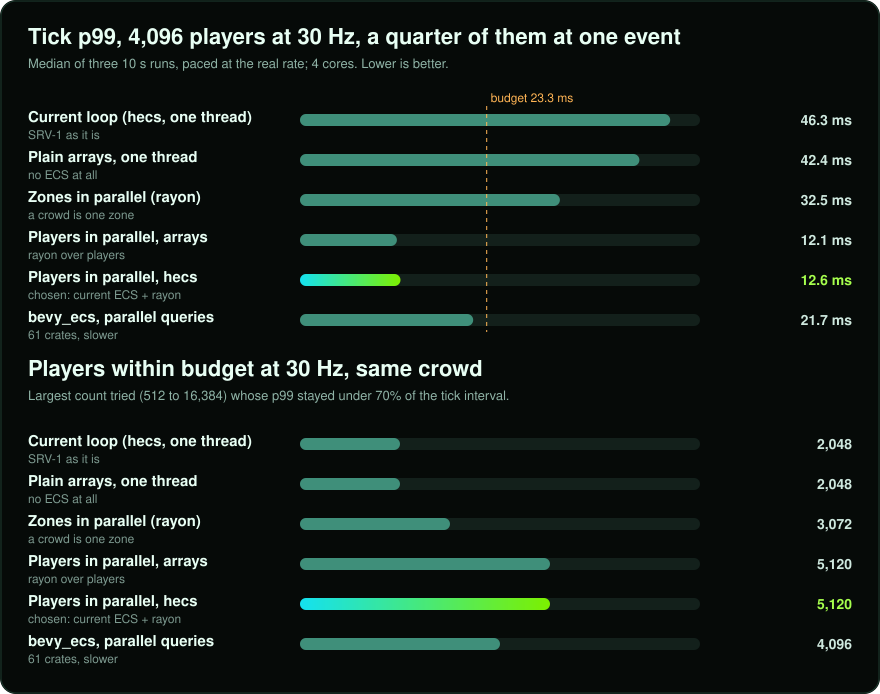

# Tick models for the world server: what we measured and what we chose

Measured 2026-11-24 on the project's own tick loop (SRV-1, SRV-2) and interest management (IM-1), with rayon
1.12.0, hecs 0.11.2 and bevy_ecs 0.20.1. Task: SRV-3 (#69).

The question: how should the world server run a tick so that 4096 players fit, at 30 Hz and at 60 Hz, with a
p99 tick under the budget of architecture.md (70% of the interval: 23.3 ms at 30 Hz, 11.7 ms at 60 Hz), and what
happens when players crowd into one place, as they do at any roleplay event?

## Short answer

**We chose to keep the current loop on hecs and run each system's per-player work in parallel with rayon
("players in parallel"), with effects on other players collected and applied in one serial, ordered phase.** On
4 cores, at 4096 players and 30 Hz, it cut tick p99 in the crowd from 46.3 ms (twice the budget) to 12.6 ms
(half of it), and raised the players that fit in the budget there from 2,048 to 5,120. It ends every tick in exactly the same
world as the one-thread loop. Zones in parallel were as fast while players were spread out and no faster than one
thread once a quarter of them gathered in one place; bevy_ecs was 30 to 40% slower with a worse tail and brings 61
crates and proc macros. See [What we chose and why](#what-we-chose-and-why).

<p align="center"></p>

4096 players at 30 Hz, tick p50 / p99 in ms (p99 is the median of three runs, their range in brackets):

| Model | Spread over 8 km | City, 3 km | Crowd: city + 1,024 at one event | CPU per tick, city / crowd | Players within budget, city / crowd |
|---|---:|---:|---:|---:|---:|
| Current loop (hecs, one thread) | 4.0 / 7.1 (6.9–8.9) | 10.1 / 18.7 (15.5–19.7) | 29.2 / **46.3** (41.7–48.7) | 10.8 / 30.4 ms | 4,096 / 2,048 |
| Plain arrays, one thread | 4.1 / 7.3 (6.4–11.3) | 9.4 / 15.7 (15.5–16.3) | 27.8 / 42.4 (39.4–42.8) | 9.8 / 29.3 ms | 5,120 / 2,048 |
| Zones in parallel (rayon) | 2.0 / 4.7 (3.1–5.0) | 4.2 / 5.6 (5.4–7.4) | 23.5 / 32.5 (30.4–33.4) | 12.3 / 29.6 ms | 8,192 / 3,072 |
| Players in parallel, plain arrays | 1.8 / 4.1 (3.6–6.3) | 3.5 / 6.0 (5.8–6.4) | 8.7 / 12.1 (11.6–12.7) | 11.7 / 31.6 ms | 8,192 / 5,120 |
| **Players in parallel, hecs** | **1.7 / 3.4 (3.1–3.5)** | **3.8 / 5.4 (4.7–8.3)** | **9.0 / 12.6 (12.1–13.4)** | **12.9 / 33.4 ms** | **8,192 / 5,120** |
| bevy_ecs, parallel queries | 2.3 / 5.0 (4.2–5.6) | 4.9 / 15.5 (9.7–23.5) | 12.4 / 21.7 (19.3–23.7) | 13.8 / 37.0 ms | 6,144 / 4,096 |

- **The current loop does not hold 4096 players in a crowd.** Every one of its crowd ticks was over budget, at
  either rate. Spread out or in a city it fits at 30 Hz, but with p99 at 80% of the budget in the city.
- **Splitting the work by player is what pays.** With 4 threads the p50 fell 2.7 times in the city and 3.2 times
  in the crowd, for 10 to 20% more CPU in total. It does not matter where the players stand.
- **Splitting by zone fails exactly where it is needed.** A zone is one task, so an event that fills one zone runs
  on one thread: in the crowd, zones gave 1.2 times one thread's speed with 2 threads and nothing more with 3 or 4.
- **hecs costs little.** Plain arrays without an ECS were up to 7% faster on one thread (not at all when spread)
  and no faster on four, within the noise of this machine. Rewriting the world as arrays buys nothing measurable.
- **60 Hz does not fit 4096 players on 4 cores.** Players in parallel held the city (p99 6.1 ms of 11.7) but went
  over budget in 4% of crowd ticks (p99 13.3 ms). 30 Hz, the top of architecture.md's 20–30 Hz, is the rate to plan
  for.
- **Every model ended in the same world**, bit for bit, on 1, 2 and 4 threads: the parallel phases only write the
  player they run for, and transfers between players are applied serially in a fixed order.

All figures come from one 4-core VM, a synthetic tick and simulated players. Read
[What was not measured](#what-was-not-measured) before relying on them.

## What was compared

One harness, [`bench/`](bench/src/main.rs), runs one model at a time. Every model does the same work per tick,
calls the same per-player functions ([`logic.rs`](bench/src/logic.rs)) and must end in the same world; they differ
only in how the state is stored and how the work is scheduled.

**The tick** has six phases, in this order:

1. **Ingest**: apply each client's reported position and velocity, rejecting impossible ones (over 60 m/s, a jump
   longer than the speed allows, outside the map), as the server validates movement (architecture.md, Authority).
2. **Grid**: update the project's `SpatialGrid` with every position. One thread in every model, since the grid is
   one shared structure.
3. **Visibility**: the project's `VisibleSet::update` for every player (IM-1: 200 m to enter, 230 m to leave).
4. **Roleplay logic**: hunger, health and a job timer that pays a wage every 30 s; and with a chance of 0.3% per
   player per tick, a hand-over of money to the nearest visible player, which reads other players' positions.
5. **Transfers**: the hand-overs, sorted by sender and applied one by one if the sender can still pay. Serial in
   every model, because it writes two players at once.
6. **Snapshot**: each player's 128 nearest visible entities, by id, with positions in centimetres: what the world
   hands the gateways. Ranking by priority (#18) does not exist yet, so nearest-first stands in for it.

**The players** ([`sim.rs`](bench/src/sim.rs)) move as in the IM-1 benchmark: a quarter drive at up to 40 m/s, the
rest walk at up to 7 m/s, each turning about every 5 s. One state in 20,000 claims a 300 m jump, which ingest must
reject. Three scenarios:

- **Spread**: everyone in an 8 km square (about 9 visible entities each);
- **City**: everyone in a 3 km square (about 60 visible);
- **Crowd**: the city, with every fourth player at one event within 100 m of a point. At 4096 players that is
  1,024 people who all see each other, and an average visible set of 307 across all players.

The clients run on the main thread between ticks, outside the timed tick (about 60 µs per tick at 4096 players).

**The models:**

- **Current loop** ([`ecs_hecs.rs`](bench/src/ecs_hecs.rs), `Current`): `sawgrass_server::TickLoop` as SRV-1 and
  SRV-2 left it, with the six phases as six systems run in order on one thread; the grid and the inbox live in
  state the systems share. Each tick is `TickLoop::run_tick`.
- **Plain arrays, one thread** ([`soa.rs`](bench/src/soa.rs)): one `Vec` per field, indexed by player, no ECS:
  what the ECS itself costs.
- **Zones in parallel** ([`zones.rs`](bench/src/zones.rs)): the map cut into 1 km squares (64 zones when spread, 9
  in the city); each zone owns its players, each phase runs one rayon task per zone, and a player crossing a
  border is handed to the next zone after ingest. Other zones' positions are read from one array rebuilt after
  movement. This is zoning inside one process, not the separate-process zones of architecture.md's scaling path.
- **Players in parallel, plain arrays** ([`soa.rs`](bench/src/soa.rs)): the arrays, with every per-player phase
  split across all players by rayon (`par_iter_mut`, at least 32 players per task).
- **Players in parallel, hecs** ([`ecs_hecs.rs`](bench/src/ecs_hecs.rs), `HecsRayon`): the current world, with
  every per-player system split across threads by hecs's own `iter_batched` (64 entities per batch) and rayon.
  Other players' positions are read through a hecs `View`.
- **bevy_ecs** ([`ecs_bevy.rs`](bench/src/ecs_bevy.rs)): the six phases as bevy systems chained in one `Schedule`,
  each using `par_iter_mut` on bevy's compute task pool, run by bevy's multi-threaded executor. A variant with the
  single-threaded executor (the systems are chained, so there is nothing to overlap) was within the noise of it
  in trial runs and is left out of the tables.

### How it was run

- **At the real rate.** Each tick starts on a fixed grid (tick n at start + n × interval) and the thread sleeps
  until then, as `TickLoop::run` does, so a parallel model pays for waking its threads every tick. A tick's
  duration is the time from its start to the end of its last phase. A model that falls more than a tick behind
  skips slots, as `TickLoop::run` does.
- **3 s of warm-up, then 10 s measured**: 300 ticks at 30 Hz, 600 at 60 Hz.
- **Each run is its own process, pinned** to as many cores as it has threads; the one-thread models to one core.
  The parallel models run 4 threads on the 4 cores.
- **Headline**: 4096 players, every model, scenario and rate, three rounds; each round runs every configuration
  once, so drift on the VM falls on all of them alike. Tables show the median p50, the median p99 and the range
  of the three p99s.
- **Scaling**: the parallel models at 4096 players and 30 Hz with 1, 2, 3 and 4 threads.
- **Sweep**: 512 to 16,384 players, in steps, until a count's p99 passes the budget. One round, so a count near the
  limit can pass or fail by noise.
- **Determinism**: every model for 300 ticks at 2,048 players in every scenario, on 1, 2 and 4 threads, compared
  by a hash of every player's position, vitals, job, money, violations, visible set and snapshot.
- **CPU per tick**: user plus system time of the whole process over the measured run, from `/proc`, minus the
  time the main thread spent simulating clients, divided by ticks. It includes time threads spend spinning
  while waiting for work.

[`run.py`](run.py) runs everything with fixed arguments and writes [`results/`](results/) (the sweep as
`sweep-30.jsonl` and `sweep-60.jsonl`).

## Results

Machine: one cloud VM, 4 vCPU (Intel Xeon 2.3 GHz, 4 cores, no hyper-threading), 16 GB RAM, Linux.

### 4096 players at 60 Hz

Tick p50 / p99 in ms, as above:

| Model | Spread | City | Crowd | Crowd ticks over budget |
|---|---:|---:|---:|---:|
| Current loop | 3.7 / 7.2 (7.0–8.2) | 9.8 / 17.1 (16.9–17.3) | 29.6 / 50.8 (50.5–53.0) | 100% |
| Plain arrays, one thread | 3.6 / 7.2 (5.7–7.4) | 9.2 / 19.0 (18.3–19.1) | 28.7 / 44.1 (43.3–44.2) | 100% |
| Zones in parallel | 1.9 / 4.2 (3.0–5.1) | 3.8 / 6.7 (6.6–8.2) | 24.3 / 36.3 (33.3–39.8) | 100% |
| Players in parallel, arrays | 1.7 / 3.9 (3.7–4.4) | 3.4 / 5.9 (4.9–6.8) | 9.7 / 13.4 (10.6–13.8) | 4.2% |
| **Players in parallel, hecs** | **1.7 / 3.6 (2.5–5.7)** | **3.5 / 6.1 (6.1–6.9)** | **9.3 / 13.3 (12.2–14.4)** | **3.9%** |
| bevy_ecs | 2.5 / 4.4 (3.5–5.0) | 4.7 / 8.5 (7.0–14.0) | 13.1 / 19.9 (19.6–26.7) | 77% |

At 30 Hz the parallel-by-player models had no tick over budget in any scenario; the current loop had every crowd
tick over budget and 0.6% of city ticks (5 of 900).

### Players within budget

Largest player count tried whose p99 stayed within budget, counting up (one round):

| Model | 30 Hz: spread | city | crowd | 60 Hz: spread | city | crowd |
|---|---:|---:|---:|---:|---:|---:|
| Current loop | 10,240 | 4,096 | 2,048 | 4,096 | 3,072 | 1,024 |
| Plain arrays, one thread | 8,192 | 5,120 | 2,048 | 6,144 | 3,072 | 1,024 |
| Zones in parallel | ≥16,384 | 8,192 | 3,072 | 12,288 | 5,120 | 1,024 |
| Players in parallel, arrays | ≥16,384 | 8,192 | 5,120 | 12,288 | 6,144 | 3,072 |
| **Players in parallel, hecs** | **≥16,384** | **8,192** | **5,120** | **12,288** | **6,144** | **3,072** |
| bevy_ecs | ≥16,384 | 6,144 | 4,096 | 8,192 | 3,072 | 2,048 |

The counts tried were 512, 1,024, 2,048, 3,072, 4,096, 5,120, 6,144, 8,192, 10,240, 12,288 and 16,384, so each
figure means "this passed and the next one failed". The two one-thread models differ by one step in places where
they did not differ in the headline runs (current 10,240 against arrays 8,192 when spread): single runs near the
limit are within noise of each other. The crowd grows with the player count (a quarter of them at the event), so
its cost grows with the square of the count: 1,024 at the event see 1,023 others each.

### Scaling with threads

4096 players, 30 Hz, tick p50 / p99 in ms (one run each):

| Model | City, 1 thread | 2 | 3 | 4 | Crowd, 1 thread | 2 | 3 | 4 |
|---|---:|---:|---:|---:|---:|---:|---:|---:|
| Players in parallel, arrays | 9.7 / 14.3 | 5.5 / 10.5 | 4.7 / 6.8 | 3.7 / 8.8 | 28.4 / 44.5 | 17.0 / 25.5 | 11.8 / 18.8 | 9.2 / 12.7 |
| Players in parallel, hecs | 10.2 / 16.0 | 6.0 / 10.1 | 4.8 / 7.6 | 3.8 / 8.0 | 29.4 / 46.4 | 18.4 / 23.4 | 11.9 / 15.9 | 9.0 / 14.0 |
| Zones in parallel | 10.1 / 15.3 | 6.2 / 8.8 | 4.5 / 6.2 | 4.2 / 7.3 | 30.7 / 40.5 | 24.4 / 36.2 | 24.9 / 39.9 | 26.3 / 37.3 |
| bevy_ecs | 11.4 / 21.2 | 8.1 / 15.1 | 6.3 / 13.5 | 5.5 / 10.5 | 34.4 / 60.7 | 24.8 / 33.1 | 17.5 / 27.8 | 14.2 / 21.2 |

- Players in parallel scaled 2.6 to 2.7 times on 4 threads in the city and 3.1 to 3.3 times in the crowd, where
  there is more work per player to split. On one thread they cost what the one-thread models cost (rayon and
  hecs batching add 1 to 3%).
- Zones scaled like players in parallel in the city, where 9 zones share the work, and stopped at 2 threads in the
  crowd: the event zone holds a quarter of the players and most of the work.
- bevy_ecs on one thread was 12 to 18% slower than the current loop, and fell further behind hecs with each thread:
  11 to 17% slower on one thread, 43 to 57% on four.

### Where the time goes

Per phase, plain arrays at 4096 players and 30 Hz, ms per tick (median of three runs):

| Phase | City, one thread | City, 4 threads | Crowd, one thread | Crowd, 4 threads |
|---|---:|---:|---:|---:|
| Ingest | 0.03 | 0.17 | 0.03 | 0.16 |
| Grid (serial) | 0.29 | 0.26 | 0.28 | 0.27 |
| Visibility | 7.69 | 2.36 | 20.92 | 5.81 |
| Roleplay logic | 0.04 | 0.07 | 0.05 | 0.07 |
| Transfers (serial) | under 0.01 | under 0.01 | under 0.01 | under 0.01 |
| Snapshot | 1.94 | 0.70 | 8.26 | 2.47 |

- Visibility is 70 to 77% of the one-thread tick and the snapshot 19 to 28%: the tick is interest management.
  Anything IM tasks do to visible sets (ranking, update rates, #18) moves every model's figures, and parallel
  models keep their lead because each viewer's update only reads the grid.
- The serial part is the grid rebuild (0.27 ms, 3% of one thread's city tick); the transfers are negligible. That
  leaves room for many more threads before the serial part dominates.
- Splitting cheap phases costs more than it saves: ingest went from 0.03 ms to 0.17 ms on 4 threads, which is the
  cost of handing out the tasks and waking the threads. Phases this small can stay serial.

### Was the comparison fair?

- **Same work, proven.** Every model calls the same per-player functions and ends in the same hash; the transfer
  counts match too. A model cannot be fast by skipping work.
- **The machine has 4 cores and the parallel models use all 4.** The main thread simulates clients only between
  ticks; bevy's executor also runs work on the calling thread, so it had 5 threads on 4 cores, as
  bevy does by default.
- **The tail is noisy on this VM.** Paced runs showed p99 1.5 to 2 times p50 even on one thread, and the three
  rounds' p99 differed by up to 50% (bevy in the city: 9.7 to 23.5 ms). p50 was stable within 20%, mostly within 10%. The
  conclusions rest on gaps larger than that spread: 46 against 13 ms in the crowd, all over budget against none.
- **Each model is written as its library suggests**, not tuned: hecs's `iter_batched` with a fixed batch of 64,
  rayon's `par_iter_mut` with 32 players at least per task, bevy's `par_iter_mut` with its automatic batch size.
  bevy might close part of its gap with tuning; the single-threaded executor did not.
- **Phase boundaries are the same everywhere**, including where a model could fuse phases (visibility, logic and
  snapshot only read others' state and could be one pass). Fusing would help all parallel models alike.

### What was not measured

- **More than 4 cores.** A dedicated server has 16 or more; scaling past 4 threads, memory bandwidth and NUMA were
  not measured. Players in parallel was still scaling at 4, zones in the crowd had stopped at 2.
- **The rest of the server**: scripts ([scripting-engines](../scripting-engines/README.md) ran every engine on one
  thread), the gateways and QUIC (the server now runs them on tokio next to the tick thread, so a rayon pool must
  leave them cores), RocksDB group commit,
  vehicles and NPCs owned by clients, routing buckets. Scripts in particular may not be callable from many
  threads, which would make their phase serial.
- **Real movement and real crowds.** The bots (BOT-1, BOT-2) will give real input and real visible sets.
- **IM-2's dense grid and bitset visible sets** ([visibility-index](../visibility-index/README.md), #80), chosen
  while this ran and not yet in the server. This harness calls today's `interest.rs`. IM-2 cut the same
  visible-set work 1.7 to 4.5 times on one thread; since it is 70 to 77% of the tick here, every model would get
  faster. Our rough estimate, not a measurement: the one-thread crowd tick at 4096 players would fall from about
  29 ms to about 16 ms (p50), still leaving its p99 near the 23.3 ms budget. The comparison between models does
  not depend on it: the per-player work stays per player, and a crowd still lands in one zone.
- **Separate-process zones** (architecture.md, scaling path step 3), with entity hand-off over the network. The
  in-process zones here have no border protocol and still lost in the crowd; separate processes would lose more,
  since a crowd in one zone is then one process.
- **Allocators and async runtimes**, compared in their own task; this harness used the system allocator.
- **Other ECS libraries**: shipyard and flecs (a C library) were not tried; specs and legion are no longer
  maintained.
- **Tick rates under 30 Hz.** architecture.md allows 20 Hz, which would give each tick 50% more time.

## What we chose and why

**Players in parallel on the current hecs world: rayon over each system's players, effects on other players
collected and applied in a serial phase in a fixed order, at 30 Hz.**

- **It holds 4096 players at 30 Hz in every scenario on 4 cores**, with p99 at half the budget in the crowd
  (12.6 of 23.3 ms) and no tick over budget, where the current loop missed every crowd tick.
- **It does not care where players stand.** A roleplay server's worst case is a crowd: a car meet, a concert, a
  police chase. Zones get no help from extra cores there.
- **It keeps what exists.** `TickLoop`, hecs and the per-system design stay; each system that loops over players
  gets a parallel loop. The only new dependency is rayon (6 crates, MIT OR Apache-2.0). Plain arrays measured no
  faster with 4 threads, so a rewrite away from hecs is not worth it.
- **It is deterministic.** A system in the parallel loop writes only the entity it runs for and reads others; a
  change to another entity (money, damage, ownership) becomes a command applied after the loop, in order of the
  entity that issued it. The determinism suite got the same world on 1, 2 and 4 threads. That rule is what keeps
  roleplay state safe: no two threads ever write one wallet.
- **It is cheap in CPU**: 10 to 20% more CPU time than one thread for 2.7 to 3.2 times shorter ticks.

What it takes, as a follow-up task for the server: a rayon pool owned by `TickLoop` (its size a setting, so
gateways and the store keep their cores); systems that use `iter_batched` with rayon for per-player work; a
command list for cross-entity effects, applied in a serial system; phases as small as ingest kept serial. The
`TickMetrics` budget check stays as it is.

### Why not the others

| Option | Measured (4096 players, 30 Hz, crowd) | Why not |
|---|---|---|
| Current loop, one thread | p99 46.3 ms, every tick over budget; 2,048 players fit | Twice the budget in a crowd; already 80% of it in the city. |
| Plain arrays, one thread | p99 42.4 ms; 2,048 players fit | Up to 7% faster than hecs on one thread: a rewrite for less than the noise. |
| Zones in parallel | p99 32.5 ms, 56% of ticks over budget; 3,072 fit | As fast as players in parallel when spread, but a crowd in one zone runs on one thread. Also adds hand-off code. |
| Players in parallel, plain arrays | p99 12.1 ms; 5,120 fit | Equal to hecs within noise; would mean leaving the ECS for nothing. |
| bevy_ecs | p99 21.7 ms, 0.8% over budget; 4,096 fit | 30 to 40% slower p50 and a wider tail; at 60 Hz 77% of crowd ticks over budget. 61 crates including proc macros, which the project avoids (AGENTS.md). |

### What would change the answer

- Scripts that cannot run on several threads, if the roleplay logic phase grows to a large share of the tick:
  that phase would become serial, and the gain would shrink to what the other phases give.
- IM-2's bitset sets, then ranking and update rates (#18): the tick gets cheaper for every model, and if it falls far
  enough the one-thread loop could hold 4096 at 30 Hz. Parallelism would then be headroom rather than a need.
- A server with many cores where players in parallel stops scaling (memory bandwidth), which would make
  separate-process zones worth their complexity for the spread part of the map, but still not for crowds.

## Licences

Checked against the manifests of the versions used. Sawgrass is AGPL-3.0, and #44 proposes MIT OR Apache-2.0.

| Component | Licence | Crates it brings (itself included) | Fits AGPL-3.0 and MIT OR Apache-2.0 |
|---|---|---:|---|
| Current loop, zones, plain arrays | our code | 0 | Yes |
| rayon 1.12.0 (rayon-core 1.13.0) | MIT OR Apache-2.0 | 6 | Yes |
| hecs 0.11.2 (already a dependency) | MIT OR Apache-2.0 | 4 | Yes |
| bevy_ecs 0.20.1 (with bevy_tasks) | MIT OR Apache-2.0 | 61, with 5 proc-macro crates | Yes |

All of these licences, and those of bevy_ecs's dependencies (MIT, Apache-2.0, Zlib, Unicode-3.0 and their
combinations), are in the allow list of `deny.toml`.

## Reproduce

```sh
cd bench && cargo build --release && cd ..
python3 -I run.py check      # determinism, about 1 minute
python3 -I run.py headline   # about 25 minutes
python3 -I run.py scaling    # about 7 minutes
python3 -I run.py sweep      # about 50 minutes
python3 -I chart.py          # redraws docs/assets/tick.svg
```

A single run: `bench/target/release/tick-bench run hecs-rayon crowd 4096 30 4 10` (model, scenario, players,
rate, threads, seconds), which prints one JSON line.

## Sources

- rayon's work-stealing pool and parallel iterators: <https://docs.rs/rayon/1.12.0/rayon/>.
- hecs batched iteration for thread pools (`QueryBorrow::iter_batched`) and `View`:
  <https://docs.rs/hecs/0.11.2/hecs/>.
- bevy_ecs schedules, executors and `Query::par_iter_mut`: <https://docs.rs/bevy_ecs/0.20.1/bevy_ecs/>.
- The budget, tick rate and scaling path: [architecture.md](../../architecture.md).
