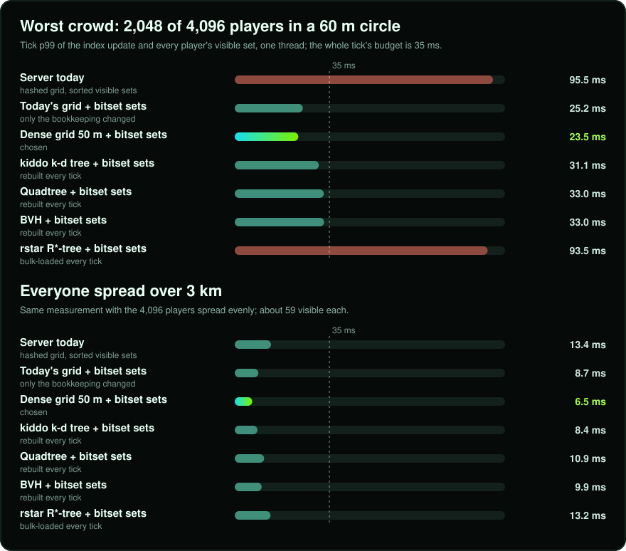

# Spatial index for visible sets: what we measured and what we chose

Measured 2026-11-24 on top of IM-1 (#4): the server's `SpatialGrid` and `VisibleSet` in
`crates/sawgrass-server/src/interest.rs`, with rstar 0.14.0 and kiddo 6.3.1. Task: IM-2 (#77).

The question: which spatial index should find each player's nearby entities, so that the visible sets of 4096
players stay inside the tick budget, above all in roleplay's worst case, when hundreds of players stand in one
place (an event, a bank job, the spawn)? Speed and reliability count equally: an index that is fast but fails
on some input is out.

## Short answer

**We chose a dense grid of 50 m cells over the whole map, rebuilt every tick, together with visible sets stored
as one bit per entity instead of sorted lists.** In the worst crowd measured (2,048 of the 4,096 players inside
60 m), the tick for every player's visible set fell from 72 ms (p99 96 ms) to 16 ms (p99 24 ms) on one thread,
and to 7.5 ms (p99 16 ms) on four. With everyone spread over 3 km it fell from 9.4 to 4.6 ms. See
[What we chose and why](#what-we-chose-and-why).

**The bitsets need dense, recycled entity slots.** They were measured over ids 0 to 4095. The server today hands out
ids from a counter that never reuses them, so a bitset over those ids would grow without bound; and reusing a slot
naively would hide a player swap from every viewer. The precondition is spelled out in
[What we chose and why](#the-precondition-dense-slots-cleared-before-reuse).

<p align="center"></p>

Tick for all 4096 visible sets (index update plus every player's set), one thread, median of three runs:

| Index + visible sets | Worst crowd (2,048 in 60 m) | 1 km crowd (IM-1) | Spread over 3 km | Spread over 8 km | Index memory |
|---|---:|---:|---:|---:|---:|
| Server today: hashed grid + sorted sets | 72.3 ms (p99 95.5) | 53.9 (70.7) | 9.4 (13.4) | 3.6 (4.2) | 340 to 540 KB |
| Today's grid + bitset sets | 15.8 (25.2) | 22.7 (30.2) | 6.7 (8.7) | 4.1 (5.5) | 340 to 540 KB |
| **Dense grid 50 m + bitset sets** | **16.0 (23.5)** | **17.6 (23.3)** | **4.6 (6.5)** | **2.1 (2.8)** | **169 KB** |
| Dense grid 25 m + bitset sets | 16.3 (25.7) | 15.6 (21.4) | 5.1 (6.9) | 2.6 (3.4) | 484 KB |
| kiddo k-d tree, rebuilt + bitset sets | 20.0 (31.1) | 22.3 (32.1) | 6.4 (8.4) | 2.3 (2.9) | 52 KB |
| Quadtree, rebuilt + bitset sets | 22.3 (33.0) | 26.8 (42.3) | 8.3 (10.9) | 3.9 (5.0) | 77 KB |
| BVH, rebuilt + bitset sets | 23.8 (33.0) | 24.3 (32.4) | 7.9 (9.9) | 3.7 (5.0) | 77 KB |
| rstar R*-tree, bulk-loaded + bitset sets | 52.3 (93.5) | 39.8 (66.7) | 11.2 (13.3) | 4.5 (5.8) | 245 KB |

- **The visible-set bookkeeping, not the index, was most of the crowd's cost.** With today's code a player in
  the crowd checks each of about 1,100 candidates against a sorted list, sorts the next list and merges the
  two. The index's own queries took 7.4 ms of the 72 ms tick. Keeping the same grid and only storing each set
  as bits cut the tick to 15.8 ms.
- **Among indexes the dense grid was fastest or tied everywhere** with everyone inside the radius (today's
  rule): 1.3 to 1.9 times faster than today's hashed grid when players are spread out, tied with it in the
  2,048-player crowd, where both read the same 1,100 entities per player. Every tree was slower: they prune
  space well, but a 230 m query over a crowd returns most of it anyway, and a cell scan reads it from one
  contiguous run.
- **When the set is cut to the 128 nearest** (the cut architecture.md plans), the dense grid was again best, and
  25 m cells beat 50 m in the largest crowd (10.2 against 15.7 ms with 2,048 in 60 m). The cell size is a constant,
  to be tuned again when the ranking task lands.
- **Reliability.** kiddo's mutable k-d tree refused 512 players on one spot (more than 32 entities sharing a
  coordinate), which is what a spawn point produces. Every other index returned exactly what brute force
  returned, at 70,320 viewer positions per index. The dense grid has no recursion, no allocation after the first tick and
  no failure path.

All figures come from one shared 4-core VM and simulated movement. Read [What was not measured](#what-was-not-measured)
before relying on them.

## What was compared

One harness, [`bench/`](bench/src/main.rs), moves 4096 players at 20 Hz and every tick updates the index with
every position, then recomputes every player's visible set with the server's rule: an entity enters within
200 m and leaves only beyond 230 m (`VisibilityConfig::default`). Each index is used through one trait
([`index.rs`](bench/src/index.rs)): update with all positions, everything within a radius, and the k nearest
within a radius.

**The indexes:**

- **Server today** (`current`): `SpatialGrid` and `VisibleSet` from `sawgrass-server`, called exactly as the
  IM-1 benchmark does. 100 m cells in a hash map, entities moved in place with `upsert`.
- **Today's grid** (`grid-current`): the same `SpatialGrid`, driven by the harness so that it can be combined
  with the other visible-set layout and with the nearest-k query (all within the radius, then cut).
- **Dense grid** ([`index.rs`](bench/src/index.rs), `DenseGrid`): one array of cells over fixed map bounds
  (8,192 m square here; positions outside are clamped to the edge cells). Every tick the entities are counted per
  cell and written out sorted by cell, row by row, so a query reads one contiguous run of positions per row of
  cells it covers. Cells of 25, 50 and 100 m were measured. The nearest-k query scans rings of cells outward and
  stops once the next ring cannot hold anything nearer than the k-th found.
- **Quadtree** and **BVH** ([`tree.rs`](bench/src/tree.rs)), our own, both rebuilt every tick (every entity moves
  every tick, so an update in place would touch every leaf anyway). The quadtree splits square cells into four
  until a leaf holds 16, up to depth 20 so that stacked entities end in one leaf; the BVH splits at the median of
  the longer axis of the tight bounding box until a leaf holds 8, so its depth stays log2(n) whatever the input.
  Both answer nearest-k best first.
- **rstar** 0.14.0: the R*-tree, rebuilt with `bulk_load` every tick (`rstar-bulk`), or updated with `remove`
  and `insert` for every entity that moved (`rstar-insert`).
- **kiddo** 6.3.1, without default features: `ImmutableKdTree` rebuilt from the positions every tick
  (`kiddo-immutable`), or `MutableKdTree` updated with `remove` and `add` (`kiddo-mutable`).
- **Brute force**: every entity against every viewer; the correctness reference, and the floor when everyone
  is in one place.

**The visible sets** ([`main.rs`](bench/src/main.rs), `Viewer`), each combined with every index:

- **Sorted** (today's layout): the members as a sorted list of ids. Each candidate is looked up with a binary
  search, the next list is sorted, and the two are merged to find what entered and left.
- **Bits**: one bit per entity id. Membership is a bit test, the next set is built by setting bits, and what
  changed is the XOR of the two, word by word. The harness lists the changed ids in one list; a server needs
  entered and left apart, which is one more bit test per changed id (0.03 to 1.4 changes per player per tick
  here), so it would not move the figures.

**The queries:**

- **Radius**: everyone within the radii, which the server does today.
- **Nearest 128**: at most the 128 nearest within the radii, with the same enter and leave rule. This is the
  per-player cut architecture.md plans (100 to 150 entities), by distance only.

**The scenarios** ([`world.rs`](bench/src/world.rs)), all 4096 players. Spread players move as in IM-1: one in four
drives at up to 40 m/s, the rest walk or run at up to 7 m/s.

| Scenario | Players | Visible per player, radius |
|---|---|---:|
| `spread` | everyone over 8 km | 8.6 |
| `city` | everyone over 3 km | 58.8 |
| `crowd-1km` | everyone over 1 km (IM-1's crowd) | 466.9 |
| `event-512` | 512 milling at up to 1.5 m/s inside 40 m, the rest over 3 km | 123.0 |
| `event-2048` | 2,048 milling inside 60 m, the rest over 3 km | 1,077.7 |
| `spawn-512` | 512 standing on exactly the same point, the rest over 3 km | 121.1 |

### Tests

- **Correctness:** in every scenario, 20 ticks, every 7th player as a viewer, radii of 25, 230 and 1,000 m:
  each index's radius query must return exactly the entities brute force returns, and its nearest-129 query the
  same distances (which of several entities tied at the k-th distance it returns may differ).
- **Speed:** 20 ticks of warm-up, then 200 measured. Per tick: the index update; the queries alone for every
  player (what the index costs); and the update plus every visible set (the tick figure). Mean, p50, p99 and the
  slowest tick. One thread pinned to one core; the full matrix (6 scenarios, 12 indexes, 2 queries, 2 set
  layouts) ran once, and the eight headline combinations twice more; tables show the median of the three runs.
- **Four threads:** the main candidates with players split into four contiguous chunks on four cores (the index
  is only read while sets update). The index update stays on one thread.
- **Memory:** heap bytes held by the index and by all visible sets after the last tick, counted by a wrapper
  around the system allocator (`cap`).

[`run.py`](run.py) runs everything with fixed arguments and writes [`results/`](results/).

## Results

Machine: one cloud VM, 4 vCPU (Intel Xeon 2.1 GHz), 16 GB RAM, Linux.

### Correctness and failures

No index returned a different set or a different distance from brute force at any of the 70,320 viewer positions
per index (11,720 in each scenario, each checked with a radius query and a nearest-k query).

| Index | Failure |
|---|---|
| kiddo `MutableKdTree` | Refused `spawn-512` on the first tick: `add` returned `UnsplittableBucket`. Its buckets hold 32 entities, and it cannot split a bucket whose entities share the coordinate it would split on. kiddo documents this limit. |
| All others | None. The quadtree caps its depth, so the 512 stacked players end in one leaf; the BVH halves by count, so stacking does not deepen it; the dense grid puts them in one cell. |

`verify` checks the index queries only. The visible sets are checked by agreement: for every index and scenario,
the server's own `VisibleSet`, the harness's sorted sets and the bitset sets gave the same average set size and
the same entered-plus-left count per player and tick (for example 1,077.7 and 0.121 in the 2,048 crowd), so the
bitset layout computes the same sets as today's code, at least in aggregate.

One exception, with the nearest-128 cut at the spawn point: kiddo's rebuilt tree returns an arbitrary 128 of the
512 players tied at distance zero, and a different 128 every tick. Its viewers there saw 9.9 entities enter or
leave per tick instead of 0.14. Our indexes and brute force break ties by entity id, so the choice is stable. A
nearest-k cut needs a stable tie-break, or players on one spot flicker in and out of view.

### The index alone

Time for every player's query in one tick, without the visible-set bookkeeping, one thread, ms: the median of
three runs' means (brute force: one run):

| Index | Spread 8 km | Spread 3 km | 1 km crowd | 2,048 in 60 m | 512 on one spot |
|---|---:|---:|---:|---:|---:|
| Today's grid | 2.8 | 4.5 | 13.0 | 7.4 | 4.3 |
| **Dense grid 50 m** | **1.0** | **2.3** | **9.2** | **7.7** | **2.3** |
| Dense grid 25 m | 1.2 | 2.7 | 7.8 | 7.9 | 2.7 |
| kiddo, rebuilt | 1.3 | 4.0 | 13.0 | 12.0 | 4.9 |
| Quadtree | 2.5 | 5.8 | 18.0 | 14.5 | 5.4 |
| BVH | 2.3 | 5.3 | 15.9 | 15.6 | 5.5 |
| rstar, bulk-loaded | 2.8 | 7.9 | 30.5 | 42.6 | 9.7 |
| Brute force | 12.1 | 15.9 | 45.2 | 15.6 | 15.7 |

The update itself took 0.14 to 0.19 ms for the 50 m dense grid and kiddo, 0.1 to 0.3 ms for today's grid and the
quadtree, 0.4 ms for the BVH and the 25 m dense grid (more cells to clear), 0.7 to 0.8 ms for rstar's bulk load,
and 2.0 to 2.7 ms for rstar's remove and insert. In the 2,048 crowd every structure must read the same thousand
entities per player; there brute force, which reads all 4096 in order, was only twice as slow as the best index.

### Visible-set bookkeeping

With the same index (today's grid), radius query, one thread, mean (p99), ms:

| Scenario | Sorted sets (today) | Bitset sets |
|---|---:|---:|
| Spread 8 km | 3.7 (5.1) | 4.1 (5.5) |
| Spread 3 km | 9.7 (12.2) | 6.7 (8.7) |
| 1 km crowd | 57.3 (73.6) | 22.7 (30.2) |
| 2,048 in 60 m | 79.8 (111.3) | 15.8 (25.2) |
| 512 on one spot | 13.0 (18.9) | 6.8 (9.4) |

(The sorted column is the single run of the full matrix.) Sorted sets cost a binary search per candidate and a
sort per player, so they grow faster than the number of candidates: with 1,100 candidates per player they cost
64 ms more per tick than bitsets. Bitsets cost the same few word operations per candidate, plus a scan of 64 words per
player. With few entities in view (8 km spread) the scan is the larger part and bitsets were 10% slower.

Memory for all 4096 sets: sorted lists grew with what players see, from 0.6 MB spread over 8 km to 66 MB in the
2,048 crowd (the server's own `VisibleSet` with its change lists: 84 MB). Bitsets took 4.2 MB in every scenario:
two bitsets of 4,096 bits per player.

### Nearest 128

With bitset sets, one thread, mean (p99), ms:

| Index | Spread 3 km | 1 km crowd | 512 in 40 m | 2,048 in 60 m | 512 on one spot |
|---|---:|---:|---:|---:|---:|
| Today's grid (all, then cut) | 7.5 (9.6) | 23.4 (34.2) | 8.0 (11.0) | 18.5 (31.6) | 8.1 (11.7) |
| **Dense grid 50 m** | **6.6 (8.5)** | **11.0 (16.8)** | **7.1 (9.9)** | **15.7 (25.3)** | **7.6 (11.2)** |
| Dense grid 25 m | 9.1 (12.5) | 11.1 (15.3) | 9.3 (13.8) | 10.2 (14.6) | 9.4 (14.4) |
| kiddo, rebuilt | 10.6 (14.1) | 25.7 (33.9) | 11.6 (15.5) | 15.9 (22.9) | 10.6 (14.1) |
| Quadtree | 18.2 (24.6) | 33.5 (41.6) | 18.8 (23.7) | 23.7 (31.1) | 17.3 (22.8) |
| BVH | 19.2 (25.6) | 33.4 (43.9) | 20.0 (25.4) | 23.1 (29.4) | 21.3 (26.2) |
| rstar, bulk-loaded | 36.4 (48.4) | 59.8 (79.7) | 38.0 (50.5) | 44.9 (62.3) | 48.8 (67.8) |

The cut keeps sets at 128 or fewer (80 on average in the 2,048 crowd), which matters for bytes on the wire. It made
the tick cheaper only where the index can stop early: the 50 m dense grid went from 17.6 to 11.0 ms in the 1 km
crowd, the 25 m one from 16.3 to 10.2 ms in the 2,048 crowd. Today's grid, which collects everyone and then cuts,
gained nothing (15.8 to 18.5 ms in the 2,048 crowd), and spread out the cut costs more than it saves (4.6 to 6.6 ms
over 3 km for the 50 m grid). Smaller cells read less of a crowd, which is why 25 m won the largest one and lost
elsewhere (more cells per query).
The trees' best-first search pays a heap operation per node and per entity; the grid collects a ring and selects
the k-th once per ring. kiddo's nearest-k returns a fresh vector per query (its API), part of its cost.

### Four threads

Players split over four threads, bitset sets, mean (p99), ms; today's server code for comparison:

| Index | Spread 3 km | 1 km crowd | 2,048 in 60 m | 2,048 in 60 m, nearest 128 | 512 on one spot |
|---|---:|---:|---:|---:|---:|
| Server today (sorted sets) | 3.4 (5.4) | 16.8 (27.9) | 38.0 (54.4) | not run | 5.5 (8.6) |
| Today's grid | 2.5 (3.7) | 8.2 (10.8) | 7.0 (12.3) | 9.8 (16.0) | 2.5 (3.4) |
| **Dense grid 50 m** | **1.7 (2.9)** | **6.1 (9.8)** | **7.5 (16.0)** | **8.3 (11.8)** | **1.9 (2.7)** |
| Dense grid 25 m | 2.1 (3.0) | 6.9 (9.8) | 8.0 (15.7) | 4.4 (6.8) | 2.4 (3.7) |
| kiddo, rebuilt | 2.3 (3.4) | 7.5 (12.8) | 10.0 (16.0) | 7.3 (9.8) | 2.8 (3.9) |
| BVH | 2.9 (4.4) | 9.2 (14.8) | 12.4 (17.9) | 10.1 (13.8) | 3.4 (6.3) |

Four threads gave 1.9 to 3.2 times one thread's speed, not four: the harness starts its threads every tick, the
index update stays on one, and the VM's four vCPUs are shared. Every index here can be read from several threads at
once; none needed a lock. These ran once, so their p99s are noisier than the one-thread figures.

### Memory

Heap held by the index at the end of a run:

| Index | Heap | Depends on |
|---|---:|---|
| Today's grid | 340 to 540 KB | occupied cells (hash map of vectors) and entities |
| **Dense grid 50 m** | **169 KB** | map area (26,900 cells of 4 bytes over 8 km) and entities (16 bytes each) |
| Dense grid 25 m | 484 KB | four times the cells |
| kiddo, rebuilt | 52 KB | entities |
| Quadtree, BVH | 77 KB | entities |
| rstar, bulk-loaded / remove and insert | 245 KB / 430 to 510 KB | entities |

Every index is small next to the visible sets. A dense grid over a 16 km square at 50 m would hold 102,400
cells, 400 KB.

### Was the comparison fair?

- **Same movement, same rule, same machine.** Every index saw the same positions every tick, and every visible set
  was computed with the same enter and leave rule; only the index and the set layout changed.
- **The harness adds a little to today's grid.** Driven through the harness (`grid-current`, sorted sets), today's
  grid was 4 to 12% slower than the server's own code (`current`) on the same scenario, because the harness
  collects candidates into a list before filtering them. The headline "server today" row is the server's own code.
- **Our quadtree and BVH are simple.** They are rebuilt every tick, in about 100 lines; tuned versions (leaf
  sizes, SIMD leaf scans, a loose quadtree updated in place) would be faster. They would still read a crowd's
  whole membership for a radius query, which is where most of the time goes.
- **rstar is built for rectangles and inserts**, not for points that all move every tick, and its nearest
  iterator is general. kiddo is tuned for static point sets; its fastest paths need nightly Rust and its
  `simd` feature, which were not used.
- **p99 on a shared VM moves between runs.** The tables show the median of three runs; the range of the three
  is in the results (for example 23.5 to 24.8 ms for the dense grid's p99 in the 2,048 crowd, 92.6 to 99.6 ms
  for today's server code).

### What was not measured

- Real movement: players in this simulation move independently. Real crowds move together, cluster in
  interiors, and the game's entity count includes vehicles, NPCs and objects, not only players.
- Entity ids as the server issues them. The harness used ids 0 to 4095; the server's `net.rs` gives each
  connection the next value of a counter and never reuses one, so ids pass 4096 within hours of reconnects. See
  the precondition below. With dense slots, the size is set by how many entities exist at once: at 32,768 slots a
  bitset is 4 KB per set, 32 MB for 4096 players, and the per-player scan reads 512 words instead of 64 (about
  1 ms per tick at four threads, estimated, not measured). If slots grow that far, a set can keep its sorted list
  for listing and a per-thread scratch bitset for the membership test.
- Height and routing buckets (interiors, floors), ranking by speed and importance, and lower update rates for far
  entities: all planned (architecture.md, finding #18) and all change what a query must return.
- The whole server tick: this measures interest management alone, not the ECS, the gateways or scripts that share
  the 35 ms.
- A thread pool: the harness starts four threads every tick; a server would keep them.
- Other machines and the real map size (GTA VI's map bounds are not known; 8,192 m is a placeholder). Positions
  outside the bounds are clamped into the edge cells: queries stay correct, since distances use the real
  positions, but everything beyond the edge piles into one row of cells that every query near that edge scans.
  The bounds must cover the real map with a margin, so that a plane or a bad client position does not do that.

## What we chose and why

**A dense grid of 50 m cells over fixed map bounds, rebuilt every tick by counting entities into cells, and visible
sets stored as bitsets over entity ids**, both replacing the IM-1 code in `interest.rs`. The enter and leave radii,
the hysteresis and the public behaviour (what entered and what left) stay as they are.

- **Fast where it matters**: in the worst crowd, 16 ms per tick on one thread instead of 72 (p99 24 instead of 96);
  7.5 ms on four. Today's code alone overran the 35 ms budget of the whole tick; this leaves most of it for the
  rest of the server. Spread out, it was the fastest of all
  measured indexes, 1.3 to 1.9 times today's grid.
- **Predictable**: no recursion, no hashing, no allocation after the first tick, and memory fixed by the map size.
  Its cost depends only on how many entities are near each player, which is what the ranking cut will bound.
- **Robust to stacking**: entities on the same point land in one cell, and nothing in it can refuse an input.
- **Our own code, no new dependency**: about 100 lines for the grid and 40 for the bitset, with no `unsafe`.

The bitset is the larger half of the gain: on its own, with today's grid, it brought the 2,048 crowd from 72 to
16 ms. The dense grid adds the rest (1.3 to 1.9 times when players spread, and it scales better under the
nearest-128 cut).

### The precondition: dense slots, cleared before reuse

The bitsets were measured over ids 0 to 4095, and they only work over a dense id space. The task that moves this
choice into `interest.rs` depends on it:

- **Index sets by a dense slot, not by today's connection id.** `net.rs` gives every connection
  `next_id.fetch_add(1)` and never reuses an id; a bitset indexed by those ids grows with every reconnect (12.5 KB
  per set at 100,000 ids, two sets per player, and the scan with it). The server maps each live entity to a slot
  below the number of entities alive at once, and frees the slot when the entity goes.
- **A freed slot must not look like the same entity when it is reused.** If viewer A sees slot 17, its entity
  leaves the server, and a new entity takes slot 17 within the hysteresis window, A's bitset shows no change: A gets
  neither "left" for the old entity nor "entered" for the new one, and its client keeps showing the old entity's
  state. So either a freed slot is cleared from every visible set in the tick it is freed (reported as "left" to
  each viewer that had it) before it is handed out again, or each slot carries a generation that the set compares,
  and a changed generation counts as left plus entered.
- The bounds of the dense grid must cover the real map with a margin (see above).

### Why not the others

| Option | Measured, one thread | Why not |
|---|---|---|
| Today's hashed grid, sorted sets | 72 ms in the 2,048 crowd, p99 96 | Over the whole tick's budget twice; the sorted sets are most of it. |
| Today's grid with bitset sets | 15.8 ms in the crowd, 6.7 spread over 3 km | Ties the dense grid in the crowd, but 1.3 to 1.9 times slower spread out and twice as slow for the nearest-128 cut in the 1 km crowd; hashes every cell. |
| Dense grid, 25 m | 10.2 ms for nearest 128 in the crowd | Best for the nearest-128 cut in big crowds, slower everywhere else. Worth re-measuring when the cut is built. |
| kiddo `ImmutableKdTree` | 20 ms in the crowd, 2.3 ms spread over 8 km | Close spread out, 25 to 30% slower in crowds and up to 2.3 times slower for nearest-k. Its nearest-k picks an unstable 128 of players tied on one spot, so they flicker at a spawn point. A large dependency (23 crates without default features, about 970 `unsafe` in its source) for no gain. |
| kiddo `MutableKdTree` | refused | Fails on 33 or more entities at one coordinate: every spawn point. |
| Quadtree | 22 ms in the crowd | Slower than the grid in every scenario; needs a depth cap against stacking. |
| BVH | 24 ms in the crowd | Slower than the grid in every scenario. |
| rstar | 52 ms in the crowd, 45 ms for nearest 128 | Slowest index: built for rectangles and inserts, not for points that all move. Remove and insert cost 2 to 2.7 ms per tick before any query. |

### What would change the answer

- Far more entities than players (vehicles, NPCs, objects): bitsets grow with the number of slots, so the set
  layout may need the hybrid described above.
- If dense, safely recycled slots turn out to be impractical for the server, the bitset layout is off, and the next
  best measured option is the dense grid with sorted sets (71 ms in the 2,048 crowd, against 72 today): the grid
  alone does not fix the crowd.
- A much larger or unbounded map: the dense grid's memory grows with area; a hashed grid of the same cells, or a
  two-level grid, would bound it.
- Real crowds from the bots (BOT-2) being denser than 2,048 in 60 m, or the ranking cut becoming the main path:
  then 25 m cells, or a finer grid only where it is crowded.

## Licences

Checked against the manifests of the versions used. Sawgrass is AGPL-3.0, and #44 proposes MIT OR Apache-2.0.

| Component | Licence | Fits AGPL-3.0 and MIT OR Apache-2.0 |
|---|---|---|
| Dense grid, quadtree, BVH, bitset sets | our code | Yes |
| rstar 0.14.0 and its dependencies (heapless, num-traits, smallvec, ordered-float, hash32, libm, byteorder, stable_deref_trait) | MIT OR Apache-2.0, MIT, or Unlicense OR MIT | Yes |
| kiddo 6.3.1 | MIT OR Apache-2.0 | Yes |
| kiddo's dependencies without default features (aligned-vec, az, cmov, equator, generator, log, nonmax, num-traits, sorted-vec, tracing and others) | MIT, MIT OR Apache-2.0, or Apache-2.0 (sorted-vec) | Yes |
| cap 0.1.2 (harness only, counts heap bytes) | MIT OR Apache-2.0 | Yes |

All of these licences are in the allow list of `deny.toml`. The choice adds no dependency.

## Reproduce

```sh
cd bench && cargo build --release && cd ..
python3 -I run.py verify single threads repeat   # about 70 minutes on 4 cores
python3 -I chart.py                              # redraws docs/assets/visibility.svg
```

`run.py` pins single-thread runs to CPU 2 and the four-thread suite to CPUs 0 to 3, so run nothing else meanwhile.
One configuration: `bench/target/release/visibility-index-bench run grid-dense-50 event-2048 radius 1 200 bits`.

## Sources

- The current grid and visible sets: `crates/sawgrass-server/src/interest.rs` and its benchmark (IM-1, #4); the
  crowd figures of finding #18.
- kiddo's bucket limit for repeated coordinates: kiddo 6.3.1 crate documentation, `MutableKdTree`.
- The dense grid rebuilt by counting entities into cells is the cell-list method common in particle simulations.
