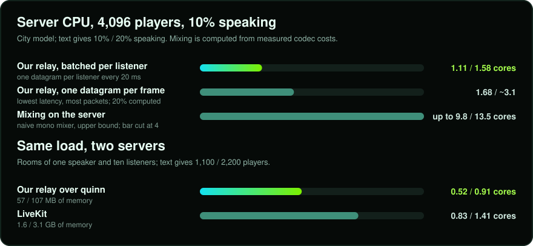

# Proximity voice chat: what we measured and what we chose

Measured 2026-11-24 on top of the transport choice of [NET-3](../network-transport/README.md) (QUIC through quinn
0.11.12), with libopus through the `opus` 0.3.1 crate and LiveKit server 1.13.11. Task: NET-7 (#68).

The question: how should voice reach players on a roleplay server of 4096, where a player hears the people near
them, their radio channel and their phone call? What does it cost the server in CPU and traffic, how late does a
word arrive, and what happens when packets are lost?

## Short answer

**We chose our own voice relay on the QUIC connection the client already has**: the client sends Opus frames
(24 kbit/s, 20 ms) as datagrams, the server decides who hears each frame (range, routing bucket, radio channel,
phone call) and sends each listener **one datagram every 20 ms holding every frame they should hear**. In-band
FEC is switched on when a client reports loss. See [What we chose and why](#what-we-chose-and-why).

<p align="center"></p>

| Option | Server CPU, 4,096 players, 10% / 20% speaking | Same load as LiveKit, 2,200 players | Latency the server adds, p50 / p99 | Why or why not |
|---|---:|---:|---:|---|
| **Our relay, batched per listener** | **1.11 / 1.58 cores** | **1.00 cores, 107 MB** | **13 / 26 ms** | **Chosen**: held 20% speaking at 4,096 within its 2 cores, everything delivered; one connection; server decides who hears. |
| Our relay, one datagram per frame | 1.68 / saturated | 0.91 cores, 107 MB | 2.6 / 24 ms | Lowest latency, but at 20% speaking it delivered 61% of frames. |
| Mixing on the server | 9.8 / 13.5 cores (computed) | not run | adds an encode | One stream per listener, but nine times the CPU and no per-speaker direction. |
| LiveKit | not established | 1.41 cores, 3.1 GB | 12 / 488 ms (generator near its limit) | 1.6 times our CPU and 30 times our memory for the same rooms, a second connection and a WebRTC stack in the client. |
| mediasoup | not run (estimate below) | not run | | Could not be built here; one worker per core, rooms piped between workers. |
| Mumble (FiveM's voice) | not run | not run | | Routes by channel or grid cell, so clients receive voice they should not hear. |

- **Packets, not bytes, set the cost.** Ten listeners per frame on average means 200,000 voice frames a second
  leave the server at 4,096 players and 10% speaking, 2.4 times the snapshot packets (82,000 a second). Batching
  per listener sends 79,000 datagrams instead, which cut the server's CPU by a third at 10% and kept it under its
  2 cores at 20%. The price is up to 20 ms of waiting in the batch.
- **Voice traffic is small next to snapshots**: 18 MB/s leaving the server at 10% speaking and 33 MB/s at 20%,
  against the 165 MB/s budget of architecture.md for snapshots.
- **In-band FEC is not free insurance.** libopus added recovery data only when told to expect at least 10% loss;
  then a lost frame came back at a 10 dB signal-to-error ratio against 2 dB for concealment. Sending each frame
  twice (RFC 2198 redundancy) recovered frames almost exactly, for twice the bytes.

All figures come from one 4-core VM and a simulated city. Read [Was the comparison fair?](#was-the-comparison-fair)
and [What was not measured](#what-was-not-measured) before relying on them.

## What was compared

One harness, [`bench/`](bench/src/main.rs), holds the world model, the codec tests and our relay with its load
generator. A second, [`livekit-load/`](livekit-load/main.go), is the same load generator for LiveKit, in Go,
because a LiveKit client needs a WebRTC stack. [`run.py`](run.py) runs everything with fixed arguments.

**The world** ([`world.rs`](bench/src/world.rs)). 4,096 players on a 6 by 6 km map: 70% in 64 hotspots whose
popularity falls off as 1/rank (the busiest draws about 600 players), each spread with a standard deviation of 8 to
40 m, a quarter of them interiors with their own routing bucket; 30% scattered in groups of one to four, as in cars.
3% are on the police radio (122 at 4,096), 1.5% on the medics', 10% on small channels of 4 to 12, and 4% are in
phone calls. Positions do not move during a run.

**Speech.** Each player alternates between silence and spurts of 1.5 s on average, so that 5, 10 or 20% speak at
any moment. Each spurt is a whisper (10%, 3 m), normal speech (75%, 7 m) or a shout (15%, 15 m); 30% of a radio
member's spurts go out on the radio as well; a player in a call is always heard by the other end. These ranges and
shares are our assumptions, not measurements of a real server.

**Who hears a frame**: everyone within range in the same bucket (a 16 m grid, 3 by 3 cells per query), plus the
radio channel for a radio spurt, plus the call partner, without duplicates. In the simulated city:

| Players | Speaking | Frames in / s | Listeners per frame, mean (p50, p99, max) | Frames out / s | Datagrams out / s, batched per 20 ms |
|---:|---:|---:|---|---:|---:|
| 1,024 | 10% | 5,111 | 4.95 (2, 43, 58) | 25,310 | 16,505 |
| 2,048 | 10% | 10,078 | 6.12 (2, 62, 114) | 61,640 | 35,154 |
| 4,096 | 5% | 9,889 | 10.21 (2, 122, 235) | 100,959 | 56,080 |
| 4,096 | 10% | 20,076 | 9.98 (2, 122, 237) | 200,386 | 79,427 |
| 4,096 | 20% | 40,084 | 10.00 (2, 122, 260) | 401,014 | 105,843 |

A fifth of frames reach nobody (a whisper in an empty street); the long tail is the police radio. Radio carries
17 to 21% of the frames sent. Deciding the listeners took 0.4 to 0.5 µs per frame on one core.

**The candidates:**

- **Our relay** ([`relay.rs`](bench/src/relay.rs)): the quinn server of NET-3. A frame is a datagram of 6 bytes
  (kind, speaker, sequence, flags) and the Opus payload. The server routes each frame as above and either sends it
  at once to every listener (*per frame*) or appends it to each listener's batch, which a timer sends every 20 ms
  (*batched*; 2 bytes of batch header and 6 per frame, split at 1,350 bytes).
- **Mixing on the server**: decode each speaker's frame once, add it with a gain into each listener's mix, encode
  one frame per listener. Computed from the measured cost of each step and the world's counts, not run.
- **LiveKit** 1.13.11, built from its published source (`go build ./cmd/server`), one node, all media on one UDP
  port ([`livekit.yaml`](livekit-load/livekit.yaml)). Clients are `server-sdk-go` 2.20.0 participants
  (DTLS-SRTP over pion).
- **mediasoup** 3.32.2 and **Mumble** were not run; see [Not run](#not-run-mediasoup-and-mumble).

**The payload.** Every frame carries 59 bytes, the mean Opus frame at 24 kbit/s measured below, with the send time
in its first bytes so that receivers measure latency. Both servers forward the payload unchanged.

### Two loads

- **The city** (our relay only): 1,024, 2,048 and 4,096 players at 5, 10 and 20% speaking, per frame and batched;
  at 4,096 and 10% also batches every 10 and 40 ms, and 40 ms Opus frames sent per frame.
- **Rooms**, the same load for our relay and LiveKit: rooms of 11 players, one speaking all the time and ten
  listening, 100, 200 and 372 rooms (1,100, 2,200 and 4,092 players; 50,000, 100,000 and 186,000 frames out a
  second). LiveKit has no notion of range, so a load both can serve has fixed listeners. A LiveKit server would
  handle proximity by changing each participant's subscriptions as players move; that churn is not in this test.

### Method

Server on CPUs 0 and 1 (quinn with 2 Tokio workers, LiveKit with `GOMAXPROCS=2`), load generator on CPUs 2 and 3.
After every client joined and 5 to 10 s of warm-up, each run measures 30 s. Server CPU is read by `run.py` from
`/proc` between the generator's `measuring start` and `measuring stop` lines, in the same way for both servers;
the generator reports its own CPU. A frame counts as delivered when a listener receives it; the generator knows
from the same world how many listeners each frame it sends should reach. Latency is the receive time minus the
send time written in the frame (same machine, same clock), in 10 µs buckets.

The codec suite ([`codec.rs`](bench/src/codec.rs)) encodes 60 s of synthetic speech: a glottal pulse train shaped
by vowel formants, some fricative noise and short pauses, generated in code so that no recording is needed. Speed
is the median of five passes over the 60 s on one core.

## Results

Machine: one cloud VM, 4 vCPU (Intel Xeon 2.3 GHz), 16 GB RAM, Linux 6.18.

### Our relay in the city

Server CPU in cores (the server had 2), and the share of expected frames delivered:

| Players | Speaking | Per frame: CPU | Delivered | Batched: CPU | Delivered | Datagrams out / s, per frame / batched |
|---:|---:|---:|---:|---:|---:|---:|
| 1,024 | 5% | 0.19 | 100% | 0.19 | 100% | 11,631 / 9,444 |
| 1,024 | 10% | 0.32 | 100% | 0.28 | 100% | 26,549 / 16,829 |
| 1,024 | 20% | 0.46 | 100% | 0.40 | 100% | 48,200 / 24,699 |
| 2,048 | 5% | 0.37 | 100% | 0.37 | 100% | 32,863 / 22,892 |
| 2,048 | 10% | 0.70 | 100% | 0.49 | 100% | 63,700 / 36,097 |
| 2,048 | 20% | 1.00 | 100% | 0.83 | 100% | 128,216 / 49,803 |
| 4,096 | 5% | 0.93 | 100% | 0.75 | 100% | 103,927 / 57,493 |
| 4,096 | 10% | **1.68** | 100% | **1.11** | 100% | 206,271 / 79,949 |
| 4,096 | 20% | 1.97 | **61%** | **1.58** | 100% | 249,434 / 104,931 |

- **CPU follows datagrams.** Per frame, a datagram cost 8 to 17 µs of server CPU, less as the load grew and the
  fixed cost of each connection was spread over more packets. Batching removed datagrams wherever a listener heard
  more than one speaker at once, which is common in a crowd.
- **At 4,096 and 20% speaking, sending per frame failed**: server and generator were both at their 2 cores, a
  third of the frames were lost, and p50 latency reached 197 ms. Batched, the same load used 1.58 cores and
  delivered everything.
- **At 4,096 and 10% speaking, the per-frame run was near the limit too**: server 1.68 and generator 1.69 of their
  2 cores, p99 24 ms. Its CPU figure is real, but it is close to the machine's limit, so the clean comparison of
  the two modes is at 2,048: 0.70 against 0.49 cores at 10%, 1.00 against 0.83 at 20%.
- Memory: 51 MB at 1,024 players, 97 MB at 2,048, 185 to 200 MB at 4,096, the same in both modes.

The batch interval trades CPU for latency (4,096 players, 10% speaking):

| Sending | Server CPU | Datagrams out / s | Latency p50 / p99 |
|---|---:|---:|---:|
| Per frame | 1.68 | 206,271 | 2.6 / 24 ms |
| Batched every 10 ms | 1.44 | 109,097 | 8.4 / 17.6 ms |
| **Batched every 20 ms** | **1.11** | **79,949** | **13.2 / 26.4 ms** |
| Batched every 40 ms | 0.82 | 40,824 | 24.5 / 46 ms |
| Per frame, 40 ms Opus frames | 1.04 | 103,257 | 1.9 / 8.0 ms, plus 20 ms more at the microphone |

Batched latency is the time a frame waits for its listener's next batch, 0 to 20 ms, plus the network. Its p50
varied between 6 and 19 ms between runs because the generator's send ticks and the server's batch timer drift
against each other.

### Same load: our relay and LiveKit

Rooms of one speaker and ten listeners:

| Players | Server | Server CPU | Busiest thread | Memory | Delivered | Latency p50 / p99 | Generator CPU |
|---:|---|---:|---:|---:|---:|---:|---:|
| 1,100 | Our relay, per frame | **0.52** | 0.26 | **57 MB** | 100% | 0.47 / 1.4 ms | 0.50 |
| 1,100 | Our relay, batched | 0.54 | 0.27 | 57 MB | 100% | 12.3 / 22 ms | 0.51 |
| 1,100 | LiveKit | 0.83 | 0.20 | 1,603 MB | 100% | 0.35 / 98 ms | 1.02 |
| 2,200 | Our relay, per frame | **0.91** | 0.45 | **107 MB** | 100% | 0.67 / 2.7 ms | 0.86 |
| 2,200 | Our relay, batched | 1.00 | 0.50 | 107 MB | 100% | 12.3 / 29 ms | 0.93 |
| 2,200 | LiveKit | 1.41 | 0.37 | 3,191 MB | 99.9% | 11.9 / 488 ms | 1.73 |
| 4,092 | Our relay, per frame | 1.83 | 0.92 | 193 MB | 99.8% | 1.8 / 138 ms | 1.75 |
| 4,092 | Our relay, batched | 1.66 | 0.83 | 192 MB | 100% | 14.5 / 39 ms | 1.57 |
| 4,092 | LiveKit | 1.88 | 0.67 | 6,012 MB | 91% | 988 / 1,000 ms | 1.83 |

- **LiveKit used 1.6 times the CPU of our relay** for the same forwarding (0.83 against 0.52 cores at 1,100,
  1.41 against 0.91 at 2,200): 15 to 17 µs of CPU per packet sent, against 9 to 10. Its published benchmark comes
  to a similar 13 µs: 80% of a 16-core machine for 959,156 audio packets a second.
- **LiveKit held about 1.45 MB per participant** (1.6 GB at 1,100, 6 GB at 4,092); our relay about 50 KB.
- **Batching does not help here**: each listener hears one speaker, so there is nothing to put together.
- **At 4,092 neither result is established**: both servers and both generators were at about 1.6 to 1.9 of
  their 2 cores. LiveKit fell behind by a second and lost 9% of the frames; 19% of its speakers were not sending
  (15,057 of 18,600 frames a second), so that row is not a like-for-like run. At 2,200 the LiveKit generator was
  at 1.73 of its 2 cores and 5% of its speakers did not publish, so LiveKit's p99 there may be the generator's.
- **LiveKit's p99 of 98 ms at 1,100** came with its generator at half its cores; whether the tail is the server's
  (pacing, per-room goroutines) or the Go client's was not isolated.

### Opus

libopus as bundled by `audiopus_sys` 0.2.2, mono, 48 kHz, `VOIP` application, variable bitrate:

| Setting | Mean frame | p99 | Encode / decode per frame |
|---|---:|---:|---:|
| 16 kbit/s, 20 ms | 37.9 B | 54 B | 224 / 22.6 µs |
| **24 kbit/s, 20 ms** | **59.2 B** | **86 B** | **107 / 19.4 µs** |
| 32 kbit/s, 20 ms | 78.5 B | 113 B | 104 / 20.2 µs |
| 24 kbit/s, 40 ms | 118.0 B | 164 B | 224 / 38.9 µs |
| 24 kbit/s, 60 ms | 177.6 B | 244 B | 362 / 57.5 µs |
| 24 kbit/s, 20 ms, complexity 1 | 52.9 B | 74 B | 66 / 23.3 µs |

- The encoder's look-ahead is 6.5 ms; with a 20 ms frame, a word leaves the client at the earliest 26.5 ms after it
  is spoken.
- A client encodes one stream (0.5% of a core) and decodes one per speaker it hears (about 0.1% each).
- 16 kbit/s was slower to encode than 24 kbit/s at the same complexity; we did not look into why.

**Mixing on the server**, from these costs: decoding every frame once (19.4 µs), adding each into its listeners'
mixes (0.10 µs per frame and listener) and encoding one frame per listener every 20 ms (105 µs at complexity 10)
comes to 8.7 cores at 4,096 players and 10% speaking, almost all of it encoding, plus the 1.1 cores of sending
what batching sends: 9.8 cores; 13.5 at 20%. Complexity 1 cuts encoding to 66 µs and the mixing to about 5.7 cores at 10%.

### Packet loss

24 kbit/s, 20 ms, 60 s of speech, five loss patterns per row. *Lost* frames are rebuilt from the next packet when
it arrives: its in-band FEC, or its redundant copy. The ratio compares the frame the client played with the one it
would have played had the packet arrived (higher is closer; a frame filled by concealment scores about 2 dB):

| Loss | Concealment only: frames concealed, ratio | In-band FEC (encoder told the loss): bytes, ratio | Redundant copy: bytes, frames concealed, ratio |
|---|---|---|---|
| 1% | 1.1%, 1.8 dB | 60.0 B, 2.0 dB | 122 B, 0.01%, 59 dB |
| 5% | 4.9%, 2.2 dB | 59.9 B, 2.0 dB | 122 B, 0.2%, 55 dB |
| 10% | 10.3%, 1.7 dB | 56.2 B, **10.0 dB** | 122 B, 1.0%, 48 dB |
| 20% | 20.3%, 0.9 dB | 60.1 B, **8.2 dB** | 122 B, 4.0%, 37 dB |
| 5%, bursts of 3 | 5.1%, -1.6 dB | 59.9 B, -1.7 dB | 122 B, 3.5%, 5.3 dB |
| 10%, bursts of 3 | 9.5%, -1.9 dB | 56.2 B, 0.8 dB | 122 B, 6.2%, 5.5 dB |

- **At 1 and 5% expected loss libopus wrote no recovery data at 24 kbit/s**: decoding from the next packet gave
  what concealment gives. From 10% it did, at no extra bytes (the encoder takes the bits from the main signal, and
  its encoding cost rose from 107 to 311 µs per frame).
- **A redundant copy of the previous frame** (RED, which WebRTC clients such as LiveKit's can send) rebuilt lost frames almost
  exactly, for twice the bytes; with bursts of loss, neither method helps much, since the next packet is lost too.
- The ratio is a crude proxy for what a listener hears; no perceptual measure (PESQ, POLQA, ViSQOL) was run.

### End to end

| Step | Time |
|---|---:|
| Frame and encoder look-ahead | 26.5 ms |
| Client to server, server to client | one round trip, about 40 to 100 ms on the internet (not measured) |
| Our relay: routing and sending, per frame / batched | 0.5 to 2.6 ms / plus 0 to 20 ms waiting |
| Jitter buffer on the client | about 40 ms (assumed, typical for VoIP) |

Batched, a word arrives in about 110 to 190 ms: inside the 150 ms one way that ITU-T G.114 recommends for players
on good connections, and well inside the 400 ms it still accepts for the rest.

### Traffic

Computed from the measured frame and datagram rates at 4,096 players, with 38 bytes of QUIC (NET-5) and 28 of
IPv4 and UDP per datagram, and for WebRTC 12 bytes of RTP (no header extensions arrived in our runs) and a 16-byte
SRTP tag:

| Leaving the server | 5% speaking | 10% | 20% |
|---|---:|---:|---:|
| Our relay, per frame | 13.2 MB/s | 26.3 MB/s | 52.5 MB/s |
| **Our relay, batched** | **10.4 MB/s** | **18.4 MB/s** | **33.3 MB/s** |
| WebRTC SFU, one packet per frame | 11.6 MB/s | 23.0 MB/s | 46.1 MB/s |
| Mixing on the server | 7.3 MB/s | 10.4 MB/s | 13.9 MB/s |

Arriving at the server: 1.3, 2.6 and 5.3 MB/s. A listener in a crowd hearing five speakers receives about
20 KB/s batched, half of the 40 KB/s snapshot budget per player.

### Routing by range, not by cell

What a server sends depends on who it thinks can hear. Mumble-based voice (FiveM's) sends to a channel or to the
players of nearby grid cells and leaves the cut by distance to the client. In the same city at 4,096 players, a
normal-speech frame reaches 6.4 players within 7 m, but 53 players in the 3 by 3 cells of 16 m around the speaker,
141 in cells of 64 m and 152 in cells of 128 m: 8 to 24 times the packets, and every one of those clients receives
voice it is not meant to hear, which a modified client can play.

### Not run: mediasoup and Mumble

**mediasoup** 3.32.2 builds its C++ worker with meson, which downloads libuv, OpenSSL, libsrtp and flatbuffers from
GitHub, wrapdb.mesonbuild.com and openssl.org; this machine's network allows none of them, and the prebuilt worker
is also downloaded from GitHub. From its documentation: a worker is one single-threaded process on one core and
"can typically handle over ~500 consumers in total"; a consumer is one listener receiving one speaker. Our city
at 4,096 players has about 26,000 speaker and listener pairs within normal range (6.4 per player), before radio
channels, so by that rule of thumb it would need about 50 workers, its routers piped together with
`pipeToRouter`, because one world does not split into rooms. That figure is an estimate from documentation, made
for video-heavy rooms; audio consumers are cheaper.

**Mumble** (the protocol behind FiveM's voice) was not run either. Its server forwards each packet to a channel or
a client-defined voice target; positional audio is the client attenuating by the positions it receives, so the
server sends more than is heard (see above).

### Was the comparison fair?

- **Same machine, same cores, same CPU measurement** for both servers, read from `/proc` by `run.py`.
- **Different load generators.** Ours speaks QUIC through quinn in Rust; LiveKit's speaks WebRTC through pion in
  Go, which costs more per packet: at 1,100 players it used 1.02 cores against our 0.50. Where a generator was
  near its 2 cores (4,096 per frame and LiveKit at 2,200 and 4,092), we say so and compare at a smaller size.
- **LiveKit does more per packet**, by design: RTCP, congestion estimation, per-subscriber stream allocation, a
  WebSocket per participant for signalling. That work is the price of using it, not a bias in the test.
- **The rooms load favours an SFU**: fixed listeners, no subscription changes as players move. Proximity in
  LiveKit would add signalling for every change of who hears whom.
- **The payload is filler of the real mean size**, not encoded speech; neither server looks inside it.
- **Single runs**, each 30 s; no repeats to show the spread.

### What was not measured

- Real players, real speech and real loss: the game does not run yet, and the bots (BOT-1) do not exist. The
  city, its hotspots, the ranges and the share of radio speech are assumptions; hearing ranges in particular move
  the fan-out, and with it every figure here.
- Moving players: positions are fixed, so the cost of keeping the grid up to date (IM-1's job) is not included.
- Voice and snapshots together on one gateway: each was measured alone; they share the gateway's packet budget.
- Several gateways: a frame whose speaker and listeners are on different gateways must cross between them.
- Perceptual audio quality under loss, adaptive jitter buffers, and the client side (capture, playback, panning).
- Network latency between real players and the server, and loss on the way up from the client.
- mediasoup and Mumble, which were not run, and LiveKit with proximity subscriptions.

## What we chose and why

**Our own voice relay, inside the gateway, on the QUIC connection the client module already opens:**

- the client captures with push-to-talk or voice activity, encodes Opus at 24 kbit/s in 20 ms frames, and sends
  each frame as a QUIC datagram with a 6-byte header;
- the server routes each frame to everyone within the speaker's range in the same routing bucket (from the
  interest grid of IM-1), to the speaker's radio channel, and to the other end of a call; radio channels and calls
  are server state that game-mode scripts set;
- every 20 ms the server sends each listener one datagram holding every frame they should hear;
- the client decodes one stream per speaker and places it in 3D from the positions in its snapshots;
- in-band FEC is switched on (with the loss the client measures) when that loss reaches about 10%; below that,
  concealment.

Why:

- **It was the cheapest and the only one that held**: 1.11 cores at 4,096 players and 10% speaking and 1.58 at
  20%, everything delivered; LiveKit needed 1.6 times the CPU and 30 times the memory for the same forwarding.
- **The server decides who hears**, with the same rules as everything else it sends: no client receives voice from
  outside its range, bucket, channel or call.
- **One connection, one stack**: no second server, port, token or WebRTC library in the client module, and the
  traffic stays under the gateway's existing rate limits and encryption.
- **Up to 20 ms of batching keeps latency in budget** and costs a third less CPU than one datagram per frame;
  10 ms is the setting to try if players notice.
- **Only libopus is added**: BSD-licensed, the codec every option here uses anyway.

### Why not the others

| Option | Measured | Why not |
|---|---|---|
| Our relay, one datagram per frame | 1.68 cores at 10%, 61% delivered at 20% | 2.6 times the datagrams of batching; fails first as speech grows. Kept as the low-latency mode for small servers. |
| Mixing on the server | 9.8 cores at 10% (computed) | Nine times the CPU, almost all of it encoding a stream per listener, and the listener loses the direction of each voice. |
| LiveKit | 1.41 against 0.91 cores, 3.1 GB against 107 MB at 2,200 | More CPU and much more memory for the same packets; a room must fit on one node; proximity means subscription changes over signalling; a WebRTC stack in the client module. |
| mediasoup | not run | One core per worker and a few hundred consumers each by its own guidance; one world would be piped across many workers; a Node.js or Rust control process; a WebRTC stack in the client. |
| Mumble / FiveM-style | not run | Routes by channel or cell: 8 to 24 times the packets in our city, and clients get voice they should not hear. |
| In-band FEC always on | 2 dB at 1 to 5% loss | libopus adds nothing below 10% expected loss at 24 kbit/s; switching it on with the measured loss gets the same. |
| Redundant copy (RED) | 37 to 59 dB, twice the bytes | The best recovery; worth trying for listeners or speakers with high loss once real loss is known. |

### What would change the answer

- Real fan-out from the bots: if crowds are denser or ranges longer, packets grow with them; if voice and
  snapshots together exceed a gateway, voice could ride in the snapshot datagram, or batch every 40 ms.
- A client runtime that ships a WebRTC stack anyway, which would lower the cost of an SFU on the client side.
- Perceptual tests showing that 10 to 20 ms of batching or concealment at real loss rates is audible.

## Licences

Checked against the licence files and manifests of the versions used. Sawgrass is AGPL-3.0, and #44 proposes MIT
OR Apache-2.0.

| Component | Licence | Fits AGPL-3.0 and MIT OR Apache-2.0 |
|---|---|---|
| Our relay | our code | Yes |
| libopus (bundled by `audiopus_sys` 0.2.2) | BSD-3-Clause | Yes |
| `opus` 0.3.1, `audiopus_sys` 0.2.2 | MIT OR Apache-2.0, ISC | Yes |
| LiveKit server 1.13.11, `server-sdk-go` 2.20.0 | Apache-2.0 | Yes |
| pion (WebRTC in Go) | MIT | Yes |
| mediasoup 3.32.2 | ISC | Yes |
| Mumble | BSD-3-Clause | Yes |

None decides the choice. libopus is covered by royalty-free patent licences from its contributors (RFC 6716).

## Reproduce

Build the harness (the `opus` crate compiles libopus with cmake and the system C compiler):

```sh
cd bench && cargo build --release && cd ..
```

For LiveKit, Go 1.26, the LiveKit server built from its module source, and the generator:

```sh
go mod download -json github.com/livekit/livekit-server@v1.13.11   # prints the source directory
# in a writable copy of that directory:
go build -o livekit-server ./cmd/server
cd livekit-load && go build -o livekit-load . && cd ..
```

Run the suites; each writes `results/<suite>.jsonl`. `relay` and `rooms` need 4 cores, raised socket buffer
limits (`sysctl -w net.core.rmem_max=16777216 net.core.wmem_max=16777216`) and `ulimit -n 20000`:

```sh
python3 -I run.py codec world        # about 4 minutes
python3 -I run.py relay              # about 20 minutes
LIVEKIT_SERVER=path/to/livekit-server LIVEKIT_LOAD=livekit-load/livekit-load python3 -I run.py rooms   # about 10 minutes
python3 -I chart.py                  # redraws docs/assets/voice.svg and prints the computed figures
```

## Sources

- Opus: RFC 6716 (codec), RFC 7587 (RTP payload, in-band FEC), RFC 2198 (redundant audio data).
- One-way delay for conversation: ITU-T G.114.
- LiveKit's audio benchmark (16-core `c2-standard-16`, 10 publishers, 3,000 subscribers, 959,156 packets a second
  out at 80% CPU) and "each room must fit within a single node": <https://docs.livekit.io/transport/self-hosting/benchmark/>.
- mediasoup workers, consumers per worker and `pipeToRouter`: <https://mediasoup.org/documentation/v3/scalability/>.
